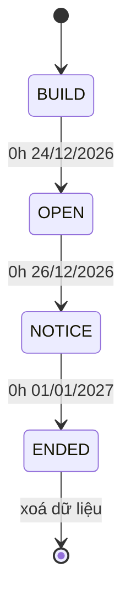
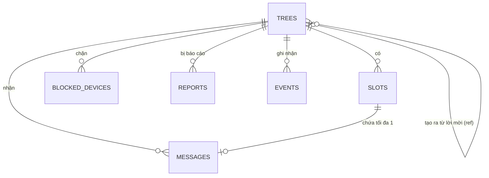
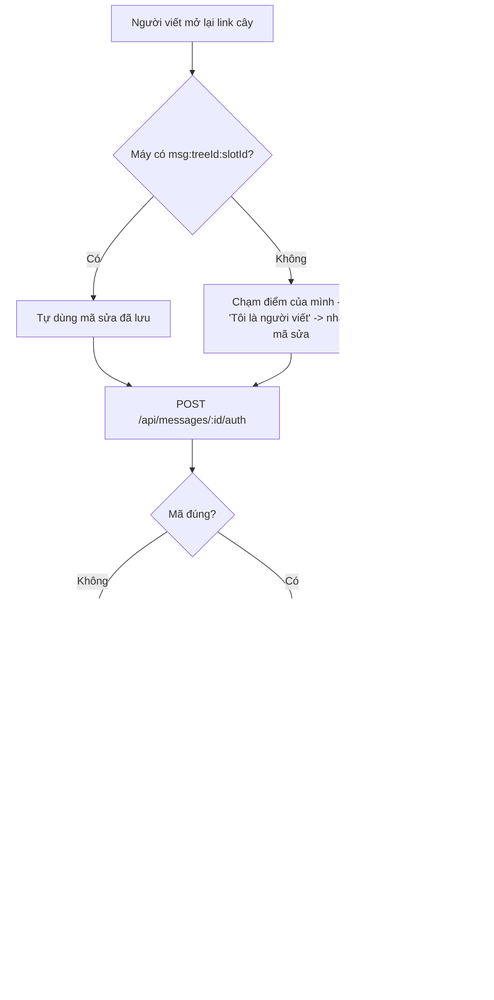
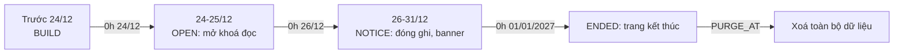

# Dự án: Cây Thông Lời Nhắn (bản đặc tả v2)

> Tài liệu này là **bản đặc tả để chốt trước khi viết code**: phạm vi, quyết định đã chốt, thiết kế cơ sở dữ liệu, API, các luồng hoạt động và kế hoạch triển khai.
> Mục có **[CẦN XÁC NHẬN]** là chỗ mình đã đề xuất một mặc định hợp lý, bạn đồng ý thì giữ, không thì sửa.
> Ngày soạn: 16/11/2026.

---

## Mục lục

1. [Tổng quan](#1-tổng-quan)
2. [Các quyết định đã chốt](#2-các-quyết-định-đã-chốt)
3. [Phạm vi chức năng](#3-phạm-vi-chức-năng)
4. [Dòng thời gian & các giai đoạn của dịch vụ](#4-dòng-thời-gian--các-giai-đoạn-của-dịch-vụ)
5. [Kiến trúc & công nghệ](#5-kiến-trúc--công-nghệ)
6. [Thiết kế cơ sở dữ liệu](#6-thiết-kế-cơ-sở-dữ-liệu)
7. [Danh mục tài nguyên đồ hoạ](#7-danh-mục-tài-nguyên-đồ-hoạ)
8. [Thiết kế API](#8-thiết-kế-api)
9. [Các luồng hoạt động chi tiết](#9-các-luồng-hoạt-động-chi-tiết)
10. [Bảo mật, quyền riêng tư, chống lạm dụng](#10-bảo-mật-quyền-riêng-tư-chống-lạm-dụng)
11. [Thiết kế giao diện](#11-thiết-kế-giao-diện)
12. [Yêu cầu phi chức năng](#12-yêu-cầu-phi-chức-năng)
13. [Triển khai trên Azure](#13-triển-khai-trên-azure)
14. [Kiểm thử](#14-kiểm-thử)
15. [Kế hoạch & mốc thời gian](#15-kế-hoạch--mốc-thời-gian)
16. [Rủi ro](#16-rủi-ro)
17. [Chỉ số thành công](#17-chỉ-số-thành-công)
18. [Câu hỏi còn mở](#18-câu-hỏi-còn-mở)

---

## 1. Tổng quan

**Sản phẩm:** website cho phép mỗi người **tự thiết kế một cây thông Noel hoạt hình** trong một căn phòng ấm cúng (cây, thú cưng, bàn ghế, lò sưởi có ống khói kiểu phương Tây...). Người dùng gửi link cho bạn bè; bạn bè mở link và **treo lời nhắn lên cây**. Mỗi lời nhắn gắn với một **phụ kiện treo** (tất, ngôi sao, bóng đèn, quả châu...). Đến đêm Noel, **chủ cây bấm vào từng phụ kiện để đọc lời nhắn**.

**Cảm xúc cốt lõi:** cảm giác "mở quà" - háo hức chờ đến đêm Noel để đọc những lời chúc bất ngờ.

**Vòng lan truyền:**

```
Chủ cây tạo cây -> gửi link -> bạn bè treo lời nhắn
      ^                                |
      |                                v
      +---- bạn bè bấm "Tạo cây của bạn" <----+
```

**Nguyên tắc thiết kế:**
- Không cần đăng ký / đăng nhập.
- Làm trên điện thoại là chính (mobile-first), máy tính vẫn dùng tốt.
- Dịch vụ **theo mùa**: hoạt động đến hết 31/12/2026 rồi ngừng, dữ liệu được xoá.
- Riêng tư: lời nhắn chỉ chủ cây đọc được; người nhắn không thấy lời nhắn của nhau.

---

## 2. Các quyết định đã chốt

| # | Nội dung | Quyết định |
|---|---|---|
| 1 | Số lời nhắn mỗi điểm nhắn | **1 lời nhắn / điểm** |
| 2 | Khoá lời nhắn đến đêm Noel | **Có khoá** (xem mục 4) |
| 3 | Ẩn danh | **Người nhắn tự chọn** ẩn danh hoặc để tên |
| 4 | Người nhắn có thấy lời nhắn của nhau không | **Không** |
| 5 | Đăng nhập | **Không bắt buộc** |
| 6 | Phong cách hình ảnh | **Hoạt hình dễ thương** |
| 7 | Ngôn ngữ | **Chỉ tiếng Việt**; phông chữ viết tay, không góc cạnh (Amatic SC, Mynerve, Grape Nuts - đều có bộ ký tự tiếng Việt) |
| 8 | Thu tiền | **Không** (miễn phí hoàn toàn, không quảng cáo) |
| 9 | Thời hạn dịch vụ | Đến **hết tháng 12/2026**. Sau Giáng sinh có thông báo "hết tháng 12 sẽ ngừng dịch vụ, muốn tải ảnh thì làm sớm" |
| 10 | Hạ tầng | **Azure**, credit khoảng 50 USD |
| 11 | Chạy thử | Trên máy cá nhân trước, chưa đưa lên mạng |
| 12 | Cách làm | Làm **đầy đủ chức năng**, ưu tiên **P0 trước** |

**Các yêu cầu bổ sung từ bạn (đã đưa vào đặc tả):**
- Điểm nhắn trống hiển thị **ánh sáng nhẹ hoặc dấu "+" mờ nằm trong một bong bóng**; người viết **tự chọn phụ kiện** treo vào điểm đó từ danh sách có sẵn.
- **Nút "Tạo cây của bạn"** xuất hiện ở vị trí thích hợp ngay từ khi khách mở link.
- Mỗi điểm nhắn **chỉ 1 lời nhắn**; người viết **được sửa** nhưng phải **xác minh đúng là người vừa tạo** lời nhắn đó.

**Hệ quả thiết kế quan trọng của yêu cầu "người viết chọn phụ kiện":**
Chủ cây chỉ đặt **vị trí** các điểm nhắn (không chọn loại). **Loại phụ kiện** do người viết chọn khi treo. Vì vậy tài liệu cũ (chủ cây chọn tất/sao/bóng cho từng điểm) được thay bằng mô hình này.

---

## 3. Phạm vi chức năng

Ký hiệu: **P0** bắt buộc cho bản đầu tiên · **P1** nên có, làm ngay sau P0 · **P2** làm nếu còn thời gian.

### 3.1 Trình thiết kế cây (chủ cây)

| Mã | Chức năng | Ưu tiên |
|---|---|---|
| B1 | Chọn kiểu tán cây (5 kiểu) | P0 |
| B2 | Chọn kiểu thân cây / chậu (3 kiểu) | P0 |
| B3 | Chọn màu tán cây (6 màu) | P0 |
| B4 | Chọn nền căn phòng (4 kiểu) | P0 |
| B5 | Thêm phụ kiện: thú cưng, lò sưởi + ống khói, nội thất, quà dưới gốc | P0 |
| B6 | Kéo thả, phóng to/thu nhỏ, xoay, xoá phụ kiện (cảm ứng + chuột) | P0 |
| B7 | Đặt / kéo / thêm / bớt **điểm nhắn** (mặc định 12, tối thiểu 3, tối đa 40) | P0 |
| B8 | Đặt tên chủ cây và tiêu đề cây | P0 |
| B9 | Nút "Ngẫu nhiên" tạo cây đẹp sẵn | P1 |
| B10 | Hoàn tác / làm lại (undo/redo) | P1 |
| B11 | Mẫu thiết kế có sẵn (5-6 bố cục) | P1 |
| B12 | Đưa phụ kiện lên trên / xuống dưới (thứ tự lớp) | P1 |
| B13 | Lưu bản nháp trên trình duyệt (làm dở quay lại tiếp) | P1 |
| B14 | **Sửa cây sau khi đã xuất bản** (đổi trang trí, thêm điểm nhắn; điểm đã có lời nhắn không được xoá) | P1 |
| B15 | Chế độ đêm / ngày (đèn sáng hơn khi đêm) | P2 |

### 3.2 Người nhắn (khách mở link)

| Mã | Chức năng | Ưu tiên |
|---|---|---|
| G1 | Xem cây của bạn mình; điểm trống hiện **ánh sáng nhẹ / dấu "+" trong bong bóng** | P0 |
| G2 | Điểm đã có người nhắn hiện phụ kiện (không lộ nội dung, không lộ tên) | P0 |
| G3 | Bấm điểm trống -> **chọn phụ kiện treo** (8 loại) -> nhập tên (hoặc chọn ẩn danh) -> nhập lời nhắn (≤ 300 ký tự) -> xem trước -> gửi | P0 |
| G4 | Sau khi gửi: hiện **mã sửa** + hiệu ứng treo lên cây + lời mời tạo cây riêng | P0 |
| G5 | **Sửa / xoá lời nhắn của mình** (xác minh bằng thiết bị hoặc mã sửa) | P0 |
| G6 | Nút **"Tạo cây của bạn"** luôn hiện (cố định, không che cây) | P0 |
| G7 | Chọn kiểu thẻ lời nhắn (4-6 kiểu) | P1 |
| G8 | Chèn sticker/emoji có sẵn | P1 |
| G9 | Báo cáo cây vi phạm | P1 |
| G10 | Đính kèm ảnh | P2 |
| G11 | Ghi âm giọng nói 10-30 giây | P2 |

### 3.3 Chủ cây đọc & quản lý

| Mã | Chức năng | Ưu tiên |
|---|---|---|
| O1 | Mở lại cây bằng **link riêng** (chứa khoá bí mật) | P0 |
| O2 | Trước 0h 24/12: thấy phụ kiện đã được treo nhưng **không đọc được** (hiệu ứng "quà còn gói") | P0 |
| O3 | Từ 0h 24/12: bấm phụ kiện -> mở thẻ lời nhắn (tên người gửi hoặc "Ẩn danh", nội dung, thời gian) | P0 |
| O4 | Đánh dấu **chưa đọc / đã đọc** (phụ kiện lấp lánh khi chưa đọc) | P0 |
| O5 | Xoá lời nhắn (điểm đó trống trở lại) | P0 |
| O6 | **Chặn** người gửi (theo thiết bị) trên cây của mình | P0 |
| O7 | Báo cáo lời nhắn vi phạm cho quản trị | P0 |
| O8 | Xoá toàn bộ cây và dữ liệu | P0 |
| O9 | Chế độ xem danh sách lời nhắn (ngoài chế độ bấm từng phụ kiện) | P1 |
| O10 | **Xuất ảnh** cây (PNG) để đăng story | P1 |
| O11 | Xuất ảnh từng thẻ lời nhắn | P1 |
| O12 | Gửi link riêng cho chính mình (Messenger/Zalo/email) để khỏi thất lạc | P1 |
| O13 | Trả lời cảm ơn người nhắn | P2 |

### 3.4 Chia sẻ & lan truyền

| Mã | Chức năng | Ưu tiên |
|---|---|---|
| S1 | Link ngắn `tenmien/c/xxxxxxxx` | P0 |
| S2 | Nút chia sẻ: Messenger, Zalo, sao chép link, chia sẻ hệ thống (Web Share) | P0 |
| S3 | **Ảnh xem trước (OG image)** đẹp khi dán link vào Messenger/Zalo/Facebook | P0 |
| S4 | Ghi nhận cây tạo ra từ lời mời nào (đo hệ số lan truyền) | P0 |
| S5 | Mã QR của link | P2 |

### 3.5 Hiệu ứng & trải nghiệm

| Mã | Chức năng | Ưu tiên |
|---|---|---|
| E1 | Đèn cây nhấp nháy nhẹ | P0 |
| E2 | Hiệu ứng treo phụ kiện (rơi nhẹ + nảy) và mở thẻ lời nhắn | P0 |
| E3 | Responsive tốt từ màn hình 360px | P0 |
| E4 | Tuyết rơi nền, lửa lò sưởi, khói ống khói chuyển động | P1 |
| E5 | Nhạc nền Noel (tắt mặc định, bấm bật) - dùng nhạc có giấy phép | P1 |
| E6 | Thú cưng có động tác khi bấm vào | P2 |
| E7 | Tôn trọng chế độ "giảm chuyển động" của hệ điều hành | P1 |

### 3.6 Vòng đời dịch vụ & quản trị

| Mã | Chức năng | Ưu tiên |
|---|---|---|
| L1 | Khoá lời nhắn đến 0h 24/12 (kiểm soát ở **server**, không chỉ giao diện) | P0 |
| L2 | Đóng tạo cây mới và gửi lời nhắn từ 0h 26/12 | P0 |
| L3 | Biểu ngữ thông báo từ 26/12: "Hết tháng 12 sẽ ngừng dịch vụ, muốn tải ảnh thì làm sớm" | P0 |
| L4 | Từ 0h 01/01/2027: trang "Dịch vụ đã kết thúc", API trả 410 | P0 |
| L5 | Tác vụ xoá toàn bộ dữ liệu sau khi ngừng (xem mục 18) | P0 |
| L6 | Giới hạn tần suất (rate limit), chống spam, honeypot | P0 |
| L7 | Công cụ quản trị dòng lệnh: xoá cây/lời nhắn, xem báo cáo, thống kê | P0 |
| L8 | Trang quản trị trên web (có khoá) | P2 |
| L9 | Lọc từ tục / từ cấm cơ bản | P1 |
| L10 | Sao lưu cơ sở dữ liệu hằng ngày | P1 |

### 3.7 Đề xuất cắt khỏi phạm vi

Do dịch vụ chỉ chạy đến hết tháng 12 và không có tài khoản, mình đề xuất **bỏ** các mục sau từ bản v1:

| Mục đã bỏ | Lý do |
|---|---|
| Bảng xếp hạng "cây nhiều lời nhắn nhất" | Xung đột với nguyên tắc riêng tư |
| Nhiều cây trên một tài khoản | Không có tài khoản |
| Song ngữ Việt - Anh | Bạn đã chốt chỉ tiếng Việt |
| Đính kèm nhạc / link nhạc ngoài | Rủi ro bản quyền |
| Mở rộng sang Tết, Valentine, sinh nhật | Dịch vụ dừng cuối tháng 12; có thể làm ở dự án sau |
| Thu tiền, bán phụ kiện | Bạn đã chốt không thu tiền |

---

## 4. Dòng thời gian & các giai đoạn của dịch vụ

Múi giờ cố định: **Asia/Ho_Chi_Minh (UTC+7)**. Server tính "giai đoạn" từ giờ hiện tại, không tin giờ của người dùng.

| Giai đoạn | Thời điểm | Tạo cây | Gửi / sửa lời nhắn | Chủ cây đọc | Biểu ngữ |
|---|---|---|---|---|---|
| `BUILD` | Từ khi ra mắt đến **23:59:59 ngày 23/12** | Có | Có | **Không** (khoá) | Không |
| `OPEN` | **0h 24/12** đến **23:59:59 ngày 25/12** | Có | Có | **Có** | Không |
| `NOTICE` | **0h 26/12** đến **23:59:59 ngày 31/12** | **Không** | **Không** | Có | **Có**: sắp ngừng, tải ảnh sớm |
| `ENDED` | Từ **0h 01/01/2027** | Không | Không | Không | Trang kết thúc |



**Quy tắc sửa lời nhắn:** người viết chỉ được **sửa / xoá** lời nhắn khi chủ cây **chưa mở** lời nhắn đó (`read_at IS NULL`) và giai đoạn còn cho phép ghi. Khi chủ cây đã đọc, lời nhắn thành "đã chốt". Lý do: tránh việc đổi nội dung sau khi người nhận đã đọc.

Mọi mốc thời gian là **biến môi trường** (`UNLOCK_AT`, `WRITE_CLOSES_AT`, `SERVICE_ENDS_AT`) và có biến `FAKE_NOW` (chỉ dùng khi phát triển) để thử từng giai đoạn mà không cần chờ.

---

## 5. Kiến trúc & công nghệ

### 5.1 Lựa chọn công nghệ

| Lớp | Lựa chọn | Lý do |
|---|---|---|
| Backend | **Node.js 22** + Express | Đơn giản, nhiều ví dụ, chạy tốt trên Azure App Service |
| Cơ sở dữ liệu | **SQLite** (`better-sqlite3`) | Không cần cài thêm máy chủ, một file, đủ cho quy mô vài chục nghìn lượt trong 6 tuần |
| Frontend | **HTML + JavaScript thuần (ES modules) + SVG** | Không cần bước build; SVG phù hợp hoạt hình dễ thương và kéo thả cảm ứng |
| Vẽ ảnh xem trước (OG) | `@resvg/resvg-js` (server) | Dùng **cùng một hàm vẽ cảnh** với trình duyệt để ra PNG |
| Phông chữ | `@fontsource` (tự lưu trữ file woff2) | Không phụ thuộc Google Fonts, có sẵn bộ ký tự tiếng Việt |

Đường lui nếu cần mở rộng: đổi SQLite sang PostgreSQL (lược đồ ở mục 6 viết tương thích).

### 5.2 Sơ đồ

```
Trình duyệt (SPA nhẹ)                    Server Node.js
 ├─ scene.js  (vẽ cảnh SVG)  <───dùng chung───>  scene.js (vẽ OG image)
 ├─ builder.js (thiết kế)                      ├─ routes: /api/*  (JSON)
 ├─ view.js   (xem/nhắn/đọc)                   ├─ routes: /c/:id  (HTML + thẻ OG)
 └─ localStorage: deviceId, ownerKey,          ├─ routes: /og/:id.png
    editCode của từng lời nhắn                 ├─ phase.js (tính giai đoạn)
                                               └─ SQLite (file .db)
```

### 5.3 Cấu trúc thư mục dự kiến

```
cay-thong/
├─ server/
│  ├─ index.js          # khởi động Express
│  ├─ db.js             # kết nối + migration
│  ├─ phase.js          # tính giai đoạn từ thời gian
│  ├─ security.js       # băm khoá, rate limit, lọc nội dung
│  ├─ routes/ trees.js, messages.js, owner.js, og.js, admin.js
│  └─ migrations/001_init.sql
├─ public/
│  ├─ index.html, css/, fonts/
│  ├─ js/ app.js, router.js, api.js, storage.js
│  ├─ js/shared/ scene.js, catalog.js   # dùng chung với server
│  └─ js/pages/ home.js, builder.js, tree.js, ended.js
├─ scripts/ admin.js, purge.js, backup.js
├─ test/
└─ docs/ (tài liệu này)
```

### 5.4 Biến môi trường

| Biến | Ý nghĩa | Ví dụ |
|---|---|---|
| `PORT` | Cổng | 3000 |
| `DB_PATH` | Đường dẫn file SQLite | `./data/app.db` |
| `PEPPER` | Chuỗi bí mật để băm mã | (ngẫu nhiên, dài) |
| `ADMIN_KEY` | Khoá công cụ quản trị | (ngẫu nhiên) |
| `UNLOCK_AT` | Mở khoá lời nhắn | `2026-12-24T00:00:00+07:00` |
| `WRITE_CLOSES_AT` | Đóng tạo cây/nhắn | `2026-12-26T00:00:00+07:00` |
| `SERVICE_ENDS_AT` | Ngừng dịch vụ | `2027-01-01T00:00:00+07:00` |
| `PURGE_AT` | Xoá dữ liệu | `2027-01-07T00:00:00+07:00` |
| `FAKE_NOW` | Giả lập "bây giờ" (chỉ khi dev) | `2026-12-24T00:01:00+07:00` |
| `BASE_URL` | Địa chỉ công khai (cho OG, link) | `https://...` |

---

## 6. Thiết kế cơ sở dữ liệu

### 6.1 Các thực thể và quan hệ



### 6.2 Lược đồ (SQLite)

```sql
PRAGMA foreign_keys = ON;

-- Cây thông. Không có tài khoản: quyền chủ cây = biết owner_key (chỉ lưu bản băm).
CREATE TABLE trees (
  id                  TEXT PRIMARY KEY,          -- 8 ký tự base32 (bỏ ký tự dễ nhầm), vd 'k7m2xq4a'
  owner_key_hash      TEXT NOT NULL,             -- HMAC-SHA256(owner_key, PEPPER)
  owner_name          TEXT NOT NULL CHECK (length(owner_name) BETWEEN 1 AND 30),
  title               TEXT CHECK (title IS NULL OR length(title) <= 40),
  design_json         TEXT NOT NULL,             -- xem 6.3
  ref_tree_id         TEXT REFERENCES trees(id) ON DELETE SET NULL,  -- cây tạo ra từ lời mời của cây nào
  creator_ip_hash     TEXT,                      -- băm IP + muối theo ngày, dùng giới hạn tần suất
  created_at          TEXT NOT NULL DEFAULT (strftime('%Y-%m-%dT%H:%M:%fZ','now')),
  updated_at          TEXT NOT NULL DEFAULT (strftime('%Y-%m-%dT%H:%M:%fZ','now')),
  last_owner_visit_at TEXT
);
CREATE INDEX idx_trees_created ON trees(created_at);
CREATE INDEX idx_trees_ref     ON trees(ref_tree_id);

-- Điểm nhắn: chỉ là VỊ TRÍ trên cây. Loại phụ kiện do người nhắn chọn (nằm ở messages.ornament).
CREATE TABLE slots (
  id         INTEGER PRIMARY KEY AUTOINCREMENT,
  tree_id    TEXT NOT NULL REFERENCES trees(id) ON DELETE CASCADE,
  x          REAL NOT NULL CHECK (x BETWEEN 0 AND 400),   -- toạ độ trong khung cảnh 400 x 600
  y          REAL NOT NULL CHECK (y BETWEEN 0 AND 600),
  created_at TEXT NOT NULL DEFAULT (strftime('%Y-%m-%dT%H:%M:%fZ','now'))
);
CREATE INDEX idx_slots_tree ON slots(tree_id);

-- Lời nhắn. UNIQUE(slot_id) bảo đảm 1 điểm nhắn = tối đa 1 lời nhắn (kể cả khi 2 người bấm cùng lúc).
CREATE TABLE messages (
  id             INTEGER PRIMARY KEY AUTOINCREMENT,
  tree_id        TEXT    NOT NULL REFERENCES trees(id) ON DELETE CASCADE,
  slot_id        INTEGER NOT NULL UNIQUE REFERENCES slots(id) ON DELETE CASCADE,
  ornament       TEXT    NOT NULL
                 CHECK (ornament IN ('sock','star','bulb','ball','candy','bell','gingerbread','heart')),
  author_name    TEXT    CHECK (author_name IS NULL OR length(author_name) BETWEEN 1 AND 30),
  is_anonymous   INTEGER NOT NULL DEFAULT 0 CHECK (is_anonymous IN (0,1)),
  content        TEXT    NOT NULL CHECK (length(content) BETWEEN 1 AND 300),
  card_style     TEXT    NOT NULL DEFAULT 'kraft',
  edit_code_hash TEXT    NOT NULL,               -- HMAC-SHA256(mã sửa, PEPPER)
  device_hash    TEXT    NOT NULL,               -- HMAC(deviceId, PEPPER): nhận diện thiết bị để chặn / giới hạn
  ip_hash        TEXT,
  created_at     TEXT NOT NULL DEFAULT (strftime('%Y-%m-%dT%H:%M:%fZ','now')),
  updated_at     TEXT NOT NULL DEFAULT (strftime('%Y-%m-%dT%H:%M:%fZ','now')),
  read_at        TEXT,                           -- NULL = chưa đọc; có giá trị = đã chốt, không sửa được nữa
  CHECK ( (is_anonymous = 1 AND author_name IS NULL)
       OR (is_anonymous = 0 AND author_name IS NOT NULL) )
);
CREATE INDEX idx_messages_tree   ON messages(tree_id);
CREATE INDEX idx_messages_device ON messages(tree_id, device_hash);

-- Thiết bị bị chủ cây chặn (chỉ có hiệu lực trên cây đó).
CREATE TABLE blocked_devices (
  tree_id     TEXT NOT NULL REFERENCES trees(id) ON DELETE CASCADE,
  device_hash TEXT NOT NULL,
  created_at  TEXT NOT NULL DEFAULT (strftime('%Y-%m-%dT%H:%M:%fZ','now')),
  PRIMARY KEY (tree_id, device_hash)
);

-- Báo cáo vi phạm, quản trị xử lý bằng công cụ dòng lệnh.
CREATE TABLE reports (
  id                 INTEGER PRIMARY KEY AUTOINCREMENT,
  tree_id            TEXT NOT NULL REFERENCES trees(id) ON DELETE CASCADE,
  message_id         INTEGER,                    -- có thể NULL (báo cáo cả cây)
  message_snapshot   TEXT,                       -- chép nội dung lúc báo cáo (vì lời nhắn có thể bị xoá)
  reason             TEXT CHECK (reason IS NULL OR length(reason) <= 200),
  reporter_hash      TEXT,
  status             TEXT NOT NULL DEFAULT 'open' CHECK (status IN ('open','resolved','dismissed')),
  created_at         TEXT NOT NULL DEFAULT (strftime('%Y-%m-%dT%H:%M:%fZ','now'))
);
CREATE INDEX idx_reports_status ON reports(status);

-- Sự kiện ẩn danh để đo phễu (không lưu nội dung lời nhắn).
CREATE TABLE events (
  id         INTEGER PRIMARY KEY AUTOINCREMENT,
  type       TEXT NOT NULL CHECK (type IN
             ('tree_created','tree_viewed_guest','cta_clicked','message_created','message_opened')),
  tree_id    TEXT,
  created_at TEXT NOT NULL DEFAULT (strftime('%Y-%m-%dT%H:%M:%fZ','now'))
);
CREATE INDEX idx_events_type_time ON events(type, created_at);
```

### 6.3 Cấu trúc `design_json`

```json
{
  "v": 1,
  "background": "night-window",
  "canopy": { "style": "tiers", "color": "green" },
  "trunk": "wood",
  "items": [
    { "id": "i1", "kind": "pet-cat",   "x": 90,  "y": 520, "s": 1.0, "r": 0,  "z": 10 },
    { "id": "i2", "kind": "fireplace", "x": 320, "y": 470, "s": 1.1, "r": 0,  "z": 5  },
    { "id": "i3", "kind": "gift-red",  "x": 150, "y": 545, "s": 0.9, "r": -8, "z": 12 }
  ]
}
```

- `x, y`: toạ độ tâm trong khung 400 x 600; `s`: tỉ lệ (0.5-2.0); `r`: góc xoay (độ); `z`: thứ tự lớp.
- Giới hạn kiểm tra ở server: tối đa **25 phụ kiện**, **40 điểm nhắn**, kích thước JSON ≤ **20 KB**, `kind` / `style` / `color` phải nằm trong danh mục (mục 7).

### 6.4 Quy tắc dữ liệu

| Quy tắc | Cách bảo đảm |
|---|---|
| 1 điểm nhắn = tối đa 1 lời nhắn | `UNIQUE(slot_id)`; hai người gửi cùng lúc thì người sau nhận lỗi 409 |
| Ẩn danh thì không lưu tên | `CHECK` trên bảng `messages` |
| Xoá cây thì xoá sạch dữ liệu liên quan | `ON DELETE CASCADE` |
| Chủ cây xoá lời nhắn thì điểm trống lại | Xoá hàng trong `messages`; `slots` giữ nguyên |
| Không lưu khoá thô | Chỉ lưu HMAC-SHA256(khoá, PEPPER) |
| Giới hạn số lời nhắn của một thiết bị trên một cây | Kiểm tra `COUNT(*)` theo `(tree_id, device_hash)` (mặc định 3) |

### 6.5 Dữ liệu lưu trên trình duyệt (localStorage)

| Khoá | Giá trị | Mục đích |
|---|---|---|
| `deviceId` | UUID ngẫu nhiên | Nhận diện thiết bị khi nhắn / chặn |
| `owned:{treeId}` | `ownerKey` | Chủ cây mở lại cây không cần nhập khoá |
| `msg:{treeId}:{slotId}` | `{ messageId, editCode }` | Người viết sửa lời nhắn của mình |
| `draft:tree` | `design + slots` | Bản nháp thiết kế (P1) |

---

## 7. Danh mục tài nguyên đồ hoạ

Toàn bộ vẽ **tự thiết kế dạng SVG** (không dùng nhân vật có bản quyền như Santa phiên bản thương hiệu, Rudolph, nhân vật hoạt hình có sẵn...). Phong cách: nét tròn, bo mềm, má hồng nhẹ, bảng màu ấm.

| Nhóm | Mã | Số lượng | Chi tiết |
|---|---|---|---|
| Tán cây | `canopy.style` | 5 | `tiers` (nhiều tầng), `round` (tròn), `slim` (thon cao), `snowy` (phủ tuyết), `fluffy` (xù mềm) |
| Màu tán | `canopy.color` | 6 | `green`, `deepgreen`, `snow`, `pink`, `blue`, `silver` |
| Thân / chậu | `trunk` | 3 | `wood`, `pot` (chậu gốm), `sack` (bao tải) |
| Nền | `background` | 4 | `night-window` (cửa sổ đêm có tuyết), `warm-wall`, `mint`, `cream-stripes` |
| Thú cưng | `pet-*` | 6 | `cat`, `dog`, `deer` (tuần lộc), `bear`, `owl`, `penguin` |
| Nội thất | `furn-*` | 4 | `table`, `armchair`, `rug`, `bookshelf` |
| Lò sưởi | `fireplace` | 1 (2 màu) | Có ống khói, lửa, giá treo tất |
| Quà dưới gốc | `gift-*` | 4 | `red`, `green`, `gold`, `blue` |
| Trang trí khác | `deco-*` | 3 | `lights` (đèn dây), `wreath` (vòng nguyệt quế), `candle` |
| **Phụ kiện treo** | `ornament` | **8** | `sock` (tất), `star` (sao), `bulb` (bóng đèn), `ball` (quả châu), `candy` (kẹo gậy), `bell` (chuông), `gingerbread` (bánh gừng), `heart` (tim) |
| Kiểu thẻ lời nhắn (P1) | `card_style` | 4-6 | `kraft`, `red`, `snow`, `green`... |

Khung cảnh: `viewBox="0 0 400 600"` (dọc, hợp điện thoại). Thứ tự lớp: nền -> sàn -> phụ kiện lớp thấp -> thân cây -> tán cây -> phụ kiện lớp cao -> điểm nhắn / phụ kiện treo -> hiệu ứng.

**Trạng thái hiển thị của một điểm nhắn:**

| Trạng thái | Người xem | Hình ảnh |
|---|---|---|
| Trống | Khách | Bong bóng trong suốt, ánh sáng nhẹ + dấu "+" mờ, nhịp thở chậm |
| Đã có lời nhắn | Khách | Hiện phụ kiện người nhắn chọn (không có nội dung) |
| Đã có, **bị khoá** | Chủ cây | Phụ kiện có nơ "quà còn gói", mờ nhẹ |
| Đã có, **chưa đọc** (đã mở khoá) | Chủ cây | Phụ kiện lấp lánh |
| Đã đọc | Chủ cây | Phụ kiện bình thường |
| Trống | Chủ cây | Bong bóng mờ hơn (chủ cây không nhắn được cho cây của mình) |

---

## 8. Thiết kế API

Quy ước: JSON, UTF-8. Header `X-Device-Id` (UUID của thiết bị). Quyền chủ cây qua header `X-Owner-Key`. Mã lỗi: 400 dữ liệu sai, 401/403 sai khoá hoặc bị chặn, 404 không thấy, 409 xung đột, 410 dịch vụ đã kết thúc, 423 đang bị khoá theo thời gian, 429 quá nhiều yêu cầu.

### 8.1 Cấu hình & trạng thái

| Phương thức | Đường dẫn | Mô tả |
|---|---|---|
| GET | `/api/config` | Trả `{ now, phase, unlockAt, writeClosesAt, serviceEndsAt, limits, catalogVersion }` |

### 8.2 Cây

| Phương thức | Đường dẫn | Quyền | Mô tả |
|---|---|---|---|
| POST | `/api/trees` | Công khai (giới hạn tần suất) | Tạo cây. Body: `ownerName, title, design, slots[{x,y}], ref?`. Trả `{ id, ownerKey, publicUrl, ownerUrl }`. `ownerKey` **chỉ trả một lần** |
| GET | `/api/trees/:id` | Công khai | Xem cây: thông tin, `design`, danh sách điểm nhắn `{ id, x, y, occupied, ornament? }`. **Không** có nội dung, tên người gửi |
| PUT | `/api/trees/:id` | Chủ cây | Sửa thiết kế / thêm bớt điểm nhắn (không xoá được điểm đã có lời nhắn) - P1 |
| DELETE | `/api/trees/:id` | Chủ cây | Xoá cây và mọi dữ liệu liên quan |
| GET | `/api/trees/:id/owner` | Chủ cây | Chế độ chủ cây: điểm nhắn kèm `{ messageId, ornament, unread, locked }`. **Không** trả nội dung ở đây |

### 8.3 Lời nhắn của người viết

| Phương thức | Đường dẫn | Quyền | Mô tả |
|---|---|---|---|
| POST | `/api/trees/:id/messages` | Công khai | Treo lời nhắn. Body: `slotId, ornament, authorName \| anonymous, content, cardStyle?, website (honeypot)`. Trả `{ messageId, editCode }` (**chỉ trả một lần**) |
| POST | `/api/messages/:mid/auth` | Mã sửa | Xác minh `editCode` trước khi sửa; trả nội dung của chính người viết |
| PUT | `/api/messages/:mid` | Mã sửa | Sửa nội dung / phụ kiện / tên. Chỉ khi `read_at IS NULL` và còn cho phép ghi |
| DELETE | `/api/messages/:mid` | Mã sửa | Người viết xoá lời nhắn của mình (cùng điều kiện) |

Gửi mã sửa trong body (`{ editCode }`), không đặt trên URL.

### 8.4 Chủ cây đọc & quản lý

| Phương thức | Đường dẫn | Mô tả |
|---|---|---|
| POST | `/api/trees/:id/messages/:mid/open` | Mở lời nhắn: trả `{ authorName\|null, content, createdAt, cardStyle }` và đặt `read_at`. **423** nếu chưa tới `UNLOCK_AT` |
| DELETE | `/api/trees/:id/messages/:mid` | Chủ cây xoá lời nhắn (điểm trống lại) |
| POST | `/api/trees/:id/block` | Body `{ messageId }`: chặn thiết bị đã gửi lời nhắn đó (đồng thời xoá lời nhắn) |
| POST | `/api/trees/:id/messages/:mid/report` | Báo cáo vi phạm (chụp lại nội dung vào `reports`) |

### 8.5 Trang, ảnh xem trước, quản trị

| Phương thức | Đường dẫn | Mô tả |
|---|---|---|
| GET | `/c/:id` | Trả HTML của trang cây, **chèn sẵn thẻ OG** (`og:title`, `og:image`, `og:description`) |
| GET | `/og/:id.png` | Ảnh 1200x630 vẽ từ `design` bằng resvg; lưu đệm |
| GET | `/da-ket-thuc` | Trang kết thúc dịch vụ |
| (CLI) | `node scripts/admin.js` | `stats`, `reports`, `delete-tree <id>`, `delete-message <id>`, `block-ip` |

### 8.4 Ma trận quyền

| Hành động | Khách | Người viết (đúng mã sửa) | Chủ cây (đúng khoá) |
|---|---|---|---|
| Xem cây, điểm trống / đã có | Có | Có | Có |
| Thấy nội dung lời nhắn | Không | Chỉ của mình | Có, sau 0h 24/12 và sau khi "mở" |
| Treo lời nhắn | Có | Có | Không (không nhắn cho cây của mình) |
| Sửa / xoá lời nhắn | Không | Có, nếu chưa bị đọc | Xoá được mọi lời nhắn |
| Chặn thiết bị | Không | Không | Có |
| Xoá cây | Không | Không | Có |

---

## 9. Các luồng hoạt động chi tiết

### 9.1 Luồng tạo cây (chủ cây)

```mermaid
sequenceDiagram
    actor U as Chủ cây
    participant B as Trình duyệt
    participant S as Server
    U->>B: Mở trang chủ, bấm "Tạo cây của bạn"
    B->>B: Mở trình thiết kế (nạp bản nháp nếu có)
    U->>B: Chọn tán, thân, nền, phụ kiện; kéo thả; đặt các điểm nhắn
    U->>B: Nhập tên + tiêu đề, bấm "Hoàn tất"
    B->>S: POST /api/trees {design, slots, ownerName, ref?}
    S->>S: Kiểm tra giai đoạn, giới hạn tần suất, hợp lệ dữ liệu
    S->>S: Sinh id (8 ký tự) và ownerKey; lưu HMAC(ownerKey)
    S-->>B: {id, ownerKey, publicUrl, ownerUrl}
    B->>B: Lưu owned:{id} = ownerKey vào localStorage
    B-->>U: Màn hình chia sẻ: link công khai, link riêng, nút Messenger/Zalo/Sao chép
```

Các bước người dùng thấy và quy tắc:

1. **Bước 1 - Nền và cây:** chọn nền, tán, màu, thân.
2. **Bước 2 - Trang trí:** thêm phụ kiện (kéo từ khay xuống cảnh); chạm để chọn, kéo để di chuyển, hai ngón để phóng to/xoay, nút thùng rác để xoá.
3. **Bước 3 - Điểm nhắn:** hiển thị sẵn 12 điểm trên tán cây; kéo để đổi chỗ, nút "+" để thêm (tối đa 40), chạm giữ hoặc nút xoá để bớt (tối thiểu 3).
4. **Bước 4 - Hoàn tất:** nhập tên (bắt buộc), tiêu đề (tuỳ chọn) rồi xuất bản.
5. **Màn hình sau xuất bản:** hiện **cảnh báo rõ**: *"Hãy lưu link riêng của bạn. Mất link này sẽ không đọc lại được lời nhắn."* kèm nút sao chép và "Gửi link riêng cho chính mình".

Lỗi và ngoại lệ:
- Hết thời gian tạo (từ 26/12): hiện thông báo, nút chuyển sang xem hướng dẫn tải ảnh.
- Quá giới hạn tần suất (429): "Bạn tạo nhiều cây quá nhanh, thử lại sau vài phút".
- Dữ liệu sai (kind lạ, quá giới hạn): server trả 400, giao diện không để xảy ra trong điều kiện bình thường.

### 9.2 Luồng người nhắn gửi lời nhắn

```mermaid
sequenceDiagram
    actor G as Người nhắn
    participant B as Trình duyệt
    participant S as Server
    G->>B: Mở link /c/:id
    B->>S: GET /api/trees/:id
    S-->>B: design + điểm nhắn (trống / đã có + loại phụ kiện)
    B-->>G: Cây + bong bóng "+" nhấp nháy + nút "Tạo cây của bạn"
    G->>B: Chạm vào một điểm trống
    B-->>G: Bảng chọn: 8 phụ kiện -> tên/ẩn danh -> lời nhắn -> xem trước
    G->>B: Bấm "Treo lên cây"
    B->>S: POST /api/trees/:id/messages {slotId, ornament, name|anonymous, content}
    S->>S: Kiểm tra giai đoạn, bị chặn?, giới hạn thiết bị, honeypot, tần suất
    S->>S: INSERT (UNIQUE slot_id); sinh editCode, lưu HMAC
    S-->>B: {messageId, editCode}
    B->>B: Lưu msg:{treeId}:{slotId} = {messageId, editCode}
    B-->>G: Hiệu ứng treo + hiển thị mã sửa + lời mời tạo cây riêng
```

Quy tắc:
- **Ẩn danh:** nếu chọn ẩn danh thì không lưu tên (`author_name = NULL`); chủ cây thấy "Ẩn danh".
- **Hai người cùng chọn một điểm:** người đến sau nhận 409 -> giao diện báo *"Điểm này vừa có người treo, hãy chọn điểm khác"* và làm mới danh sách.
- **Giới hạn:** mỗi thiết bị tối đa **3** lời nhắn trên một cây (**[CẦN XÁC NHẬN]**); nội dung ≤ 300 ký tự; tên ≤ 30 ký tự.
- **Bị chủ cây chặn:** trả 403, thông báo trung tính (*"Không thể gửi lời nhắn lên cây này"*), không nêu lý do.
- **Hết chỗ:** nếu mọi điểm đã có lời nhắn, hiện *"Cây này đã đầy lời nhắn"* và nút tạo cây riêng.
- **Chủ cây vào link công khai của chính mình:** nếu máy có `owned:{id}` thì chuyển thẳng sang chế độ chủ cây.

### 9.3 Luồng người viết sửa / xoá lời nhắn (có xác minh)

Xác minh dựa trên **mã sửa (`editCode`)**: chỉ người vừa gửi mới biết.



- Người viết dùng máy khác: nhập **mã sửa** (dạng `K7M2-X9QA-4TBD`, 12 ký tự) đã được hiển thị lúc gửi, kèm nút "Chép mã" và "Chụp màn hình".
- Mã sửa **chỉ lưu dạng băm** ở server -> không thể gửi lại nếu mất. Giao diện nhắc rõ điều này.

### 9.4 Luồng chủ cây đọc lời nhắn

```mermaid
sequenceDiagram
    actor O as Chủ cây
    participant B as Trình duyệt
    participant S as Server
    O->>B: Mở link riêng /c/:id#k=ownerKey (hoặc đã lưu sẵn)
    B->>B: Lưu ownerKey; xoá phần #k khỏi thanh địa chỉ
    B->>S: GET /api/trees/:id/owner (X-Owner-Key)
    S-->>B: điểm nhắn + {ornament, unread, locked}
    alt Trước 0h 24/12
        B-->>O: Phụ kiện "quà còn gói" + đếm ngược đến đêm Noel
    else Từ 0h 24/12
        B-->>O: Phụ kiện chưa đọc lấp lánh
        O->>B: Chạm một phụ kiện
        B->>S: POST /api/trees/:id/messages/:mid/open
        S->>S: Kiểm tra phase >= OPEN, đặt read_at nếu NULL
        S-->>B: {authorName, content, createdAt}
        B-->>O: Thẻ lời nhắn mở ra với hiệu ứng
    end
```

Chi tiết:
- **Khoá thực thi ở server:** trước `UNLOCK_AT`, API trả 423 và **không bao giờ** chứa nội dung, nên không thể xem lén bằng công cụ lập trình của trình duyệt.
- **Đếm ngược:** giao diện hiện "Còn X ngày Y giờ nữa là mở quà" (tính theo `now` và `unlockAt` từ `/api/config`).
- **Thẻ lời nhắn:** nút Xoá, Chặn người gửi, Báo cáo; nút "Sau" / "Trước" để duyệt lần lượt các lời nhắn.
- **Chế độ danh sách (P1):** liệt kê lời nhắn đã mở, đánh dấu chưa đọc.

### 9.5 Luồng kiểm duyệt

| Tình huống | Hành động của chủ cây | Kết quả |
|---|---|---|
| Lời nhắn khó chịu | **Xoá** | Lời nhắn bị xoá, điểm trống lại |
| Người gửi cố tình quấy rối | **Chặn** (kèm xoá) | Thiết bị đó không nhắn được trên cây này nữa |
| Nội dung nghiêm trọng (đe doạ, bạo lực, nhạy cảm) | **Báo cáo** | Lưu vào `reports` kèm bản chụp nội dung; quản trị xem bằng `admin.js reports` và có thể xoá cây của người gửi |
| Spam hàng loạt | (tự động) | Rate limit theo IP/thiết bị, honeypot, giới hạn 3 lời nhắn/thiết bị/cây |

**Hạn chế đã biết:** chặn theo thiết bị có thể bị lách bằng cách xoá dữ liệu trình duyệt hoặc dùng chế độ ẩn danh; chấp nhận được với quy mô này, kết hợp rate limit theo IP để giảm lạm dụng.

### 9.6 Luồng "Tạo cây của bạn" (lan truyền)

- Nút **luôn nằm cố định** ở mép dưới trang cây (trên điện thoại là thanh dưới nhỏ gọn, trên máy tính là nút nổi góc phải), không che các điểm nhắn.
- Bấm nút -> mở `/tao?ref=<id cây đang xem>`; server lưu `ref_tree_id` khi cây mới được tạo -> đo **hệ số lan truyền**.
- Sau khi gửi lời nhắn thành công, hiện thêm lời mời lớn hơn: *"Bạn cũng muốn nhận lời nhắn như thế này? Tạo cây của bạn"*.
- Chủ cây mở link công khai của chính mình sẽ không thấy nút này.

### 9.7 Luồng chia sẻ

1. Sau khi tạo cây: màn hình chia sẻ với 2 link: **Công khai** (gửi bạn bè) và **Riêng tư** (chỉ để chủ cây giữ).
2. Nút **Chia sẻ** gọi Web Share của hệ điều hành (điện thoại); nút Messenger / Zalo mở ứng dụng với link công khai; nút **Sao chép**.
3. Khi link được dán vào Messenger/Zalo/Facebook, ứng dụng đọc thẻ OG ở `/c/:id` và hiện ảnh `/og/:id.png` (ảnh cây + tiêu đề) - đây là yếu tố quyết định tỉ lệ bấm vào link.

### 9.8 Luồng vòng đời: khoá, thông báo, kết thúc



- **NOTICE (từ 26/12):** biểu ngữ trên mọi trang: *"Noel đã qua rồi! Hết tháng 12 trang web sẽ ngừng hoạt động và dữ liệu sẽ bị xoá. Bạn muốn giữ lại kỷ niệm thì tải ảnh cây và lời nhắn sớm nhé."* kèm nút **Tải ảnh** (cho chủ cây). Người viết và khách chỉ xem.
- **ENDED:** mọi đường dẫn chuyển về trang cảm ơn; API trả 410.
- **Xoá dữ liệu:** `scripts/purge.js` xoá mọi bảng và file sao lưu sau `PURGE_AT` (mặc định 07/01/2027; xem mục 18).

### 9.9 Các tình huống lỗi chung

| Tình huống | Hành vi |
|---|---|
| Link sai / cây không tồn tại | Trang 404 dễ thương + nút tạo cây |
| Mất mạng khi gửi lời nhắn | Giữ nguyên nội dung đã nhập, hiện nút "Thử lại" |
| Chủ cây mất link riêng | Không khôi phục được (không có tài khoản); giao diện cảnh báo ngay từ lúc tạo |
| Trình duyệt xoá localStorage | Người viết vẫn sửa được bằng mã sửa; chủ cây dùng link riêng |
| Hai tab cùng sửa lời nhắn | Lần lưu sau ghi đè; cập nhật `updated_at` |
| Đồng hồ máy người dùng sai | Không ảnh hưởng: mọi mốc thời gian do server quyết định |

---

## 10. Bảo mật, quyền riêng tư, chống lạm dụng

### 10.1 Khoá và xác minh

| Đối tượng | Cách tạo | Lưu ở server | Truyền |
|---|---|---|---|
| `ownerKey` | 128 bit ngẫu nhiên (CSPRNG), mã hoá base32 (26 ký tự) | HMAC-SHA256 với `PEPPER` | Header `X-Owner-Key`; nằm ở phần `#` (fragment) của link riêng để không lọt vào nhật ký server |
| `editCode` | 60 bit ngẫu nhiên, 12 ký tự base32, nhóm 4-4-4 | HMAC-SHA256 với `PEPPER` | Trong body POST/PUT/DELETE |
| `deviceId` | UUID ngẫu nhiên sinh ở trình duyệt | HMAC(deviceId, `PEPPER`) | Header `X-Device-Id` |

So sánh khoá bằng hàm so sánh thời gian hằng định (`timingSafeEqual`). Thử `editCode` sai quá **5 lần/phút** cho cùng lời nhắn hoặc cùng IP thì bị chặn tạm.

### 10.2 Chống spam và lạm dụng

| Biện pháp | Mặc định |
|---|---|
| Tạo cây | 5 cây / giờ / IP |
| Gửi lời nhắn | 20 lời nhắn / giờ / IP |
| Số lời nhắn của một thiết bị trên một cây | 3 |
| Trường honeypot ẩn (`website`) | Có nội dung -> từ chối âm thầm |
| Kiểm tra độ dài, ký tự điều khiển, URL dồn dập | Có |
| Lọc từ cấm cơ bản | P1 |
| Giới hạn kích thước body | 32 KB |

Rate limit lưu trong bộ nhớ (một instance). Nếu sau này chạy nhiều instance thì chuyển sang bảng DB hoặc Redis.

### 10.3 Bảo vệ ứng dụng web

- Chỉ hiển thị lời nhắn bằng `textContent` (không bao giờ `innerHTML`) để chống XSS; thẻ OG được thoát ký tự HTML.
- Tiêu đề bảo mật: `Content-Security-Policy` (chỉ cho tài nguyên cùng nguồn), `X-Content-Type-Options`, `Referrer-Policy: no-referrer`, HTTPS bắt buộc khi lên mạng.
- Truy vấn SQL **luôn dùng tham số** (không nối chuỗi).
- Không dùng cookie theo dõi, không gắn tài nguyên bên thứ ba (phông chữ tự lưu trữ).

### 10.4 Quyền riêng tư

- Dữ liệu cá nhân duy nhất: tên người dùng tự nhập, nội dung lời nhắn, mã băm của IP và thiết bị.
- IP được băm với muối đổi **hằng ngày**, không lưu IP thô.
- Lời nhắn ẩn danh **không lưu tên**; ngay cả quản trị cũng không biết tên người gửi (chỉ có mã băm thiết bị).
- Có trang **Chính sách riêng tư ngắn** (3-5 gạch đầu dòng) và thông báo thời hạn xoá dữ liệu.
- Người dùng có thể **xoá cây và toàn bộ lời nhắn** bất cứ lúc nào.

---

## 11. Thiết kế giao diện

### 11.1 Phong cách

- **Hoạt hình dễ thương:** nét viền dày vừa, bo tròn, màu phẳng + bóng nhẹ, má hồng, mắt chấm tròn.
- **Không góc cạnh:** nút bo tròn tối đa, thẻ bo lớn, đường nét mềm.
- Bảng màu gợi ý:

| Vai trò | Màu |
|---|---|
| Nền kem | `#FFF6E5` |
| Đỏ Noel | `#D94B4B` |
| Xanh thông | `#2F7D5B` |
| Vàng ánh sao | `#F4C542` |
| Xanh đêm | `#1F2A44` |
| Chữ chính | `#3A2E2A` |

### 11.2 Phông chữ (đều hỗ trợ tiếng Việt)

| Vai trò | Phông | Ghi chú |
|---|---|---|
| Tiêu đề lớn | **Amatic SC** (700) | Cao, mảnh, viết tay; chỉ dùng cỡ lớn |
| Nội dung và **lời nhắn** | **Mynerve** | Viết tay dễ đọc, dùng cho thẻ lời nhắn và văn bản chính |
| Nhấn nhá, chữ ký, nhãn nhỏ | **Grape Nuts** | Dùng thưa, tạo cảm giác "chữ ký tay" |

Tự lưu trữ file `woff2` các tập con `latin` + `vietnamese` (qua `@fontsource`), `font-display: swap`. Cần thử với chuỗi tiếng Việt đủ dấu để chắc chắn không bị lỗi chồng dấu (ví dụ: *"Chúc Giáng sinh ấm áp, ước mơ rực rỡ, nghị lực phi thường"*). Cỡ chữ tối thiểu cho nội dung lời nhắn: 18px.

### 11.3 Màn hình và bố cục (mobile-first)

**Trang chủ**
```
+---------------------------+
|        (tuyết rơi)        |
|     Cây Thông Lời Nhắn    |  <- Amatic SC
|   [ cây mẫu đang lấp lánh ]|
|  "Tạo cây Noel của bạn,    |
|   để bạn bè treo lời chúc" |
|    ( Tạo cây của bạn )     |
|   Cách hoạt động: 1-2-3    |
+---------------------------+
```

**Trình thiết kế**
```
+---------------------------+
| <  Bước 2/4: Trang trí  ? |
|  +---------------------+  |
|  |   khung cảnh 400x600 |  |
|  |   (kéo thả)          |  |
|  +---------------------+  |
| [Nền][Cây][Phụ kiện][Nhắn] |  <- thanh tab dưới
| khay: 🐱 🐶 🦌 🧸 🦉 🪑 ...  |
| (Hoàn tác)(Làm lại) (Tiếp) |
+---------------------------+
```

**Xem cây (khách)**
```
+---------------------------+
|  Cây thông của Minh       |
|  +---------------------+  |
|  |     ★ (bong bóng +)  |  |
|  |   (+)  🔔  (+)       |  |
|  |  🧦 (+)  🔴 (+)      |  |
|  +---------------------+  |
|  Còn 5 chỗ trống          |
|  ( Tạo cây của bạn ) <-cố định
+---------------------------+
```

**Bảng nhắn (khi chạm điểm trống)** - trượt từ dưới lên: 1) chọn phụ kiện (8 ô) 2) tên / checkbox "Ẩn danh" 3) ô lời nhắn + đếm ký tự 4) xem trước thẻ 5) nút "Treo lên cây".

**Xem cây (chủ cây)**: giống khách nhưng phụ kiện có trạng thái khoá / chưa đọc / đã đọc, thanh trên có đếm ngược (trước 24/12), thanh dưới có nút Danh sách, Chia sẻ, Tải ảnh.

### 11.4 Hoạt hình và trải nghiệm

- Bong bóng điểm trống "thở" chậm; khi chạm, nở ra rồi mở bảng.
- Phụ kiện mới **rơi nhẹ rồi nảy** vào vị trí.
- Thẻ lời nhắn **lật mở** như mở quà; có thể kèm rung nhẹ trên điện thoại (nếu hỗ trợ).
- Tôn trọng `prefers-reduced-motion`: tắt chuyển động mạnh.

---

## 12. Yêu cầu phi chức năng

| Hạng mục | Mục tiêu |
|---|---|
| Thiết bị | Chạy tốt từ màn hình **360px**; Chrome/Safari di động và máy tính phiên bản gần đây |
| Hiệu năng | Tải trang đầu < 2 giây trên 4G; JS+CSS < 300 KB nén; phông chữ < 150 KB; SVG cảnh ≤ ~400 phần tử; 60 khung hình khi kéo thả |
| Tương tác chạm | Mục tiêu chạm ≥ 44px; hỗ trợ kéo bằng ngón, chụm để thu phóng |
| Khả năng truy cập | Độ tương phản đủ, `aria-label` cho điểm nhắn, điều hướng bàn phím trong bảng nhắn, nhãn cho nút biểu tượng |
| Độ tin cậy | Giao dịch ghi bằng transaction; sao lưu hằng ngày (P1) |
| Quy mô | Thiết kế cho khoảng **5.000 cây / 50.000 lời nhắn / 100.000 lượt xem** trong cả mùa (SQLite đủ) |
| Quan sát | Nhật ký lỗi, đếm sự kiện ẩn danh (bảng `events`), endpoint `/healthz` |
| Bảo trì | Cấu hình bằng biến môi trường; mốc thời gian không viết cứng trong code |

---

## 13. Triển khai trên Azure

> Giá chỉ là **ước tính**, cần kiểm tra lại bảng giá Azure khi tạo tài nguyên.

| Thành phần | Đề xuất | Ghi chú |
|---|---|---|
| Chạy ứng dụng | **Azure App Service (Linux, Node 22)**, gói **B1** | Khoảng 13 USD/tháng theo ước tính; "Always On" để không bị ngủ |
| Lưu SQLite | Thư mục `/home` của App Service (được giữ lại giữa các lần khởi động) | **Chỉ chạy 1 instance**; không bật scale-out |
| Sao lưu | Copy file `.db` hằng đêm vào **Azure Blob Storage** (P1) | Rất rẻ, xoá cùng lúc xoá dữ liệu |
| Tên miền | Tên miền riêng (tuỳ chọn) hoặc `*.azurewebsites.net` | Chứng chỉ HTTPS miễn phí quản lý bởi App Service |
| CDN / bảo vệ | Cloudflare gói miễn phí đứng trước (tuỳ chọn) | Lưu đệm ảnh OG, giảm tải |

**Ngân sách:** chạy khoảng 2-2,5 tháng (từ cuối tháng 11 đến đầu tháng 1) -> khoảng 30-35 USD, nằm trong credit 50 USD. Sau khi ngừng dịch vụ, **xoá resource group** để dừng tính phí.

**Phương án nếu cần mở rộng:** Azure Database for PostgreSQL (Flexible Server, cỡ nhỏ) + nhiều instance App Service; giữ nguyên lược đồ ở mục 6.

**Quy trình triển khai:** 1) chạy thử trên máy; 2) tạo App Service + cấu hình biến môi trường; 3) đẩy mã bằng ZIP deploy hoặc GitHub Actions; 4) kiểm tra `/healthz` và thử toàn bộ luồng bằng `FAKE_NOW` trên môi trường thử; 5) bật tên miền + HTTPS.

---

## 14. Kiểm thử

| Loại | Nội dung |
|---|---|
| Đơn vị | Tính giai đoạn từ thời gian (các mốc biên 23:59:59/00:00:00 ngày 24/12, 26/12, 01/01); băm và so sánh khoá; kiểm tra hợp lệ `design_json`; kiểm tra tên/nội dung |
| API | Tạo cây -> nhắn -> mở (bị 423 trước 24/12, thành công sau) -> sửa (thành công khi chưa đọc, bị từ chối khi đã đọc) -> chặn -> xoá; tranh chấp cùng một điểm (409); giới hạn 3 lời nhắn/thiết bị; rate limit; ENDED trả 410 |
| Giao diện | Kéo thả bằng chuột và cảm ứng; bong bóng điểm nhắn; bảng nhắn; thẻ lời nhắn; biểu ngữ theo giai đoạn |
| Thiết bị thật | iPhone Safari, Android Chrome, màn hình nhỏ 360px; truy cập qua mạng nội bộ khi chạy thử |
| Phông chữ | Đủ dấu tiếng Việt, không bị cắt/chồng dấu ở mọi cỡ |
| Chia sẻ | Dán link vào Messenger/Zalo để kiểm tra ảnh xem trước (cần địa chỉ công khai, thử sau khi đưa lên mạng) |
| Bảo mật | Thử XSS trong tên và lời nhắn, thử đoán mã sửa, thử xem nội dung khi bị khoá bằng công cụ trình duyệt |
| Tải | Thử nhẹ (vài trăm yêu cầu đồng thời) trước khi ra mắt |

---

## 15. Kế hoạch & mốc thời gian

Hôm nay là 16/11, còn khoảng 5 tuần đến Noel.

| Mốc | Thời gian | Nội dung | Kết quả |
|---|---|---|---|
| M0 | 16-18/11 | Chốt đặc tả này; chọn tên sản phẩm + phong cách; chốt danh sách đồ hoạ | Đặc tả được duyệt |
| M1 | 18-23/11 | Backend + CSDL + khoá + giai đoạn + API (P0) + kiểm thử API | Chạy trên máy, test qua script |
| M2 | 23/11-30/11 | Bộ vẽ cảnh SVG dùng chung + toàn bộ đồ hoạ + trình thiết kế (P0) | Tạo được cây hoàn chỉnh |
| M3 | 30/11-05/12 | Trang xem cây: khách nhắn, người viết sửa, chủ đọc + khoá, kiểm duyệt (P0) | Luồng đầu-cuối chạy trọn vẹn |
| M4 | 05-08/12 | Responsive, hoạt hình, OG image, biểu ngữ giai đoạn, lỗi, 404 | Bản P0 hoàn chỉnh |
| M5 | 08-10/12 | Triển khai Azure, kiểm thử trên điện thoại thật, kiểm tra OG trên Messenger/Zalo | **Ra mắt bản P0** |
| M6 | 10-18/12 | P1: ngẫu nhiên, hoàn tác, mẫu, sửa cây sau xuất bản, xuất ảnh, danh sách, tuyết/lửa, nhạc, lọc từ cấm, sao lưu | Cập nhật hằng ngày không gián đoạn |
| M7 | 18-23/12 | Đóng băng tính năng; kiểm tra khoá 24/12 bằng `FAKE_NOW` trên môi trường thử | Sẵn sàng đêm Noel |
| M8 | 24-25/12 | Theo dõi đêm mở khoá | Ổn định |
| M9 | 26-31/12 | Giai đoạn NOTICE: banner + tải ảnh | Người dùng kịp lưu kỷ niệm |
| M10 | 01/01-07/01/2027 | ENDED -> xoá dữ liệu -> xoá resource group Azure | Dọn dẹp xong |

P2 (ảnh, giọng nói, mã QR, thú cưng hoạt động...) chỉ làm nếu M6 còn dư thời gian.

---

## 16. Rủi ro

| Rủi ro | Mức | Cách giảm thiểu |
|---|---|---|
| Nội dung xấu, bắt nạt qua lời nhắn ẩn danh | Cao | Xoá/Chặn/Báo cáo, rate limit, giới hạn 3 lời nhắn/thiết bị/cây, lọc từ cấm (P1), nhắc quy tắc cộng đồng ở bảng nhắn |
| Chủ cây mất link riêng | Trung bình | Cảnh báo ngay khi tạo; nút gửi link cho chính mình; nhắc lại ở màn hình đếm ngược |
| Tải đột biến khi lan truyền | Trung bình | Lưu đệm ảnh OG, tài nguyên tĩnh có cache, kiểm tra tải trước; có thể nâng gói App Service tạm thời |
| Hết hạn Azure credit trước khi xong | Thấp | Theo dõi chi phí; xoá resource group đúng hạn |
| Trễ tiến độ đồ hoạ (nhiều SVG phải tự vẽ) | Cao | Ưu tiên bộ P0 tối thiểu (3 tán, 2 thân, 3 thú cưng, 1 lò sưởi, 8 phụ kiện treo); phần còn lại bổ sung ở M6 |
| Lệch múi giờ làm khoá mở sai lúc | Cao nếu sai | Mọi mốc thời gian chỉ do server quyết định, đặt rõ `+07:00`, có kiểm thử biên |
| SQLite trên App Service gặp khoá tệp | Thấp | Một instance, bật chế độ WAL, sao lưu hằng đêm |
| Bản quyền đồ hoạ / nhạc | Thấp | Tự vẽ; nhạc chỉ dùng loại có giấy phép rõ ràng, tắt mặc định |
| Trùng ý tưởng sản phẩm khác | Thấp | Khác biệt ở thiết kế đẹp, cảm xúc "mở quà", tốc độ tạo cây |
| Dữ liệu cá nhân còn lại sau khi ngừng | Trung bình | Tác vụ xoá tự động + kiểm tra thủ công; thông báo trước cho người dùng |

---

## 17. Chỉ số thành công

| Chỉ số | Mục tiêu tham khảo |
|---|---|
| Số cây tạo ra | Theo dõi hằng ngày |
| **Hệ số lan truyền** = số cây mới tạo từ lời mời / số cây hiện có | > 1 là tự lan truyền |
| Số lời nhắn trung bình mỗi cây | ≥ 5 |
| Tỉ lệ khách vào link -> để lại lời nhắn | ≥ 25% |
| Tỉ lệ khách sau khi nhắn -> tạo cây riêng | ≥ 15% |
| Tỉ lệ chủ cây quay lại vào ngày mở khoá | ≥ 60% |
| Thời gian tạo xong một cây | < 3 phút |
| Tỉ lệ lỗi gửi lời nhắn | < 1% |

Lấy từ bảng `events` (không chứa nội dung cá nhân).

---

## 18. Câu hỏi còn mở

Mình đề xuất sẵn mặc định; bạn đồng ý thì không cần trả lời lại.

| # | Câu hỏi | Đề xuất mặc định |
|---|---|---|
| 1 | Thời điểm mở khoá | **0h ngày 24/12/2026** (đêm Noel) |
| 2 | Mỗi thiết bị được nhắn tối đa bao nhiêu lời nhắn trên một cây | **3** |
| 3 | Người viết được sửa/xoá đến khi nào | Đến khi chủ cây **mở** lời nhắn đó (sau đó "đã chốt") |
| 4 | Từ 26/12 có cho tạo cây mới / nhắn thêm không | **Không** (chỉ xem và tải ảnh) |
| 5 | Dữ liệu bị xoá khi nào sau khi ngừng | **07/01/2027** (7 ngày sau 31/12, để có thời gian xử lý sự cố) |
| 6 | Lời nhắn ẩn danh có bị lộ tên khi chủ cây mở không | **Không**, chủ cây thấy "Ẩn danh" |
| 7 | Chủ cây có tự nhắn lên cây của mình không | **Không** |
| 8 | Số điểm nhắn mặc định / tối thiểu / tối đa | **12 / 3 / 40** |
| 9 | Tên sản phẩm | Gợi ý: *Cây Thông Lời Nhắn*, *Noel Treo Lời*, *Cây Noel Gửi Thương*; bạn chọn hoặc đặt tên khác |
| 10 | Tên miền | Dùng `*.azurewebsites.net` lúc đầu; tên miền riêng nếu bạn muốn |
| 11 | Có cho phép chèn sticker/emoji ngay từ P0 không | **P1** |
| 12 | Có cần trang quản trị web không | Chỉ công cụ dòng lệnh ở P0; trang web là P2 |

---

## Phụ lục A. Bảng ánh xạ: chức năng -> bảng dữ liệu / API

| Chức năng | Bảng | API chính |
|---|---|---|
| Tạo cây (B1-B8) | `trees`, `slots` | `POST /api/trees` |
| Xem cây (G1, G2) | `trees`, `slots`, `messages` (chỉ `ornament`, `occupied`) | `GET /api/trees/:id` |
| Treo lời nhắn (G3, G4) | `messages` | `POST /api/trees/:id/messages` |
| Sửa / xoá lời nhắn (G5) | `messages` | `POST /auth`, `PUT`, `DELETE /api/messages/:mid` |
| Đọc lời nhắn (O2-O4) | `messages` (`read_at`) | `GET /owner`, `POST .../open` |
| Xoá / chặn / báo cáo (O5-O7) | `messages`, `blocked_devices`, `reports` | `DELETE`, `POST /block`, `POST /report` |
| Xoá cây (O8) | `trees` (cascade) | `DELETE /api/trees/:id` |
| Chia sẻ, OG (S1-S3) | `trees` | `GET /c/:id`, `GET /og/:id.png` |
| Đo lan truyền (S4) | `trees.ref_tree_id`, `events` | `POST /api/trees` (`ref`) |
| Khoá / giai đoạn (L1-L4) | (cấu hình) | `GET /api/config`, kiểm tra ở mọi route |
| Quản trị (L7) | tất cả | `scripts/admin.js` |

## Phụ lục B. Bước tiếp theo

1. Bạn rà soát file này: gạch/bổ sung chức năng, sửa các mặc định ở **mục 18**.
2. Chốt tên sản phẩm.
3. Mình dựng lại khung dự án theo mục 5 và bắt đầu **M1 (backend + CSDL)**; sau đó mới đến đồ hoạ và giao diện.
