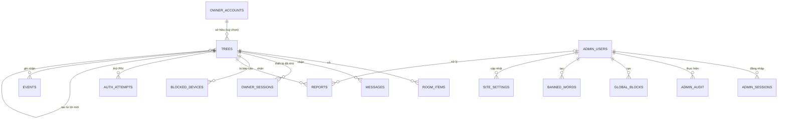
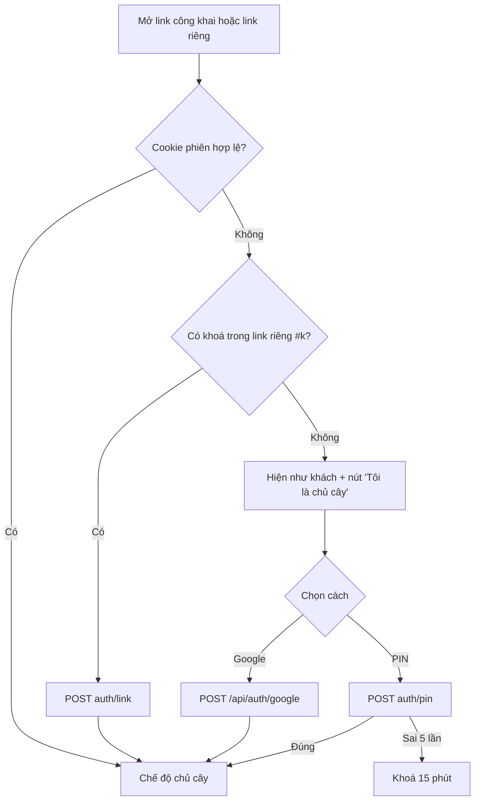
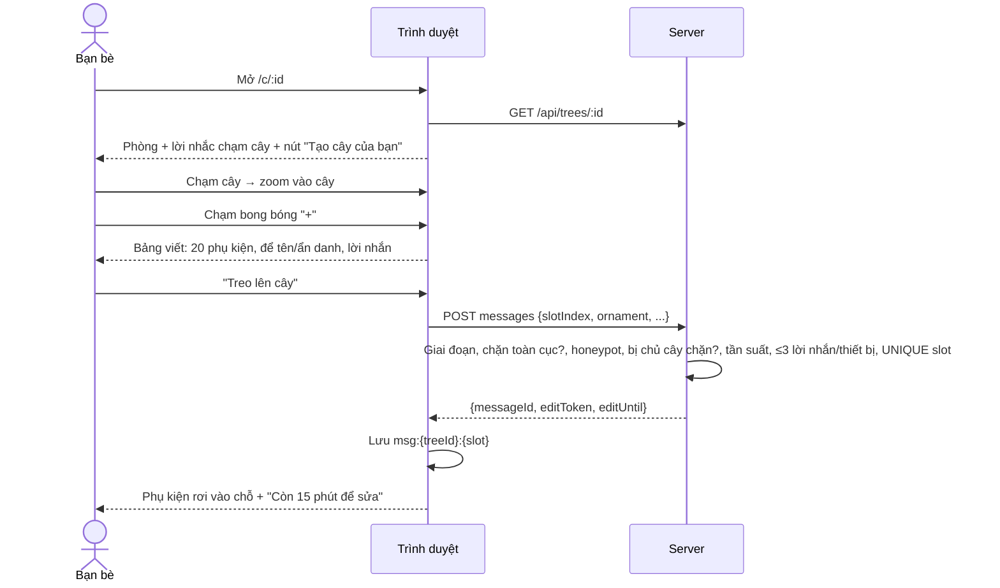
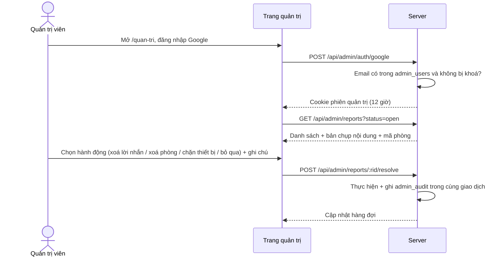

# Cây Thông Lời Nhắn — Đặc tả dự án v3

> Bản v3 thay cho v2. Thay đổi lớn: **phòng tự do** (chủ cây tự sắp đồ), **đồ hoạ màu nước tách lớp**, **20 phụ kiện treo**, **xác thực chủ cây bằng Google hoặc mã PIN**, **sửa lời nhắn trong 15 phút theo thiết bị**.
> Mục có **[CẦN XÁC NHẬN]** là chỗ mình đề xuất mặc định, bạn đồng ý thì giữ.
> Ngày soạn: 16/11/2026. Bản thiết kế đồ hoạ: canvas "Cây Thông Lời Nhắn – Bản thiết kế đồ hoạ".

---

## Mục lục

1. Tổng quan
2. Các quyết định đã chốt
3. Phạm vi chức năng
4. Danh mục đồ hoạ
5. Dòng thời gian & giai đoạn dịch vụ
6. Kiến trúc & công nghệ
7. **Thiết kế cơ sở dữ liệu**
8. Thiết kế API
9. Các luồng hoạt động
10. Bảo mật, quyền riêng tư, chống lạm dụng
11. Giao diện & trải nghiệm
12. Yêu cầu phi chức năng
13. Triển khai Azure & chi phí
14. Kiểm thử
15. Kế hoạch & mốc thời gian
16. Rủi ro
17. Chỉ số thành công
18. Các câu hỏi đã chốt
- Phụ lục A: Ánh xạ chức năng → bảng → API
- Phụ lục B: Thay đổi so với v2

---

## 1. Tổng quan

Mỗi người dùng có một **căn phòng Noel** vẽ theo phong cách màu nước. Trong phòng có **cây thông** (bắt buộc) và các món đồ chủ cây tự chọn, tự kéo thả: cửa sổ, lò sưởi, thảm, hộp quà, chồng quà, thú cưng. Chủ cây gửi link cho bạn bè. Bạn bè mở link, chạm vào cây thì **camera zoom vào cây**, chạm một **bong bóng "+"** để chọn 1 trong 20 phụ kiện treo, viết lời nhắn rồi treo lên cây. Đến **0h ngày 24/12**, chủ cây mới đọc được lời nhắn.

**Cảm xúc cốt lõi:** trang trí căn phòng của riêng mình, rồi háo hức "mở quà" vào đêm Noel.

**Vòng lan truyền:** chủ cây tạo phòng → gửi link → bạn bè treo lời nhắn → nút "Tạo cây của bạn" → bạn bè tạo phòng riêng → lặp lại.

**Nguyên tắc:**
- Không bắt buộc đăng ký.
- Mobile-first, máy tính có bố cục riêng.
- Dịch vụ theo mùa, kết thúc 31/12/2026, xoá dữ liệu sau đó.
- Lời nhắn chỉ chủ cây đọc được.

---

## 2. Các quyết định đã chốt

| # | Nội dung | Quyết định |
|---|---|---|
| 1 | Lời nhắn mỗi điểm | 1 lời nhắn / điểm |
| 2 | Khoá đến đêm Noel | Có, mở lúc 0h 24/12 |
| 3 | Ẩn danh | Người viết tự chọn để tên hoặc ẩn danh |
| 4 | Người viết thấy lời nhắn của nhau | Không |
| 5 | Đăng nhập | Không bắt buộc |
| 6 | Phong cách | Màu nước hoạt hình (cây, phòng, lò sưởi); thú cưng và phụ kiện treo dạng hoạt hình viền mềm, loang màu |
| 7 | Ngôn ngữ, phông | Chỉ tiếng Việt; Amatic SC, Mynerve, Grape Nuts |
| 8 | Thu tiền | Không |
| 9 | Thời hạn | Đến hết 31/12/2026; từ 26/12 có thông báo ngừng và nhắc tải ảnh |
| 10 | Hạ tầng | Azure, credit khoảng 50 USD |
| 11 | Ra mắt | Chạy thử kín 10–12/12, công khai 15/12 |
| 12 | Bố cục phòng | **Phòng tự do**: kéo thả, phóng to/nhỏ, lật, đổi kiểu, thêm/xoá đồ |
| 13 | Xác thực chủ cây | Nhớ thiết bị + **bắt buộc chọn 1 cách khôi phục**: đăng nhập Google hoặc mã PIN 6 số; link riêng làm dự phòng |
| 14 | Sửa lời nhắn | **Trong 15 phút** kể từ lúc tạo, **trên đúng thiết bị đã viết**; khoá sớm hơn nếu chủ cây đã mở |
| 15 | Điểm nhắn | Chủ cây chọn số theo mốc 6/9/12/16/20/25/30; máy tự xếp đều trên tán |
| 16 | Đổi kiểu trên điện thoại | Phương án C: mũi tên ‹ › cạnh món + dải chọn mỏng. **Sửa 18/11:** phòng luôn hiện trọn theo chiều rộng; camera chỉ dời khi dải chọn che món đang sửa |
| 17 | Trên máy tính | Hai bảng bên: trái là khay đồ và phông nền, phải là chỉnh món đang chọn |
| 18 | Cách làm | Làm đầy đủ chức năng, ưu tiên P0 trước |
| 19 | Công nghệ | TypeScript; React + Vite; Fastify; PostgreSQL 16 + Drizzle; pnpm monorepo |
| 20 | Trang quản trị | Có, tại `/quan-tri` |

---

## 3. Phạm vi chức năng

Ký hiệu: **P0** bắt buộc khi ra mắt · **P1** nên có · **P2** nếu còn thời gian.

### 3.1 Trang trí phòng (chủ cây)

| Mã | Chức năng | Ưu tiên |
|---|---|---|
| R1 | Phòng mặc định khi tạo mới (phông, cửa sổ, lò sưởi, thảm, cây, quà, thú cưng đã sắp sẵn) | P0 |
| R2 | Kéo thả để di chuyển món đồ; cửa sổ chỉ nằm trên tường, đồ khác chỉ nằm trên sàn | P0 |
| R3 | Tự xếp lớp: món đứng gần người xem hơn nằm trước; tường → thảm → đồ trên sàn | P0 |
| R4 | Phóng to / thu nhỏ (50%–160%), lật ngang | P0 |
| R5 | Đổi kiểu: mũi tên ‹ › cạnh món (đổi nhanh) và dải chọn mỏng (xem hết kiểu) | P0 |
| R6 | Thêm đồ từ khay; xoá đồ (trừ cây thông); tối đa 25 món | P0 |
| R7 | Đổi phông nền (9 kiểu) | P0 |
| R8 | Cây thông: dáng tán, màu tán, dáng thân, màu gỗ, số điểm nhắn | P0 |
| R9 | Tự lưu (sau mỗi thay đổi, gộp lại 1–2 giây mới gửi) | P0 |
| R10 | Bố cục máy tính với hai bảng bên | P0 |
| R11 | Hoàn tác / làm lại | P1 |
| R12 | Nút "Phòng ngẫu nhiên" | P1 |
| R13 | Giảm số điểm nhắn khi đã có lời nhắn (tự dồn lời nhắn sang chỗ trống) | P1 |
| R14 | Nhân bản một món | P2 |

### 3.2 Bạn bè mở link

| Mã | Chức năng | Ưu tiên |
|---|---|---|
| G1 | Xem phòng, lời nhắc "Chạm vào cây thông để treo lời nhắn", nút "Tạo cây của bạn" | P0 |
| G2 | Chạm cây → zoom mượt vào giữa cây (ở bất kỳ vị trí/kích thước nào), hiện bong bóng "+" và phụ kiện đã treo | P0 |
| G3 | Chạm bong bóng → bảng viết: chọn 1/20 phụ kiện, để tên hoặc ẩn danh, lời nhắn ≤ 400 ký tự và không quá 9 dòng khi xếp lên thiệp (nâng từ 300, chốt 23/11, mục 6.7); xem trước thiệp trước khi treo | P0 |
| G4 | Treo xong: phụ kiện rơi vào chỗ, thông báo "còn 15 phút để sửa" | P0 |
| G5 | Sửa / xoá lời nhắn của mình trong 15 phút trên cùng thiết bị | P0 |
| G6 | Chạm lò sưởi, quà, thú cưng → hiệu ứng (mỗi lần một hiệu ứng khác) | P0 |
| G7 | Hai người cùng chọn một bong bóng: người sau được báo và chọn chỗ khác | P0 |
| G8 | Báo cáo phòng vi phạm | P1 |
| G9 | **Ảnh** kèm lời nhắn: tối đa 1 ảnh, tệp chọn ≤ 20 MB (nâng lên P0 ngày 23/11, mục 6.7) | P0 |
| G10 | Ghi âm kèm lời nhắn | P2 |

### 3.3 Chủ cây đọc & quản lý

| Mã | Chức năng | Ưu tiên |
|---|---|---|
| O1 | Mở lại phòng: tự nhận thiết bị; thiết bị khác dùng Google, mã PIN hoặc link riêng | P0 |
| O2 | Trước 0h 24/12: phụ kiện hiện "quà còn gói" + đếm ngược; không đọc được | P0 |
| O3 | Từ 0h 24/12: phụ kiện chưa đọc lấp lánh; chạm → thẻ lời nhắn | P0 |
| O4 | Xoá lời nhắn, chặn thiết bị người gửi, báo cáo | P0 |
| O5 | Xoá phòng và toàn bộ dữ liệu | P0 |
| O6 | Danh sách lời nhắn dạng thẻ (ngoài cách chạm từng phụ kiện) | P1 |
| O7 | Tải ảnh phòng (PNG) và ảnh thiệp lời nhắn (nâng lên P0 ngày 23/11 để biểu ngữ L3 "tải ảnh sớm" có cái để tải; mục 6.7) | P0 |
| O8 | Đổi mã PIN, liên kết thêm Google sau khi tạo | P1 |
| O9 | Trả lời cảm ơn | P2 |
| O10 | Hiện số lời nhắn đang có (và số mới kể từ lần vào trước); chủ cây bật/tắt được, **mặc định hiện**, lưu theo phòng | P0 |

### 3.4 Chia sẻ & lan truyền

| Mã | Chức năng | Ưu tiên |
|---|---|---|
| S1 | Link ngắn `/c/{id}` (id 8 ký tự) | P0 |
| S2 | Nút chia sẻ: hệ thống (Web Share), Messenger, Zalo, sao chép | P0 |
| S3 | Ảnh xem trước (OG) vẽ từ chính căn phòng | P0 |
| S4 | Ghi nhận phòng tạo từ lời mời (đo hệ số lan truyền) | P0 |
| S5 | Mã QR | P2 |

### 3.5 Vòng đời & quản trị

| Mã | Chức năng | Ưu tiên |
|---|---|---|
| L1 | Khoá đọc đến 0h 24/12 (server quyết định) | P0 |
| L2 | Đóng tạo phòng / gửi lời nhắn / sửa phòng từ 0h 26/12 | P0 |
| L3 | Biểu ngữ từ 26/12: "Hết tháng 12 sẽ ngừng dịch vụ, tải ảnh sớm" | P0 |
| L4 | Từ 0h 01/01/2027: trang kết thúc, API trả 410 | P0 |
| L5 | Xoá toàn bộ dữ liệu ngày 07/01/2027 | P0 |
| L6 | Giới hạn tần suất, honeypot, chặn dò PIN | P0 |
| L7 | **Trang quản trị web** (chi tiết ở mục 3.7 và 9.10) | P0/P1 |
| L8 | Lọc từ ngữ thô tục cơ bản (danh sách từ quản lý trên trang quản trị) | P1 |
| L9 | Sao lưu tự động hằng ngày (dịch vụ PostgreSQL của Azure, giữ 7 ngày) | P0 |

### 3.7 Trang quản trị (`/quan-tri`)

Chỉ dành cho bạn (và người bạn cấp quyền). Đăng nhập bằng Google, chỉ tài khoản có trong danh sách cho phép mới vào được. Mọi thao tác đều ghi nhật ký.

**M3b (chốt 24/11, mục 6.8):** chỉ chủ dự án dùng, không phân quyền; làm A1–A5; hàng đợi báo cáo bỏ hành động chặn thiết bị (để cuối); Tổng quan có thêm khối "Máy chủ".

**Nguyên tắc riêng tư:** quản trị viên **không đọc được lời nhắn tuỳ ý**. Chỉ thấy nội dung của lời nhắn **đã bị báo cáo** (bản chụp lúc báo cáo). Trang tra cứu phòng chỉ hiện số liệu, không hiện nội dung.

| Mã | Màn hình / chức năng | Ưu tiên |
|---|---|---|
| A1 | **Đăng nhập** bằng Google + danh sách cho phép; phiên riêng cho quản trị, hết hạn sau 12 giờ | P0 |
| A2 | **Tổng quan:** giai đoạn hiện tại + đếm ngược tới mốc kế tiếp; tổng số phòng, lời nhắn, lượt xem; số mới trong 24 giờ; báo cáo đang chờ; hệ số lan truyền | P0 |
| A3 | **Hàng đợi báo cáo:** danh sách báo cáo đang mở, xem bản chụp nội dung và phòng liên quan; hành động: xoá lời nhắn, xoá phòng, chặn thiết bị toàn hệ thống, bỏ qua; ghi chú lý do | P0 |
| A4 | **Tra cứu phòng** theo mã hoặc link: tên chủ cây, ngày tạo, số món, số lời nhắn (đã đọc / chưa đọc), cách khôi phục đang dùng, số phiên đang mở, số báo cáo; xem ảnh căn phòng (như khách thấy); hành động: xoá phòng, thu hồi mọi phiên chủ cây, mở khoá PIN đang bị khoá | P0 |
| A5 | **Nhật ký thao tác:** ai làm gì, lúc nào, với đối tượng nào | P0 |
| A6 | **Biểu đồ:** phòng mới, lời nhắn mới, lượt xem theo giờ/ngày; phễu khách → treo lời nhắn → tạo phòng riêng; phân bố lựa chọn đồ hoạ (phông, lò sưởi, phụ kiện treo được chọn nhiều nhất) | P1 |
| A7 | **Chặn toàn hệ thống:** danh sách thiết bị / IP (dạng băm) bị chặn, thời hạn, lý do; thêm, gỡ | P1 |
| A8 | **Từ cấm:** thêm, xoá từ; chọn mức xử lý (che bằng dấu \*, hoặc từ chối gửi) | P1 |
| A9 | **Thông báo hệ thống:** bật/tắt biểu ngữ tuỳ chỉnh trên toàn trang (ví dụ báo bảo trì) | P1 |
| A10 | **Tạm dừng khẩn cấp:** tắt tạo phòng mới / tắt gửi lời nhắn mới (khi bị spam), không cần triển khai lại | P1 |
| A11 | **Quản lý quản trị viên:** thêm / gỡ người, vai trò `admin` (toàn quyền) hoặc `moderator` (chỉ xử lý báo cáo) | P1 |
| A12 | **Sao lưu & dữ liệu:** xem trạng thái sao lưu tự động của Azure; nút xoá toàn bộ dữ liệu chỉ hiện sau ngày kết thúc và cần xác nhận 2 bước | P2 |
| A13 | Xuất số liệu tổng hợp (CSV, không có nội dung cá nhân) | P2 |

### 3.6 Đã bỏ khỏi phạm vi

Bảng xếp hạng công khai · màn quản lý nhiều phòng trên một tài khoản (một tài khoản vẫn có thể sở hữu nhiều phòng, xem 8.2) · song ngữ · nhạc ngoài · mở rộng Tết/Valentine · thu tiền · bố cục cố định theo vị trí (thay bằng phòng tự do).

---

## 4. Danh mục đồ hoạ

Mọi đồ hoạ vẽ bằng code (SVG có bộ lọc màu nước) rồi xuất sẵn thành ảnh WebP theo lớp; phần chuyển động là lớp SVG nhẹ hoặc CSS. Toạ độ căn phòng cố định **720 × 1080** (dọc), sàn bắt đầu ở y = 770.

| Nhóm | Mã loại (`item_type`) | Lớp | Biến thể (`variant`) | Số lượng |
|---|---|---|---|---|
| Phông nền | (thuộc tính phòng) | — | night, wood, stone, home, sage, rose, navy, whitebrick, shiplap | 9 |
| Cây thông | `tree` | sàn | main (cấu hình riêng, xem dưới) | 1, bắt buộc |
| Cửa sổ | `window` | tường | wood, white, honey | 3 |
| Lò sưởi | `fireplace` | sàn | classic, stove, rustic, victorian, modern, dome, cabinet, tiled | 8 |
| Thảm | `rug` | thảm | plaid, knit | 2 |
| Chồng quà | `stack` | sàn | warm, pastel | 2 |
| Hộp quà lẻ | `gift` | sàn | red, green, gold, blue, cream, pink, mint, lilac | 8 |
| Thú cưng | `pet` | sàn | cat, dog, deer, bear, owl, penguin | 6 |

**Cấu hình cây thông:**

| Thuộc tính | Giá trị |
|---|---|
| Dáng tán | cloud3 (3 tầng mây), cloud4 (thon cao 4 tầng), puffy (bông tròn), snowy (3 tầng phủ tuyết) |
| Màu tán | teal, green, pine, pink, lavender, frost |
| Dáng thân | straight, flared, stout |
| Màu gỗ | oak, walnut, cedar, birch |
| Số điểm nhắn | 6, 9, 12, 16, 20, 25, 30 |

**20 phụ kiện treo (`ornament`):** sock, star, bulb, ball, candy, bell, gingerbread, heart, snowflake, mitten, minigift, pinecone, bow, snowman, moon, lantern, stripeball, cookie, reindeer, cocoa.

**Danh mục là dữ liệu tĩnh trong code** (`catalog.json`, có trường `version`), dùng chung cho trình duyệt và server để kiểm tra hợp lệ. Không lưu danh mục trong cơ sở dữ liệu vì nó không đổi khi chạy. Thêm kiểu mới chỉ cần thêm ảnh + một dòng danh mục.

**Kích thước tải:** mỗi món 6–90 KB; phông nền 60–250 KB; tải lần đầu một phòng điển hình khoảng 0,5–0,8 MB.

---

## 5. Dòng thời gian & giai đoạn dịch vụ

Múi giờ **Asia/Ho_Chi_Minh (UTC+7)**, server quyết định giai đoạn.

| Giai đoạn | Thời gian | Tạo/sửa phòng | Treo/sửa lời nhắn | Chủ cây đọc | Ghi chú |
|---|---|---|---|---|---|
| `BUILD` | Ra mắt → 23:59:59 ngày 23/12 | Có | Có | Không (quà còn gói) | Đếm ngược |
| `OPEN` | 0h 24/12 → 23:59:59 ngày 25/12 | Có | Có | Có | |
| `NOTICE` | 0h 26/12 → 23:59:59 ngày 31/12 | Không | Không | Có | Biểu ngữ ngừng dịch vụ, tải ảnh |
| `ENDED` | Từ 0h 01/01/2027 | Không | Không | Không | Trang kết thúc, API 410 |
| (xoá dữ liệu) | 0h 07/01/2027 | | | | Chạy tác vụ xoá, xoá resource group |

Quy tắc sửa lời nhắn: chỉ khi `now < edit_until` **và** `read_at IS NULL` **và** giai đoạn cho phép ghi.

Các mốc là biến môi trường (`UNLOCK_AT`, `WRITE_CLOSES_AT`, `SERVICE_ENDS_AT`, `PURGE_AT`); `FAKE_NOW` chỉ dùng khi phát triển.

---

## 6. Kiến trúc & công nghệ

### 6.1 Lựa chọn công nghệ (đã chốt 16/11)

| Lớp | Lựa chọn | Lý do |
|---|---|---|
| Ngôn ngữ | **TypeScript** cho frontend và backend; riêng `packages/shared` là JavaScript (`.mjs`) có kiểu qua JSDoc, không cần bước build | Dùng chung kiểu dữ liệu, danh mục, xếp điểm nhắn, quy tắc kiểm tra; chạy giống nhau trên Node 22 (Azure) và máy phát triển |
| Frontend | **React 19 + Vite** | Nhiều màn có trạng thái (trang trí, dải chọn, bảng bên, viết lời nhắn, đọc lời nhắn, quản trị) |
| Định tuyến | React Router | `/`, `/tao`, `/c/:id`, `/quan-tri/*` |
| Trạng thái phía trình duyệt | Zustand (phòng đang sửa) + `lib/api.ts` (gọi server; bỏ TanStack Query 21/11) | Nhẹ, ít khuôn mẫu |
| Kéo thả | Tự viết bằng Pointer Events, cập nhật thẳng `transform` khi đang kéo, chỉ ghi vào state khi thả tay | Giữ 60 khung hình trên điện thoại |
| Backend | **Fastify 5** + plugin cookie, helmet, static; giới hạn tần suất tự viết trên bảng `rate_counters` (7.4) | Nhanh, có kiểm tra dữ liệu, log có cấu trúc |
| Kiểm tra dữ liệu | **Zod** (dùng chung frontend/backend) | Một bộ quy tắc cho form và API |
| Cơ sở dữ liệu | **PostgreSQL 16** (Azure Database for PostgreSQL – Flexible Server) | Chạy được nhiều instance, sao lưu tự động |
| Truy vấn | **Drizzle ORM** + driver `postgres` | Có kiểu TypeScript, gần SQL; migration là file SQL viết tay (7.9) |
| Xác thực | scrypt (Node), `google-auth-library`, cookie HttpOnly | Không lưu mật khẩu, không lưu email người dùng |
| Ảnh OG | `sharp` ghép các lớp WebP | Đã dùng khi xuất đồ hoạ |
| Biểu đồ quản trị | Recharts | |
| Kiểm thử | Vitest, React Testing Library, PGlite, Playwright (vài luồng chính) | |
| Quản lý repo | pnpm workspaces | Một repo, nhiều gói |

### 6.2 Cấu trúc repo

```
cay-thong-loi-nhan/
├─ apps/
│  ├─ web/                 React + Vite
│  │  └─ src/
│  │     ├─ routes/        trang chủ, tạo phòng, phòng (/c/:id), quản trị
│  │     ├─ room/          Scene, Camera, DragLayer, Editor, PickerStrip, SidePanels, Effects
│  │     ├─ guest/         Compose (viết / sửa lời nhắn)
│  │     ├─ owner/         Reader (đếm ngược, mở quà), Auth (PIN, Google, link riêng)
│  │     ├─ admin/         Overview, Reports, TreeLookup, Stats, Blocks, Words, Settings, Admins, Audit
│  │     ├─ art/           hàm vẽ SVG động: thú cưng, phụ kiện treo, lửa, đèn
│  │     └─ styles/        base, room (chuyển động), admin
│  └─ server/              Fastify
│     └─ src/
│        ├─ routes/        trees, room, messages, owner, auth, og, admin
│        ├─ db/            schema Drizzle, migration, truy vấn
│        ├─ phase.ts       giai đoạn theo giờ
│        └─ security.ts    băm, phiên, giới hạn tần suất, từ cấm, chặn
├─ packages/
│  ├─ shared/              catalog, slots, schema Zod, kiểu dữ liệu, hằng số giai đoạn
│  └─ art/                 mã nguồn SVG màu nước + script xuất WebP và catalog.json
├─ tools/design-canvas/    mã sinh các bảng thiết kế trên canvas
└─ docs/
```

### 6.3 Cách chạy khi triển khai

```
Trình duyệt ──HTTPS──> Azure App Service (Fastify)
                         ├─ /assets/*      ảnh WebP, phông (cache dài hạn)
                         ├─ /c/:id         HTML có sẵn thẻ chia sẻ + bản build React
                         ├─ /og/:id.png    ảnh xem trước (lưu đệm theo room_version)
                         └─ /api/*         API ──TLS──> Azure Database for PostgreSQL
```

Một tên miền cho cả trang và API: cookie đơn giản, không cần cấu hình chia sẻ giữa nhiều tên miền.

### 6.4 Ghi chú cài đặt backend (chốt 16/11, cho M1)

- **Cấu trúc:** `buildApp({ db, now })` dựng ứng dụng Fastify; test truyền PGlite + đồng hồ giả, chạy thật truyền PostgreSQL. Mọi kiểm tra giai đoạn vẫn qua `phase.ts`.
- **Phiên chủ cây** hết hạn ở `PURGE_AT` (nhớ thiết bị suốt mùa).
- **Băm IP:** muối theo ngày = HMAC(`PEPPER`, ngày giờ VN), mọi instance tính ra giống nhau; danh sách chặn IP dùng `BLOCK_IP_KEY` cố định.
- **Honeypot** (`website` có giá trị): trả kết quả thành công giả, không lưu gì. Kiểm **trước** chặn theo cây, giới hạn tần suất và ≤3/thiết bị (chốt 19/11) để bot không đọc được gì từ mã lỗi.
- **Chủ cây không treo lời nhắn** lên cây của mình (8.8): có cookie chủ cây → 403.
- **Giảm số điểm nhắn** (P0): còn lời nhắn ở chỉ số ≥ số điểm mới → 409 kèm lý do; tự dồn là R13 (P1).
- **Vị trí khi lưu phòng:** món lớp `wall` có y < `floorY`, món khác y ≥ `floorY` (lấy từ `catalog.json`).
- **Có ở M1:** kiểm tra `global_blocks` và `pause_*` trước thao tác ghi (bảng trống đến khi có trang quản trị). **Để M7:** lọc từ cấm.
- **`events`:** M1 chỉ ghi sự kiện server tự biết (tạo phòng, lưu phòng, treo/sửa/gỡ, mở lời nhắn); sự kiện chỉ trình duyệt biết để M3.
- **Google:** test dùng bộ xác minh giả; thiếu `GOOGLE_CLIENT_ID` thì API Google trả 503, PIN vẫn chạy.
- **Chống giả mạo yêu cầu:** API ghi chỉ nhận `Content-Type: application/json`, kết hợp cookie `SameSite=Lax`.

### 6.5 Thiết kế frontend M2 — phòng tự do (chốt 18/11)

**Mục đích.** Chủ cây tạo và trang trí căn phòng trên điện thoại và máy tính, mọi thay đổi tự lưu lên server M1. Đây là nền cho M3 (khách treo lời nhắn, mở quà), nên quy tắc phòng phải tách khỏi giao diện và có test. Mẫu các màn đã duyệt ngày 18/11 (bản phác trong `.superpowers/brainstorm/`, không commit).

**Mục tiêu M2:** R1–R10 (mục 3.1), luồng tạo cây (9.1) có khung giới thiệu, chủ cây mở lại phòng (9.2, trừ Google), hai chế độ Xem / Sửa phòng (khung), thông báo lỗi lưu phòng (9.3, 9.11).
**Không làm ở M2:** khách zoom cây, viết lời nhắn, hiệu ứng chạm (M3); nội dung chế độ Xem — đếm ngược, số lời nhắn, chia sẻ Zalo/Messenger, mở quà (M3); OG (M3); hoàn tác, phòng ngẫu nhiên (R11, R12 — P1, chỉ làm nếu còn thời gian sau khi xong P0); Playwright (M4).
**Không được xảy ra:** mất công trang trí ở `/tao` khi tải lại trang (trước khi tạo cây); kéo thả giật trên điện thoại; phòng bị cắt mất phần nào trên bất kỳ cỡ màn hình nào; lộ khoá link riêng trong thanh địa chỉ sau khi đã đăng nhập.

**Cách dựng (phương án A, chủ dự án chọn 18/11).** Phương án đã cân nhắc: (A) tách "bộ não" phòng thành module thuần có test, component chỉ hiển thị; (B) chép gần nguyên khối logic bản thiết kế canvas vào một component lớn — nhanh hơn 1–2 ngày nhưng không test được và M3 phải gỡ ra. Chọn A.

**Đường dẫn (React Router):**

| Đường dẫn | Nội dung |
|---|---|
| `/` | Phòng mặc định làm mờ + khung giới thiệu (màn 1a, luôn giống nhau với mọi máy): giới thiệu 3 dòng, lời chúc, nút chính "Bắt đầu tạo cây" (không có nút đóng), nút chữ nhỏ **"Bạn đã có cây?"** mở khung "Mở lại cây của bạn" (xem dưới). `/?ref={id}` lưu `ref` vào `sessionStorage` để gửi kèm khi tạo phòng (S4). |
| `/tao` | Trang trí bản nháp (chưa có trên server; lưu `localStorage` khoá `draft:new`) → nút "Hoàn tất" → bảng: tên chủ cây (bắt buộc, ≤ 30), tên cây (≤ 40), chọn "Mã PIN 6 số" / "Google", cảnh báo mất PIN → `POST /api/trees` → màn "Tạo xong": **mã cây** (8 ký tự, ví dụ `k7m2xq4a`), link gửi bạn bè, link riêng (nút sao chép), nhắc "Ghi lại mã cây và PIN để mở cây trên máy khác", nút "Về phòng của tôi". |
| `/c/:id` | Gọi `GET /api/trees/:id/owner`: 200 → chủ cây (chế độ Xem, nút "Sửa phòng"); 401 → khách (chỉ xem phòng, nút "Tạo cây của bạn" → `/?ref={id}`, nút nhỏ "Tôi là chủ cây"); 404 → "Không tìm thấy cây này" + nút tạo cây. Có `#k=` → `POST auth/link` rồi xoá `#k=` khỏi địa chỉ bằng `history.replaceState`. |

Khách trong phòng bạn bè bấm "Tạo cây của bạn" thấy đúng màn 1a (không có màn riêng). **Không giới hạn số cây trên một máy** (chủ dự án chốt 18/11): ai cũng có thể bấm "Bắt đầu tạo cây" để làm thêm cây.

**Khung "Mở lại cây của bạn"** (bấm "Bạn đã có cây?"; chủ dự án chốt 18/11). Mã PIN gắn với từng cây, nên phải biết mở cây nào:
- Ô **"Mã cây hoặc link cây"**: nhận mã 8 ký tự (`^[a-z2-9]{8}$`) hoặc dán nguyên link (link gửi bạn bè `/c/{id}` hay link riêng `/c/{id}#k=...`; dán link riêng thì vào thẳng bằng `auth/link`, không cần PIN). Sai định dạng → "Mã cây chưa đúng".
- Ô **PIN 6 số** + nút "Mở cây" → `POST /api/trees/{id}/auth/pin`; thành công → chuyển tới `/c/{id}` (chế độ Xem của chủ cây). Lỗi dùng chung thông báo với bảng "Chào chủ cây" (sai PIN, bị khoá — thông báo dùng `retryAt`: "N phút", hoặc "N giờ" khi dài hơn 60 phút); 404 → "Không tìm thấy cây này".
- Nút **"Đăng nhập bằng Google"** → `POST /api/auth/google` không kèm `treeId`: 1 cây thì mở luôn, nhiều cây thì hiện danh sách tên cây để chọn, 0 cây → "Tài khoản này chưa có cây nào".
- **Máy có ghi nhớ:** `localStorage` khoá `myTrees` (`[{ id, title, createdAt }]`, ghi khi tạo phòng hoặc đăng nhập thành công). Có thì điền sẵn ô mã cây (cây mới nhất; nhiều cây thì hiện danh sách tên để chọn). Chọn một cây mà phiên trên máy còn hiệu lực (`GET /owner` trả 200) → mở thẳng, không hỏi PIN. Khi mở khung chỉ tự thử khi máy nhớ **đúng 1 cây**; nhiều cây thì chờ người dùng bấm chọn (sửa 22/11). Server trả 404 → xoá cây đó khỏi `myTrees`.

**Bố cục.** Phòng hiện trọn (mục 11). Điện thoại: thanh trên (Thêm đồ, Phông nền, chấm trạng thái lưu, Xong/Hoàn tất) đặt trong phần dư phía trên nếu đủ ≥ 44px; mũi tên ‹ ›, thanh công cụ (nhỏ hơn, to hơn, lật, đổi kiểu, xoá) và dải chọn đặt trong phần dư phía dưới; không đủ chỗ thì đè lên phòng và phòng tự đẩy lên để món đang chọn nằm trên dải. Từ 900px: bảng trái (Thêm đồ, Phông nền), phòng giữa (co theo chiều cao), bảng phải (món đang chọn: các kiểu, to/nhỏ, lật, xoá; cây có tab Dáng · Màu · Thân · Gỗ · Điểm nhắn).

**Module phòng `apps/web/src/room/model.ts` (thuần, không React, có test).** Quy tắc lấy từ bản thiết kế canvas:
- Thứ tự vẽ: `rank = (wall ? 0 : rug ? 2000 : 4000) + y` — tường sau cùng, thảm, rồi đồ sàn; cùng lớp thì y lớn hơn (gần người xem) nằm trước.
- Giới hạn khi kéo: x trong 10–710; món lớp `wall`: y trong 200–750 (`floorY` − 20); món khác: y trong 810 (`floorY` + 40) – 1075.
- Phóng to/thu nhỏ bước 0,1 trong 0,5–1,6; lật ngang.
- Mũi tên ‹ ›: đổi kiểu theo thứ tự trong `catalog.json`, quay vòng; với cây thông thì đổi màu tán.
- Thêm món: đặt ở (360, 380) nếu lớp tường, (360, 1000) nếu sàn; tối đa 25 món; không xoá được cây.
- `clientId` sinh ngẫu nhiên, không dùng lại cho món khác (tránh lỗi đổi loại khi lưu).
- Hàm chuyển sang/đọc từ dạng `Room` của `@ctln/shared` để gửi API; mọi phòng gửi đi phải qua `validateRoom`.

**Dựng phòng (`room/Scene`).** Ảnh WebP ở `/assets/...` theo `catalog.json` (kích thước, điểm neo `ax, ay`). Cây = thân + tán (ảnh) + đèn + ngôi sao (SVG `lightsSource`, `starSource` của `@ctln/art/tree`) + đung đưa. Lò sưởi có lửa (`fire2Overlay`), cửa sổ có tuyết (`windowSnowOverlay`), thú cưng là SVG động (`petSVGSoft`). Lớp SVG chèn nguyên văn từ `packages/art` (chuỗi tĩnh, không chứa dữ liệu người dùng), toạ độ lớp phủ theo `crop` trong catalog. CSS chuyển động: `room-animations.css` + `TREE2_CSS`; tôn trọng "giảm chuyển động".

**Kéo thả (`room/DragLayer`).** Pointer Events; khi kéo chỉ đổi `transform` của món qua ref (không render lại React), thả tay mới ghi vị trí vào store và tính lại thứ tự vẽ. Chạm nền bỏ chọn.

**Trạng thái.** Zustand: phòng đang sửa, món đang chọn, dải/bảng đang mở, trạng thái lưu. Dữ liệu từ server gọi qua `lib/api.ts` (bỏ TanStack Query — chốt 21/11, mục 6.6).

**Tự lưu (`room/autosave`).** Sau 1,5 giây không thao tác gửi `PUT /api/trees/:id/room` kèm `roomVersion`. Chấm trạng thái: Đã lưu / Đang lưu / Chưa lưu. Mỗi lần lưu gửi **cả phòng**, nên lần lưu thành công sau sẽ mang theo mọi thay đổi trước đó còn trên trang. **Không lưu nháp phòng đã tạo trên máy** (chủ dự án chốt 19/11: mất mạng thì không cần cố giữ thay đổi; chỉ `/tao` giữ nháp `draft:new`). Xử lý trả về:
- 409 `version_conflict` → **hỏi chủ cây** (chủ dự án chọn 18/11): bảng "Có thay đổi chưa lưu trên máy này, nhưng phòng đã được sửa ở thiết bị khác" với hai nút **"Giữ bản trên máy này"** (gửi lại phòng đang sửa kèm `roomVersion` mới nhận trong `error.room`) và **"Dùng bản mới nhất"** (thay bằng `error.room`). Nếu `error.room` **giống hệt** phòng đang sửa (so theo `clientId`, bỏ qua thứ tự món) thì không hỏi: nhận `roomVersion` mới và coi như đã lưu (xung đột giả, ví dụ lượt lưu lúc `pagehide` vừa được nhận) (22/11).
- 409 `slots_in_use` → trả số điểm nhắn về giá trị cũ, hiện thông báo của server.
- 403 `write_closed` → chuyển về chế độ Xem, ẩn "Sửa phòng".
- 401 → mất phiên chủ cây: hiện bảng "Tôi là chủ cây".
- Lỗi mạng / 5xx → "Chưa lưu", **không tự thử lại** (chủ dự án chốt 19/11); thông báo một lần "Mất mạng — thay đổi chưa được lưu". Thao tác tiếp theo của chủ cây sẽ lưu lại cả phòng như bình thường.
- 429 (vượt 600 lần lưu/giờ, mục 10) → thông báo "Bạn lưu hơi nhiều, sẽ tự lưu lại sau ít phút.", thử lại sau 60 giây (trong lúc vẫn ở trang); khi đã có ≥ 540 lần lưu trong một giờ thì giãn khoảng chờ lên 60 giây.
- **Đóng tab / rời trang** (`pagehide`) khi còn thay đổi chưa lưu → gửi `PUT /room` một lần bằng `fetch` có `keepalive`, không chờ kết quả; thành công thì nhận `roomVersion` mới, huỷ lượt hẹn giờ đang chờ (tránh xung đột giả khi quay lại bằng Back) (sửa 22/11).
- "Xong" đúng lúc lượt lưu bị 409 `version_conflict` → ở lại chế độ Sửa và hiện bảng hỏi ở trên (sửa 22/11).
- "Xong" → lưu ngay một lần; vẫn chưa lưu được (mất mạng, 429, lỗi khác) → vẫn rời chế độ Sửa, thông báo "Thay đổi chưa được lưu.", chế độ Xem hiện bản server đã xác nhận (phần chưa lưu bị bỏ).

**Chủ cây vào từ máy khác.** Bảng "Chào chủ cây": ô PIN 6 số → `POST auth/pin`; sai → "Mã PIN chưa đúng"; 429 `pin_locked` → "Nhập sai quá nhiều lần, thử lại sau N phút" (dùng `retryAt`: "N phút", hoặc "N giờ" khi dài hơn 60 phút); dòng "Có link riêng? Mở link đó là vào được ngay".

**Google.** `/api/config` trả thêm `googleClientId` (chuỗi công khai, `null` nếu chưa cấu hình). Chưa có → nút Google hiện mờ, ghi "sắp có", chỉ dùng PIN. Tích hợp Google Identity Services làm khi chủ dự án có Client ID (chậm nhất M4).

**Kiểm thử (Vitest + React Testing Library + jsdom).** `model.ts`: mọi quy tắc trên. Tự lưu: gộp 1,5 giây, từng mã lỗi ở trên, không tự thử lại khi mất mạng (đồng hồ giả, `fetch` giả). Màn: khung giới thiệu 1a, khung "Mở lại cây của bạn" (đọc mã từ mã 8 ký tự / link thường / link riêng, sai định dạng, PIN sai, bị khoá, mở thẳng khi còn phiên, điền sẵn từ `myTrees`), bảng Hoàn tất (tên bắt buộc, PIN đúng 6 số), màn Tạo xong hiện mã cây, đăng nhập PIN (sai, bị khoá), xoá `#k=` khỏi địa chỉ. Server: test `googleClientId` trong `/api/config`.

**Làm rõ sau lượt đọc thử (18/11):**
- **Phòng mặc định** = `catalog.defaultRoom` trong `@ctln/shared` (đã có), thêm `clientId` cho từng món. Phòng mờ phía sau khung giới thiệu cũng là phòng này. Dạng gửi API là `Room` của `@ctln/shared/schemas.mjs`: `{ background, tree: { shape, palette, trunkShape, wood, slotCount }, items: [{ clientId, type, variant, x, y, scale, flip }] }` — cây thông cũng là một món trong `items`.
- **Điểm nhắn và phụ kiện đã treo** không hiện ở M2 (cả chế độ Xem lẫn khách); M3 thêm.
- **M2 chạy qua Vite dev** (`pnpm dev`, cổng 5173, chuyển `/api` sang 3000). Đặt `BASE_URL=http://localhost:5173` trong `.env` khi phát triển để link "Tạo xong" mở được. Server phục vụ bản build + chuyển mọi đường dẫn trang về `index.html` làm ở M4 khi triển khai.
- **Bố cục chi tiết** (ngưỡng thanh trên ≥ 44px, bề rộng bảng bên máy tính…) lấy theo CSS của bản thiết kế canvas. Script vẽ mẫu đã duyệt lưu ở `tools/design-canvas/build-mock-m2.mjs` (chạy lại để xem mẫu).
- **Thư viện test thêm (devDependencies):** `@testing-library/user-event`, `@testing-library/jest-dom`; `apps/web/vitest.config.ts` dùng jsdom. `pnpm test` ở gốc chạy cả test web.

**Để người làm tự quyết:** chia nhỏ component, tên CSS, hiệu ứng mở/đóng bảng, cách nạp trước ảnh — miễn giữ đúng bản thiết kế canvas và mẫu đã duyệt.

### 6.6 Thiết kế M3 (chốt 21/11)

M3 chia **3 phần làm nối tiếp**, mỗi phần một kế hoạch, xong phần nào thì **dừng cho chủ dự án thử tay** rồi mới làm phần sau: (1) khách treo lời nhắn — G1–G7; (2) chủ cây đọc & quản lý — O2–O5, O10; (3) chia sẻ + OG — S2–S4. Chỉ làm P0. Phần 2 và 3 viết thiết kế khi tới lượt (cần mẫu duyệt cho thanh đếm ngược, thẻ lời nhắn, bảng chia sẻ).

**Quyết định chung (chủ dự án chọn 21/11):**
- **OG:** server ghép ảnh 1200×630 từ chính căn phòng bằng `sharp` (lớp WebP theo `catalog.json`, SVG cây/đèn/sao/thú cưng ở khung tĩnh), lưu đệm theo `room_version`. Ảnh xem trước là ảnh tĩnh — Zalo/Messenger không phát ảnh động hay video từ link; phòng thật vẫn đủ chuyển động. Đã loại: trình duyệt vẽ rồi tải lên (cần chỗ lưu, kiểm ảnh, chỉ có khi chủ cây mở phòng), một ảnh chung (trái S3).
- **HTML `/c/:id` có thẻ OG làm ngay ở M3** (kéo từ M4): server phục vụ `apps/web/dist` và chèn thẻ OG vào `index.html` cho `/c/:id`; thử bằng `pnpm build && pnpm start`.
- **Gỡ TanStack Query** (sửa mục 6.5 "Trạng thái"): dùng tiếp `lib/api.ts`; `/api/config` gọi trực tiếp khi cần.

#### 6.6.1 Phần 1 — Khách treo lời nhắn

**Mục đích.** Bạn bè mở link `/c/:id`, chạm cây, chọn chỗ trống, viết lời nhắn, chọn phụ kiện và treo lên; sửa/gỡ được trong 15 phút trên cùng máy. Đây là hành động chính của sản phẩm (chỉ số "khách mở link → treo lời nhắn ≥ 25%", mục 17). API đã có từ M1 (8.3, 8.4); phần này gần như chỉ là giao diện.

**Mục tiêu:** G1–G7 (mục 3.2), luồng 9.4, 9.5, lỗi 9.11 phía khách; hiệu ứng chạm đồ vật (G6).
**Không làm:** báo cáo phòng của khách (G8, P1); mọi thứ của chủ cây ngoài hiệu ứng chạm (phần 2); chia sẻ, OG (phần 3); cập nhật thời gian thực (khách khác treo thì chỉ thấy khi tải lại hoặc zoom lại).
**Không được xảy ra:** khách thấy nội dung hay tên trong lời nhắn của người khác (giao diện chỉ dùng `GET /api/trees/:id`, không có nội dung); mất lời nhắn đang viết vì một lỗi (409/429/mạng) — bảng viết giữ nguyên chữ; treo trùng chỗ mà không báo; bong bóng "+" hiện khi giai đoạn không cho ghi.

**Cách dựng.** Theo bản thiết kế canvas đã duyệt (bảng "Phòng tự do", `tools/design-canvas/build-board-free.mjs`: zoom, `.slots-layer`, bong bóng, `COMPOSE_UI`, `GIFT_FX`/`PET_FX`, `parts()`) và lớp CSS đã có trong `room-animations.css` (`.compose`, `.orn-pick`, `.g-*`, `.p-*`, `.fx-fire`, `.burst`, `.say`). Logic tách module thuần có test như phương án A của M2.

**Zoom vào cây (G2).**
- Chạm cây (khách, chế độ Xem) → biến đổi khung phòng 0,9 giây về giữa cây: hệ số `zf = 1,6 / max(0,8; tree.scale)`, tâm `(tree.x, tree.y − 300·TS·tree.scale)` như canvas; đúng với cây ở bất kỳ vị trí/cỡ/lật nào. "Giảm chuyển động" → không chuyển tiếp, nhảy thẳng.
- Khi zoom: hiện lớp điểm nhắn (`z-index: 1000`, mờ dần 0,6 s sau 0,55 s), nút "‹ Về căn phòng", ẩn lời nhắc và nút "Tạo cây của bạn"/"Tôi là chủ cây".
- Vị trí điểm: `layoutSlots(tree.shape, tree.slotCount)` của `@ctln/shared` (toạ độ trong hệ của cây) → đổi sang toạ độ phòng theo `x, y, scale, flip` của cây. Hàm đổi toạ độ nằm trong module thuần, có test (cây lật, cây thu nhỏ).
- Mỗi lần zoom vào gọi lại `GET /api/trees/:id` để có trạng thái điểm mới nhất (rẻ, không cần thời gian thực).
- Điểm trống → bong bóng "+" (`slotBubbleSVG`); điểm có lời nhắn → phụ kiện `ornamentSVGSoft(kind, 'filled')` đung đưa; điểm của chính máy này (có `msg:{treeId}:{slot}` còn hạn) → phụ kiện trông như mọi phụ kiện khác, chỉ có nhãn đọc màn hình "Lời nhắn của bạn: …" (chủ dự án bỏ vòng viền vàng 21/11).

**Bảng viết (G3)** — Sheet trượt lên, giữ `aria-modal`, Escape, giữ tiêu điểm như M2:
- 20 phụ kiện (`catalog.ornaments`, thứ tự catalog), mặc định chọn `ball` như canvas; "Người gửi": **Để tên** / **Ẩn danh**, mặc định Để tên (như canvas); ô tên ≤ 30 (bắt buộc khi Để tên), điền sẵn `lastName`; lời nhắn ≤ 400 ký tự (và không quá 9 dòng khi xếp lên thiệp, mục 6.7.2) có bộ đếm, bắt buộc, cắt khoảng trắng hai đầu.
- Ô ẩn `website` (honeypot) không hiện với người, gửi kèm.
- Nút "Treo lên cây" → `POST /api/trees/:id/messages` với `X-Device-Id`. Đang gửi thì khoá nút.
- Thành công (G4): lưu `msg:{treeId}:{slot}` = `{ messageId, editToken, editUntil }`, lưu `lastName` (nếu Để tên), đóng bảng, phụ kiện rơi vào chỗ (`drop-in`), thông báo "Đã treo! Còn 15 phút để sửa".

**Sửa / gỡ (G5, 9.5).** Chạm phụ kiện của mình:
- Còn token và `now < editUntil` → `GET /api/messages/:mid/mine` (`X-Edit-Token`) → bảng viết ở chế độ sửa: tiêu đề kèm "còn N phút", nút "Lưu thay đổi" (`PUT`) và "Xoá lời nhắn" (`DELETE`, hỏi lại một lần). Lưu xong rung phụ kiện (`ring`); xoá xong điểm thành bong bóng, xoá khoá `msg:`.
- Hết hạn, hoặc server trả 403 (`bad_token`, `already_opened`, `edit_expired`) / 404 → hiện thông báo của server (mặc định "Lời nhắn này không sửa được nữa"), đóng bảng, xoá khoá `msg:` của điểm đó.
- 409 `conflict` (đua tạm thời) → "Lời nhắn vừa thay đổi, thử lại nhé", **giữ** khoá và chữ trong bảng.
- `GET /mine` chỉ kiểm token, nên bảng sửa có thể mở dù chủ cây vừa mở lời nhắn; khi đó Lưu/Xoá nhận `already_opened` và xử lý như trên. Chấp nhận, không sửa server.
- Phụ kiện của người khác → không mở gì (rung nhẹ, không lộ thông tin).
- Khoá `msg:` hết hạn được dọn khi mở phòng.
- **Đồng hồ:** so `editUntil` theo giờ server, không theo đồng hồ máy: khi mở phòng lấy `now` từ `GET /api/config`, tính độ lệch `serverNow − Date.now()` và dùng cho mọi so sánh hạn sửa/đếm phút (đúng cả khi chạy `FAKE_NOW` và máy lệch giờ). Không lấy được config thì độ lệch = 0.

**Lỗi khi treo (9.11)** — bảng viết giữ nguyên chữ, trừ khi ghi khác:
- 409 `slot_taken` → "Chỗ này vừa có người treo, chọn chỗ khác nhé", đóng bảng **nhưng giữ chữ trong bộ nhớ trang**, tải lại trạng thái điểm; chạm bong bóng khác thì bảng mở lại với chữ cũ (G7).
- 409 `device_limit` → "Mỗi người chỉ treo được 3 lời nhắn trên một cây."
- 403 `blocked` → thông báo trung tính của server, không nêu lý do.
- 403 `write_closed` → đóng bảng, ẩn bong bóng, "Đã hết thời gian treo lời nhắn".
- 429 → "Bạn thao tác nhanh quá, đợi một lát nhé."
- 503 `paused` (tạm dừng khẩn cấp, 9.9) → hiện thông báo của server, giữ chữ, không ẩn bong bóng.
- 400 → hiện thông báo của server cạnh ô tương ứng nếu có, ngược lại thông báo chung.
- Lỗi mạng / 5xx → "Chưa gửi được, thử lại nhé", không tự thử lại.
- Cây đã đầy (không còn điểm trống) → không có bong bóng, dòng "Cây đã đầy lời nhắn" + nút "Tạo cây của bạn".

**Giai đoạn.** Chỉ `BUILD`, `OPEN` mới có bong bóng và cho mở bảng viết/sửa (lấy `phase` trong `GET /api/trees/:id`); `NOTICE` vẫn zoom xem phụ kiện được. Kiểm tra thật vẫn ở server (`assertWritable`).

**Hiệu ứng chạm (G6)** — cho khách và chủ cây ở chế độ Xem (không có ở chế độ Sửa vì chạm là chọn món):
- Quà / chồng quà: lần lượt 6 kiểu `GIFT_FX`; thú cưng: lần lượt 6 kiểu `PET_FX` (câu nói theo loài `SOUND`); lò sưởi: bùng lửa + tia lửa. Đếm vòng **theo từng món**, nên chạm liên tiếp một món không lặp kiểu (G6 "mỗi lần một hiệu ứng khác").
- Hạt (pháo giấy/tim/sao/tuyết/lấp lánh) sinh bằng hàm `parts()` có hạt giống, module thuần có test; hiệu ứng tự tắt sau 1,8 giây; "giảm chuyển động" → chỉ hiện câu nói/đổi nhẹ, không bay hạt.
- Chủ cây chạm cây ở chế độ Xem: phần 1 chưa làm gì (phần 2 thêm mở quà).

**Trên trình duyệt** (7.6, đã có): `deviceId`, `msg:{treeId}:{slot}`, `lastName`. Không thêm khoá mới.

**Kiểm thử (Vitest + RTL).** Module thuần: đổi toạ độ điểm theo cây (lật, cỡ, vị trí), tâm/hệ số zoom, đếm vòng hiệu ứng theo món, `parts()` ổn định theo hạt giống, chọn trạng thái điểm (trống / của người khác / của mình còn hạn / hết hạn). Màn: chạm cây → hiện điểm; bảng viết (bắt buộc lời nhắn, ≤ 400, ≤ 9 dòng thiệp, tên khi Ghi tên, điền `lastName`, honeypot có trong body); treo thành công lưu `msg:` và hiện thông báo; từng mã lỗi ở trên (đặc biệt `slot_taken` giữ chữ); sửa/xoá trong hạn, hết hạn; giai đoạn `NOTICE` không có bong bóng; cây đầy; khách không có đường nào gọi API đọc nội dung người khác. Server: không thêm API; thêm test nếu phải sửa server.

**Danh sách thử tay khi xong phần 1** (chủ dự án, `pnpm dev`): mở link khách ở tab ẩn danh → chạm cây zoom mượt (thử cây đã kéo lệch, thu nhỏ, lật) → treo 1 lời nhắn → thấy rơi vào chỗ → chạm lại sửa và xoá → treo đủ 3 lời nhắn, cái thứ 4 bị chặn → hai tab ẩn danh khác nhau cùng chọn một bong bóng → tab sau được báo, chữ còn nguyên → chạm quà/thú cưng/lò sưởi nhiều lần thấy hiệu ứng đổi → `FAKE_NOW` sang 26/12 không còn bong bóng → thử ở 360×640 và 390×844.

**Để người làm tự quyết:** chia component (`guest/` theo `apps/web/src/README.md`), cách nối vào `RoomPage`/`RoomStage`, tên CSS mới (không trùng `room-animations.css`), chữ thông báo phụ (giữ giọng thân thiện như trên).

**Zoom vào cây và lời nhắc (chủ dự án, 21/11 — thay cách zoom ×1,6 ở trên):** chạm cây (khách và chủ cây) → độ phóng tự tính để **cả cây từ gốc thân tới ngôi sao** vừa trong khung (chừa 4% mỗi phía), căn giữa; cây nhỏ phóng nhiều, cây to phóng ít, không bao giờ nhỏ hơn lúc chưa zoom; không nhìn ra ngoài phòng 720×1080. **Khung phòng giữ nguyên cỡ và vị trí** như lúc chưa zoom; phần phóng to tràn ra ngoài khung bị che (không lấn lên thanh tiêu đề, khối nút, nền mờ). Lời nhắc chạm cây là **bong bóng thoại do cây nói, hình đám mây màu kem, viền mờ** (chữ 20px theo toạ độ phòng, hai chấm mây nhỏ dẫn về phía cây), **hiện rồi biến mất lặp lại mỗi 6 giây — phóng to ra từ mép tán (0,72 s), hiện 2,28 s, thu nhỏ về mép tán (0,72 s), ẩn 2,28 s (thời gian ẩn bằng thời gian hiện)** (giảm chuyển động: hiện yên): cao 2/3 cây tính từ gốc, sát mép tán (đuôi cách tâm cây 0,22 bề ngang khung cây + 8); cây ở nửa trái phòng thì bong bóng bên phải cây và ngược lại, giới hạn bề rộng để không vượt mép phòng, vẽ trong toạ độ phòng; **đung đưa theo cây** (khung bọc trùng khung cây, cùng hiệu ứng `sway2`, cây lật thì lệch nửa chu kỳ) nên luôn giữ đúng khoảng cách với cây; zoom thì chỉ ẩn (không gỡ) để không lệch nhịp. Chữ: khách "Chạm vào cây thông để treo lời nhắn" (từ 26/12: "…xem các lời nhắn đã treo"); chủ cây trước 0h 24/12 "Chạm vào cây để xem lời nhắn", từ 0h 24/12 "Chạm vào cây để mở quà".

**Chuyển động khung phòng (chủ dự án, 21/11):** chỉ khi zoom vào / ra cây mới có chuyển tiếp 0,9 giây; lúc vào trang và khi đổi cỡ màn hình phòng hiện thẳng. Mở bảng (Tuỳ chọn, Chia sẻ, bảng viết…) không được làm phòng xê dịch — bảng lấy tiêu điểm với `preventScroll`; bảng che phòng là được.

**Bổ sung sau thử nghiệm nội bộ (21/11, chủ dự án yêu cầu):** đóng bảng viết khi đã có chữ (hoặc bảng sửa đã đổi) → hộp xác nhận "Huỷ lời nhắn đang viết?" / "Bỏ thay đổi?" (nút an toàn được chọn sẵn); xoá lời nhắn cũng hỏi bằng hộp này (`ui/ConfirmDialog`, thay `window.confirm`). Tiêu đề bảng sửa kèm "(còn N phút)", tự đếm lùi, hết giờ khoá Lưu/Xoá. Đang gửi thì khoá ô nhập và không đóng được bảng. Chạm đồ vật/cây tính khi nhấn-thả (click). Đang zoom mà đổi cỡ màn hình thì tính lại camera.

#### 6.6.2 Phần 2 — Chủ cây đọc & quản lý (chốt 21/11, chủ dự án giao người làm tự chốt, xem lại khi thử tay)

**Mục đích.** Chủ cây ở chế độ Xem thấy đếm ngược tới 0h 24/12, số lời nhắn, chạm cây để xem các "món quà"; từ 0h 24/12 mở từng lời nhắn, xoá / chặn / báo cáo; bật/tắt hiện số lời nhắn; xoá cả cây. API đã có từ M1 (8.3, 8.5).

**Mục tiêu:** O2, O3, O4, O5, O10 (mục 3.3), luồng 9.6. **Không làm:** danh sách thẻ (O6), tải ảnh (O7), đổi PIN (O8), trả lời (O9), biểu ngữ giai đoạn (M4).
**Không được xảy ra:** đọc được nội dung trước `UNLOCK_AT` (server đã chặn 423; giao diện không gọi `open` khi `locked`); chủ cây mất số "mới" vì trang gọi `/owner` hai lần (StrictMode) — lượt tải đầu chỉ gọi một lần.

**Chế độ Xem của chủ cây** (thay khung trống "Chỗ cho M3"):
- Khối dưới (chừa 116px như khách): dòng trạng thái + hàng nút **"Chia sẻ"** (phần 3) và **"⋯ Tuỳ chọn"**. Lời nhắc nổi phía trên: BUILD → "Chạm vào cây để xem các món quà đang chờ"; OPEN/NOTICE → "Chạm vào cây để mở quà".
- **Đếm ngược** (sửa 21/11 theo chủ dự án): nhãn ngắn ở **góc trên bên phải**, ngay dưới thanh tiêu đề, đè lên phòng được — "Còn {d} ngày {h} giờ" (dưới 1 ngày: "Còn {h} giờ {m} phút", dưới 1 giờ: "Còn {m} phút"), tính từ `unlockAt` của `/api/config` theo giờ server, cập nhật mỗi 30 giây; từ 0h 24/12 → "Đã mở quà" (trang đang mở qua mốc cũng tự đổi và tải lại trạng thái quà). Dòng trạng thái ở khối dưới chỉ còn số lời nhắn (nếu `showMessageCount`): "{n} lời nhắn" và "· {k} mới" khi k > 0 (O10).
- Chạm cây → zoom như khách (dùng chung camera). Phụ kiện vẽ theo trạng thái: chưa mở được → `locked` (vẽ như phụ kiện bình thường — không nhạt, không nơ, chủ dự án chốt 23/11; nhãn "Quà còn gói"); chưa đọc → `unread` (lấp lánh); đã đọc → `read`. Không có bong bóng "+" (chủ cây không treo).
- Chạm phụ kiện khi `locked` → "Quà còn gói — mở được từ 0h 24/12" + rung, không gọi API. Khi mở được → `POST …/messages/:mid/open` → **thẻ lời nhắn** (Sheet): tiêu đề "Lời nhắn từ {tên}" hoặc "Lời nhắn ẩn danh", nội dung (Mynerve ≥ 18px, hiển thị dạng chữ), thời gian treo ("21/11 lúc 20:05", giờ Việt Nam), nút "‹ Trước" / "Sau ›" đi qua các điểm có lời nhắn theo thứ tự điểm, và **Xoá** / **Chặn người gửi** / **Báo cáo**. Mở xong phụ kiện chuyển sang `read`.
- Xoá → hộp xác nhận "Xoá lời nhắn này?" → `DELETE …/messages/:mid` → điểm trống. Chặn → "Chặn người gửi?" ("Lời nhắn này sẽ bị xoá và người đó không gửi được tới cây của bạn nữa.") → `POST …/block` → điểm trống. Báo cáo → bảng nhỏ: lý do (không bắt buộc, ≤ 200 ký tự) → `POST …/reports` kèm `messageId` → "Đã gửi báo cáo, cảm ơn bạn".
- Lỗi: 423 → thông báo của server; 404 → "Lời nhắn này không còn nữa", tải lại; 401 → bảng "Tôi là chủ cây" (như M2); mạng/5xx → "Chưa tải được, thử lại nhé".
- **"⋯ Tuỳ chọn"** (Sheet): công tắc "Hiện số lời nhắn" (`PUT …/settings`, O10); "Xoá cây này" → hộp xác nhận "Xoá cây và mọi lời nhắn?" ("Không khôi phục được.") → `DELETE /api/trees/:id` → xoá khỏi `myTrees`, về trang chủ (O5).
- Mỗi lần zoom gọi lại `/owner` để cập nhật điểm (giữ nguyên số "mới" đã hiện lúc vào trang).

**Kiểm thử:** đếm ngược (thuần, theo mốc); trạng thái phụ kiện; chạm `locked` không gọi API; mở → thẻ, nội dung có thẻ HTML hiện nguyên chữ; trước/sau; xoá, chặn, báo cáo (gọi đúng API, hộp xác nhận); tắt số lời nhắn; xoá cây; StrictMode chỉ một lượt `/owner` lúc vào trang.

#### 6.6.3 Phần 3 — Chia sẻ + OG (chốt 21/11, người làm tự chốt)

**Chia sẻ (S2).** Nút "Chia sẻ" của chủ cây mở Sheet "Gửi cây cho bạn bè": ô link công khai `{origin}/c/{id}` + nút **Sao chép**; **"Chia sẻ…"** (chỉ hiện khi có `navigator.share`) gọi Web Share với tiêu đề + link; **Messenger**: trên điện thoại mở `fb-messenger://share/?link={link}`, trên máy tính sao chép link và báo "Đã sao chép — dán vào Messenger nhé"; **Zalo**: sao chép link và báo "Đã sao chép — mở Zalo và dán vào nhé" (nút chia sẻ chính thức của Zalo cần tài khoản Zalo OA — chưa có, để M4 nếu có). Sao chép dùng `navigator.clipboard`, lỗi thì chọn sẵn chữ trong ô để người dùng tự sao chép.

**Ghi nhận lời mời (S4)** đã có từ M2 (`/?ref=` → `ref` khi tạo phòng); không đổi.

**Ảnh xem trước (S3) — `GET /og/:id.png`** (`apps/server/src/routes/og.ts` + `og/render.ts`): ảnh PNG 1200×630: phông nền của phòng phủ kín (làm mờ, tối nhẹ) + cả căn phòng 720×1080 thu về cao 630 (420×630) đặt giữa, vẽ bằng `sharp` theo đúng thứ tự `drawOrder`: ảnh WebP của từng món (theo `catalog.json`, lật bằng `flop`), cây = thân + tán + đèn + sao (SVG `@ctln/art/tree`), thú cưng SVG, phụ kiện đã treo (`filled`) tại vị trí điểm nhắn. Không có chữ trong ảnh (tránh thiếu phông tiếng Việt trên server); chữ nằm ở thẻ OG. Thư mục ảnh: `WEB_DIST` (mặc định `apps/web/dist`), khi phát triển dùng `apps/web/public`. Lưu đệm trong bộ nhớ theo `id + room_version + chuỗi phụ kiện đã treo` (tối đa 200 ảnh), `Cache-Control: public, max-age=300`. Không có cây → 404.

**HTML `/c/:id` có thẻ OG** (`og.ts`): khi có `WEB_DIST/index.html` (bản build), server phục vụ tĩnh `WEB_DIST` (`@fastify/static`) và trả `index.html` cho mọi đường dẫn trang không phải `/api/*`, `/og/*` (SPA). Riêng `/c/:id` có cây: chèn vào `<head>` — `og:title` "{tên cây hoặc 'Cây thông của {chủ cây}'}", `og:description` "Treo một lời nhắn Giáng sinh lên cây của {chủ cây} — mở vào đêm 24/12.", `og:image` `{BASE_URL}/og/{id}.png`, `og:url`, `og:type=website`, `twitter:card=summary_large_image`, và `<title>` tương ứng; mọi giá trị thoát HTML. Không có cây → `index.html` gốc, mã 404. Khi phát triển (Vite) thẻ OG không có; thử bằng `pnpm build && pnpm start` (`BASE_URL` đúng cổng server).

**Kiểm thử (server, Vitest + PGlite):** `/og/:id.png` trả PNG 1200×630, 404 khi không có cây, đổi phòng (room_version) thì ảnh đổi, gọi lại trả bản đệm; `/c/:id` có đủ thẻ OG và thoát HTML (`ownerName` chứa `"<>&`), 404 vẫn trả HTML; `/tao` trả `index.html`; `/api/...` không bị ảnh hưởng; không có `WEB_DIST` thì không đăng ký phục vụ tĩnh. Web: Sheet chia sẻ (sao chép, ẩn "Chia sẻ…" khi không có Web Share, Messenger trên điện thoại/máy tính, Zalo).

**Danh sách thử tay gộp khi xong cả M3** ghi ở `docs/tien-do.md`.

### 6.7 Thiệp lời nhắn, ảnh kèm và tải ảnh (chốt 23/11)

**Mục đích.** Lời nhắn hiện thành một **tấm thiệp** do chủ dự án thiết kế. Người viết được kèm một ảnh của mình. Từ 26/12 biểu ngữ L3 nhắc "tải ảnh sớm", nên phải có cái để tải: ảnh căn phòng và ảnh từng tấm thiệp, giữ làm kỷ niệm trước khi dữ liệu bị xoá ngày 07/01/2027.

**Mục tiêu:** O7 (P0), G9 phần ảnh (P0), G3 nâng lên 400 ký tự, và sửa chỗ sót: phụ kiện đã treo phải hiện trên cây cả khi xem toàn phòng.
**Không làm:** ghi âm (G10); "tải tất cả" gộp nhiều thiệp (cần thêm thư viện nén zip); lọc ảnh tự động (Azure AI Content Safety); vẽ thiệp ở server; cho người viết chọn mẫu thiệp (có ảnh dùng mẫu 2, không ảnh dùng mẫu 1); biểu ngữ L3 (vẫn ở M4).
**Không được xảy ra:** khách thấy ảnh hay chữ trong lời nhắn của người khác; chủ cây thấy ảnh trước 0h 24/12; ảnh có link công khai (vùng chứa Blob là riêng tư, mọi lượt đọc đi qua server có kiểm tra quyền); ảnh còn giữ thông tin vị trí (EXIF); thiệp bị cắt mất chữ; ảnh còn lại sau khi lời nhắn, cây bị xoá hoặc sau 07/01/2027; quản trị viên xem được ảnh không bị báo cáo.

**Các cách đã cân nhắc (chủ dự án chọn III):**
- I. Thiệp vẽ trên trình duyệt, ảnh lưu trong PostgreSQL (`bytea`). Ít dịch vụ nhất, nhưng CSDL và bản sao lưu nặng thêm.
- II. Thiệp vẽ ở server bằng `sharp`. Một nơi vẽ, nhưng phải cài phông Mynerve vào App Service, tốn CPU gói B1, và bảng viết không kiểm tra chính xác được 9 dòng.
- **III. Thiệp vẽ trên trình duyệt (canvas), ảnh lưu ở Azure Blob, vùng chứa riêng tư.** CSDL nhẹ; đổi lại phải tự làm phần đọc ảnh có kiểm quyền và việc xoá Blob.

#### 6.7.1 Phụ kiện hiện trên cây khi xem toàn phòng

Lớp phụ kiện (`SlotsLayer`) hiện chỉ vẽ khi đã zoom vào cây. Sửa: khi xem toàn phòng cũng vẽ các phụ kiện đã treo (khách: `filled`; chủ cây: như 6.6.2, quà còn gói vẽ như phụ kiện thường). Ở toàn phòng phụ kiện chỉ để nhìn, không chạm được và không có bong bóng "+"; chạm vào cây vẫn zoom như cũ. Ảnh OG (6.6.3) vốn đã vẽ phụ kiện, nên hai nơi khớp nhau.

#### 6.7.2 Lời nhắn 400 ký tự, không quá 9 dòng

- `catalog.limits.messageMax` = 400 (sinh từ `packages/art`, không sửa tay); migration `0004` đổi ràng buộc `messages.content` thành `BETWEEN 1 AND 400`. Đếm theo ký tự Unicode như `text()` trong `schemas.mjs`.
- **Luật 9 dòng** đo bằng chính bộ xếp chữ của thiệp (6.7.3): bảng viết hiện "Lời nhắn dài quá khung thiệp, bớt vài dòng nhé" và khoá nút gửi khi vượt. Server không đo được phông, nên chỉ chặn thô: **không quá 8 lần xuống dòng** (`invalid_body`). *(Người làm chốt.)*
- Phòng hờ phông thay thế làm chữ rộng hơn khi hiển thị: bộ vẽ tự giảm cỡ chữ từng bước (tối thiểu 80%) cho tới khi vừa, không bao giờ cắt chữ.
- Với khoảng cách dòng của thiệp, 9 dòng chữ chứa khoảng 450 ký tự văn bản liền (đo bằng phông Mynerve thật, 23/11), nên 400 ký tự viết liền luôn vừa; chỉ xuống dòng nhiều hoặc emoji mới chạm luật 9 dòng.

#### 6.7.3 Tấm thiệp

**Mẫu (chủ dự án vẽ, 23/11):** `christmas_card.svg` (không ảnh) và `christmas_card_2.svg` (có ảnh: khung polaroid có băng dính, nghiêng trái ~12,2°, che chỗ sticker chiếc tất), khổ 1574,88 × 1125 (xuất 2100 × 1500). Cả hai là ảnh raster bọc trong SVG (~7,6 MB). Nguồn đặt ở `packages/art/src/card/`; `pnpm art:export` xuất ra `apps/web/public/assets/card/`:
- `card-plain.webp`: mẫu 1 nguyên tấm;
- `card-photo-bg.webp`: mẫu 2 bỏ nhóm khung ảnh;
- `card-photo-frame.webp`: riêng nhóm khung ảnh, nền trong suốt.

Ảnh của người gửi kẹp **giữa** nền và khung, nên viền polaroid và băng dính luôn đè lên ảnh. Toạ độ của thiệp ghi vào `catalog.json` (mục `card`, do script xuất sinh ra, đo từ file mẫu):

| Thông số | Giá trị (% bề ngang W / bề cao H của thiệp) |
|---|---|
| Dòng kẻ 1…11 | y = 27,0 · 32,0 · 37,1 · 42,0 · 47,0 · 52,0 · 57,1 · 62,1 · 67,1 · 72,1 · 77,2 %H (cách ~5,02 %H = 3,586 %W) |
| Vùng chữ | trái 29,8 %W, rộng 52 %W; dòng chữ đầu nằm trên **dòng kẻ 2** (dòng 1 để trống dưới chữ "merry Christmas"); tối đa 9 dòng chữ + 1 dòng ký tên (hết dòng kẻ 11) |
| Chữ | Mynerve, cỡ 2,3 %W, màu `#7a1f2a` |
| Ký tên | dòng **ngay dưới dòng chữ cuối**, căn phải: "— {tên}"; ẩn danh thì "— Một người bạn" *(người làm chốt)* |
| Giờ treo | trong ô hồng góc trên phải: trái 79,3 %W, trên 20,1 %H, rộng 8,8 %W, cao 5 %H; Grape Nuts, màu kem; dạng "24/12 · 20:05" giờ Việt Nam |
| Ô ảnh (mẫu 2) | góc trên trái (0,64 %W; 54,66 %H), rộng 27,75 %W, cao 37,42 %H, xoay −12,19° quanh góc trên trái; ảnh cắt cho vừa ô (cover), không méo |
| Tránh khung (mẫu 2) | mép phải khung đi từ (28,52 %W; 38,0 %H) tới (37,12 %W; 93,71 %H). Mỗi dòng chữ lùi đúng phần khung lấn vào, cách mép 0,4 %W: **dòng chữ 1–3 sát lề**, từ dòng 4 lùi dần theo đường chéo |

**Một bộ vẽ cho mọi nơi** (`apps/web/src/card/`):
- `layoutCard(text, sign, hasPhoto, measure)` là hàm thuần (có test): ngắt dòng theo từ, áp lề tránh khung, trả về các dòng, vị trí ký tên, và cờ `fits` (≤ 9 dòng). `measure` là `CanvasRenderingContext2D.measureText` sau khi phông Mynerve đã nạp (`document.fonts.load`).
- `drawCard(canvas, message, photo?)`: vẽ nền, ảnh, khung, chữ, giờ, ký tên. Cùng một bản vẽ dùng cho: xem trước trong bảng viết, thẻ lời nhắn của chủ cây, xem toàn màn hình, nút tải ảnh. Canvas có `role="img"` và `aria-label` chứa nguyên lời nhắn (trình đọc màn hình vẫn đọc được).

**Xem trước trong bảng viết (khách):** viết xong (và chọn ảnh nếu muốn), nút chính "Xem trước thiệp" mở thiệp đúng như chủ cây sẽ thấy (giờ = lúc này), kèm hai nút "‹ Sửa lại" và "Treo lên cây". Quá 9 dòng thì không qua được bước xem trước. *(Bước xem trước theo yêu cầu chủ dự án; chữ trên nút do người làm chốt.)*

**Thẻ lời nhắn của chủ cây** (thay nội dung `MessageCard`, giữ tiêu đề, "‹ Trước" / "Sau ›", Xoá / Chặn / Báo cáo): hiện tấm thiệp, thêm nút **"⬇ Tải ảnh"**. **Chạm thiệp → xem toàn màn hình:** trên điện thoại dọc thiệp xoay 90° cho lấp màn hình, chụm hai ngón để phóng to; chạm lần nữa hoặc nút ✕ để đóng (Escape trên máy tính). *(Phương án A, chủ dự án chọn 23/11.)*

**Khung thiệp (chủ dự án chốt 24/11):** bước xem trước của khách và thẻ lời nhắn của chủ cây **không nằm trong bảng trượt** mà hiện thành một khung phủ toàn trang (nền tối, thiệp ở giữa, tiêu đề + ✕ phía trên, các nút ngay dưới thiệp). Thiệp co theo bề ngang: điện thoại rộng hết màn hình; màn từ 900px trở lên rộng 2/3 bề ngang, thu lại nếu màn thấp để thiệp và nút không tràn. "‹ Sửa lại" quay về bảng viết thường. Vẫn giữ chạm thiệp → xem toàn màn hình xoay 90° (điện thoại dọc). Làm bằng lớp `cd-frame` trên `Sheet` (`card/card.css`), giữ nguyên giữ tiêu điểm / Escape của `Sheet`.

#### 6.7.4 Tải ảnh (O7)

- **Ảnh phòng:** `GET /api/trees/:id/image.png` (công khai như `GET /api/trees/:id`). Ghép bằng bộ vẽ OG (`og/render.ts`, tách phần vẽ phòng 720 × 1080 dùng chung) ở tỉ lệ 1,5 (1080 × 1620), có phụ kiện đã treo (`filled`), không có chữ hay nội dung lời nhắn. `Content-Disposition: attachment; filename="cay-thong-{id}.png"`, lưu đệm như ảnh OG, ghi `events` loại `image_downloaded`. Nút: chủ cây trong Sheet "Chia sẻ" ("⬇ Tải ảnh phòng"); khách thêm một nút chữ trong khối nút dưới (tính lại `GUEST_BOTTOM_RESERVE`).
- **Ảnh thiệp:** chỉ chủ cây, chỉ thiệp đã mở. `drawCard` trên canvas 2100 × 1500 → PNG → tải về `loi-nhan-{số điểm + 1}.png`. Trên iPhone (Safari không tải được blob) dùng `navigator.share({ files })` nếu có, không thì mở ảnh ở tab mới để giữ lâu và lưu. Không có API server riêng.

#### 6.7.5 Ảnh kèm lời nhắn (G9)

**Lưu trữ:** module `apps/server/src/storage/` với `put / get / delete / copy`. Có ba nơi chứa:
- **Azure Blob** (`@azure/storage-blob`), vùng chứa riêng tư `photos`, chuỗi kết nối `AZURE_STORAGE_CONNECTION_STRING`; tạo tài nguyên ở M4, dưới 1 USD.
- **Thư mục trên máy** khi phát triển (`PHOTO_DIR`, mặc định `.data/photos`, đã gitignore).
- **Bộ nhớ** khi chạy test.

Khoá: `m/{treeId}/{messageId}-{ngẫu nhiên}.webp`; ảnh chụp trong báo cáo: `r/{reportId}.webp`. *(Người làm chốt dùng thư mục trên máy thay vì Azurite khi phát triển.)*

**Gửi ảnh — cùng lúc với lời nhắn** (chủ dự án chốt 23/11):
1. Trình duyệt kiểm tệp là ảnh và **≤ 20 MB** (chủ dự án chốt), giải mã rồi thu cạnh dài về tối đa 1600 px, mã hoá lại thành WebP/JPEG chất lượng ~0,85. Bước mã hoá lại bỏ luôn EXIF. Ảnh trình duyệt không đọc được (ví dụ HEIC trên Chrome) → "Ảnh này chưa đọc được, chọn ảnh JPG hoặc PNG nhé".
2. Ảnh đi **trong chính yêu cầu treo lời nhắn**: `POST /api/trees/:id/messages` thêm trường `photo` (tuỳ chọn) = chuỗi base64 của ảnh WebP/JPEG đã thu nhỏ, ≤ 3 MB sau giải mã. Route này đặt `bodyLimit` 4,5 MB; các route khác giữ 64 KB. API vẫn chỉ nhận JSON.
3. Server giải mã bằng `sharp` (ảnh hỏng hoặc sai loại → 400 `bad_photo`), xoay theo EXIF, thu cạnh dài ≤ 1600, **bỏ toàn bộ metadata**, mã hoá WebP q80, **lưu Blob trước**, rồi mới ghi lời nhắn kèm `photo_key` trong giao dịch như cũ. Giao dịch lỗi (`slot_taken`, `device_limit`…) → xoá Blob vừa lưu. Kết quả: lời nhắn và ảnh cùng có hoặc cùng không. Honeypot (`website`) trả giả như cũ, không lưu ảnh.
4. **Sửa trong 15 phút:** `PUT /api/messages/:mid` thêm `photo`: chuỗi base64 = thay ảnh, `null` = gỡ ảnh, không có trường = giữ nguyên. Cùng luật sửa chữ (cùng thiết bị, chưa bị mở, giai đoạn cho ghi). Ảnh mới lưu trước; cập nhật dòng thành công thì xoá ảnh cũ, thất bại thì xoá ảnh mới.
5. Giới hạn thêm `photo:ip:` 30 ảnh/giờ (chỉ đếm khi có ảnh), bên cạnh `msg:ip:` sẵn có.
6. Bảng viết hiện thanh "Đang gửi…" khi có ảnh (yêu cầu lớn hơn); lỗi mạng thì giữ nguyên chữ **và ảnh** để gửi lại.
7. **Bị người khác treo trước (`slot_taken`)**: giữ cách của M3 (6.6.1). Bảng viết đóng, báo "Chỗ này vừa có người treo, chọn chỗ khác nhé", tải lại các điểm; chạm bong bóng trống khác thì mở lại bảng viết với nguyên lời nhắn. Bản nháp giữ lại (`held`) **gồm cả ảnh đã thu nhỏ**, người viết không phải chọn lại ảnh.

**Đọc ảnh** (luôn `Cache-Control: private, no-store`):
- **Người viết:** `GET /api/messages/:mid/photo` với `X-Edit-Token` (để bảng sửa hiện lại ảnh).
- **Chủ cây:** `GET /api/trees/:id/messages/:mid/photo` cần phiên chủ cây, `canRead` (từ 0h 24/12) và lời nhắn đã mở (`read_at` khác NULL); ngược lại 423 / 403.
- **Khách khác:** không có đường đọc. `GET /api/trees/:id` và `/owner` **không** cho biết lời nhắn nào có ảnh. `POST …/open` trả thêm `hasPhoto`.

**Xoá ảnh:** lời nhắn bị xoá (người viết, chủ cây, chặn) → xoá Blob cùng lúc; xoá cây → lấy danh sách `photo_key` trước khi xoá dòng, rồi xoá các Blob. Lỗi xoá Blob chỉ ghi log, không làm hỏng thao tác chính. Ngày 07/01/2027 xoá cả tài khoản lưu trữ cùng resource group (M10).

**Báo cáo:** chủ cây báo cáo lời nhắn có ảnh → server chép Blob sang `r/{reportId}.webp`, ghi `reports.photo_snapshot_key`. Quản trị viên (M3b) chỉ xem được bản chụp này. Bản chụp còn lại kể cả khi lời nhắn bị xoá, giống `message_snapshot`.

**Lưu ý với server hiện có:**
- `bodyLimit` chung (64 KB) giữ nguyên; chỉ `POST /api/trees/:id/messages` và `PUT /api/messages/:mid` đặt 4,5 MB (base64 làm ảnh 3 MB thành ~4 MB). Lỗi quá cỡ vẫn trả 413 `body_too_large` như hiện có.
- `MessageBodySchema` / `MessageEditSchema` trong `packages/shared` thêm `photo` (chuỗi base64, giới hạn độ dài); kiểm tra ảnh thật ở server bằng `sharp`.
- CSP của helmet: thêm `blob:` vào `img-src` (xem trước ảnh bằng `URL.createObjectURL` và tải thiệp).

**Migration `0004`:** `messages.content` ≤ 400; thêm `messages.photo_key text NULL`; thêm `reports.photo_snapshot_key text NULL`. Giữ `docs/schema.postgres.sql` và mục 7.3 khớp.

#### 6.7.6 Thứ tự làm và kiểm thử

Làm lần lượt: (1) phụ kiện ở toàn phòng → (2) 400 ký tự + luật 9 dòng → (3) bộ vẽ thiệp + xem trước + thẻ chủ cây + xem toàn màn hình → (4) tải ảnh phòng và thiệp → (5) ảnh kèm lời nhắn.

**Kiểm thử:**
- **Thuần (Vitest):** `layoutCard` (dòng đầu ở dòng kẻ 2; ký tên ngay dưới dòng cuối; dòng 1–3 sát lề và từ dòng 4 lùi theo khung ở mẫu có ảnh; quá 9 dòng → `fits: false`; xuống dòng giữ nguyên; từ quá dài bị bẻ); tỉ lệ xoay toàn màn hình.
- **Màn (RTL):** phụ kiện hiện ở toàn phòng và không chạm được; bảng viết đếm 0/400 và khoá khi quá 9 dòng; xem trước → sửa lại / treo; chọn ảnh > 20 MB hoặc không phải ảnh bị báo; thẻ chủ cây có "Tải ảnh"; xem toàn màn hình mở/đóng.
- **Server (Vitest + PGlite, nơi chứa trong bộ nhớ):** 401 chữ → 400, 9 lần xuống dòng → 400; treo kèm ảnh → có `photo_key` và Blob; treo kèm ảnh mà `slot_taken` / `device_limit` → không còn Blob nào; ảnh hỏng / sai loại → 400 `bad_photo`; quá cỡ → 413; honeypot kèm ảnh → không lưu; sửa: thay ảnh (ảnh cũ bị xoá), `null` gỡ ảnh, không gửi trường giữ ảnh, sai token / hết 15 phút / đã mở → ảnh mới không còn lại; ảnh lưu ra không còn EXIF (kiểm bằng `sharp().metadata()`); khách và chủ cây trước 24/12 không đọc được ảnh, chủ cây sau khi mở thì đọc được; xoá lời nhắn, chặn, xoá cây đều xoá Blob; báo cáo chép ảnh; `image.png` trả PNG 1080 × 1620, có `Content-Disposition`, 404 khi không có cây.

**Để người làm tự quyết:** chia component; cách tách bộ vẽ phòng khỏi `og/render.ts`; chữ thông báo phụ; hiệu ứng mở thiệp; chỗ đặt nút tải ảnh phòng của khách.

### 6.8 Thiết kế M3b — trang quản trị và đăng nhập Google (chốt 24/11)

**Mục đích.** Trong tháng 12, chủ dự án mở `/quan-tri` để (1) biết dịch vụ đang chạy ra sao, cả phía người dùng lẫn phía máy chủ; (2) xử lý lời nhắn bị báo cáo; (3) giúp chủ cây gặp sự cố qua email hỗ trợ. **Chỉ một người dùng trang này** (chủ dự án). Cùng lượt: gắn nút đăng nhập Google cho chủ cây trên web (server đã có từ M1).

**Mục tiêu:** A1–A5 (mục 3.7) theo các quyết định dưới đây; khối "Máy chủ" trên Tổng quan; nút Google thật cho chủ cây (tạo cây, "Bạn đã có cây?", bảng "Chào chủ cây"); email hỗ trợ `SUPPORT_EMAIL`.
**Không làm:** phân quyền admin / moderator (cột `role` giữ nguyên, mọi API quản trị kiểm tra như nhau); A6–A13 (biểu đồ, quản lý chặn, từ cấm, biểu ngữ, tạm dừng, quản lý quản trị viên, sao lưu, xuất CSV); biểu đồ nhỏ 24 giờ ở Tổng quan (thuộc A6); cảnh báo tự động qua email; liên kết Google sau khi tạo (O8); lối đăng nhập quản trị không qua Google.
**Không được xảy ra:** API quản trị trả nội dung lời nhắn hay ảnh nào **ngoài bản chụp của báo cáo**; tra cứu phòng lộ nội dung; người không có trong `admin_users` vào được bất kỳ API quản trị nào; phiên chủ cây dùng được cho API quản trị hoặc ngược lại; thao tác quản trị thay đổi dữ liệu mà không có dòng `admin_audit` trong cùng giao dịch; mã trang quản trị lọt vào gói JS chính của khách / chủ cây; khối "Máy chủ" ghi URL có mã phòng, body hay IP.

**Để cuối, làm nếu chủ dự án muốn** (không thuộc M3b):
- **Chặn thiết bị người viết từ báo cáo** (hành động `block_device` ở 8.7). Cách làm khi cần: migration thêm `reports.author_device_hash` (và `author_ip_hash` nếu muốn), chép từ `messages` lúc chủ cây báo cáo; nút "Chặn" ghi `global_blocks` kind `device`, hết hạn hết mùa. Chưa làm vì chủ dự án thấy chưa cần (24/11).
- **Đổi link riêng / đổi PIN khi bị lộ** (O8, `PUT /api/trees/:id/recovery`). Hiện "thu hồi mọi phiên" không chặn được người đang giữ link riêng.

**Các cách đã cân nhắc (chủ dự án chọn 1):**
- **1. Trang quản trị nằm trong `apps/web`, tải riêng khi cần** (`React.lazy` cho `/quan-tri/*`, mã ở `apps/web/src/admin/`). Dùng lại lớp API, nút Google, `Button`, `Sheet`, bảng màu; một bản build; khách không tải thêm gì.
- 2. App riêng `apps/admin`. Tách bạch nhưng thêm bản build, đường phục vụ và phải tách phần dùng chung — quá nhiều cho trang một người dùng.
- 3. Server tự dựng HTML. Gọn phía web nhưng làm lại nút Google, hộp xác nhận, CSRF theo kiểu khác cả dự án.

**Cách xem máy chủ (chủ dự án chọn C):** A — chỉ đặt đường dẫn sang Azure Portal; B — tự đo hết trong app; **C — app tự hiện những gì nó biết rẻ và chính xác, còn CPU / bộ nhớ / chi phí thì mở Azure.**

#### 6.8.1 Đăng nhập Google cho chủ cây (web)

Server không đổi (`POST /api/trees` với `recovery: { type: 'google', idToken }`, `POST /api/auth/google` có / không `treeId`).
- Component dùng chung `GoogleButton` ở `apps/web/src/ui/`: tải `https://accounts.google.com/gsi/client` **khi cần** (không tải ở mọi trang), vẽ nút Google bằng Google Identity Services với `googleClientId` từ `/api/config`, trả `idToken` qua callback. `googleClientId` là `null` → giữ nút khoá, chữ "Đăng nhập Google tạm thời chưa dùng được".
- **Tạo cây (`/tao`):** chọn ô "Google" thay cho PIN → hiện nút Google; đăng nhập xong hiện "Đã chọn Google: {tên}" và cho bấm tạo. `idToken` hết hạn (400 `google_invalid`) → báo và hiện lại nút.
- **"Bạn đã có cây?" (`ReopenDialog`):** `POST /api/auth/google` không `treeId` → 0 cây: "Tài khoản Google này chưa có cây nào"; 1 cây: mở cây đó và đăng nhập bằng `treeId`; nhiều cây: danh sách tên cây để chọn.
- **Bảng "Chào chủ cây" (`OwnerLogin`):** `POST /api/auth/google` có `treeId` → 204 thì vào; 403 `not_owner` → "Tài khoản này không phải chủ cây."
- Google Cloud (đã tạo 24/11): dự án `cay-thong-loi-nhan`, ứng dụng ở trạng thái Testing (chỉ tài khoản trong *Test users* đăng nhập được), nguồn được phép `http://localhost:5173`, `http://localhost`, `http://localhost:3001`. **M4:** thêm địa chỉ Azure vào nguồn được phép và bấm *Publish app*.

#### 6.8.2 Đăng nhập quản trị (A1)

- Trang `/quan-tri` chưa có phiên → màn đăng nhập chỉ có nút Google (dùng `GoogleButton`). `POST /api/admin/auth/google { idToken }`.
- Server xác minh `idToken` như chủ cây, nhưng **cần thêm `email` và `email_verified`** từ payload (sửa `google.ts` trả thêm hai trường). Điều kiện vào: `email_verified`, `lower(email)` có trong `admin_users`, `disabled = false`; nếu `google_sub` đã ghi thì phải trùng. Lần đầu đăng nhập ghi `google_sub`. Cập nhật `last_login_at`.
- **Quản trị viên duy nhất** tạo từ `ADMIN_BOOTSTRAP_EMAIL` lúc server khởi động: chưa có dòng email đó thì chèn với `role = 'admin'`. Không đặt biến → không ai vào được trang quản trị (server vẫn chạy).
- Phiên: 256 bit ngẫu nhiên, lưu HMAC trong `admin_sessions`, hết hạn 12 giờ. Cookie `ctln_admin` HttpOnly, Secure (production), SameSite=Strict, **`Path=/api/admin`** (cookie chỉ có một đường dẫn; trang `/quan-tri` không cần đọc cookie). Không dùng chung gì với cookie chủ cây.
- **Chống giả mạo yêu cầu:** token CSRF = HMAC(`PEPPER`, "csrf:" + token phiên), không cần cột mới. Trả trong `POST …/auth/google` và `GET /api/admin/me`; web giữ trong bộ nhớ, gửi header `X-CSRF-Token` với mọi POST / DELETE quản trị; sai hoặc thiếu → 403 `csrf`.
- Giới hạn 10 lần đăng nhập thất bại / IP / giờ (`rate_counters`, bucket `admin-login:ip:`), quá → 429.
- Trang `/quan-tri` gắn `<meta name="robots" content="noindex">` (thêm khi vào route); server thêm header `X-Robots-Tag: noindex` cho `/quan-tri*` và `/api/admin/*`.
- **Sau 0h 01/01/2027 (ENDED):** `/api/admin/*` **không** trả 410 như API khác — chủ dự án vẫn vào được đến khi xoá dữ liệu 07/01.
- `GET /api/admin/me` → `{ email, csrfToken }` hoặc 401. `POST /api/admin/auth/logout` thu hồi phiên.

#### 6.8.3 Tổng quan (A2) — trang mở đầu

`GET /api/admin/overview` trả một lần cho cả trang; web tự tải lại mỗi 60 giây khi tab đang mở.

**Người dùng:**
- Giai đoạn hiện tại (từ `phase.ts`) và đếm ngược tới mốc kế tiếp.
- Tổng và số mới trong 24 giờ của: **phòng** (`trees`), **lời nhắn** (`messages`), **lượt xem** (`events` loại `tree_viewed_guest`).
- **Báo cáo đang chờ** (`reports.status = 'open'`), bấm vào sang trang Báo cáo.
- **Hệ số lan truyền** = số phòng có `ref_tree_id` / tổng số phòng (định nghĩa ở mục 17).

**Máy chủ:**
- **Lỗi 5xx:** hook `onResponse` của Fastify, mã trạng thái ≥ 500 → cộng vào bảng mới `error_counts` theo giờ (upsert). Hiện số lỗi trong 24 giờ và **lần lỗi gần nhất**: thời điểm, mã trạng thái, **mẫu đường dẫn** của route (`req.routeOptions.url`, ví dụ `/api/trees/:id/messages`, không phải URL thật có mã phòng). Không ghi body, IP, mã thiết bị.
- **Độ chậm:** p95 thời gian phản hồi của `/api/*` trong 60 phút qua, đo trong bộ nhớ (vòng đệm theo phút). Mất khi khởi động lại — ghi rõ "từ lúc khởi động {giờ}" nếu chưa đủ 60 phút.
- **Dung lượng CSDL:** `pg_database_size(current_database())` so với `DB_QUOTA_GB` (biến môi trường, mặc định 32 — dung lượng nhỏ nhất của Azure Flexible B1ms).
- **Kho ảnh:** số lời nhắn có ảnh và tổng `photo_bytes` (cột mới, số byte của file WebP thực sự lưu, ghi lúc lưu / thay ảnh); thêm số bản chụp báo cáo có ảnh. Lời nhắn cũ chưa có `photo_bytes` thì không cộng và ghi "{n} ảnh chưa rõ dung lượng".
- **Đường dẫn sang Azure Portal** cho CPU, bộ nhớ, chi phí: biến `ADMIN_AZURE_URL` (đặt ở M4); chưa đặt thì ẩn.

**Migration `0005`:** thêm `messages.photo_bytes integer NULL`; tạo bảng
```sql
CREATE TABLE error_counts (
  hour        timestamptz PRIMARY KEY,   -- đầu giờ
  count       integer NOT NULL DEFAULT 0,
  last_at     timestamptz NOT NULL,
  last_route  text,                      -- mẫu route, không có giá trị tham số
  last_status smallint NOT NULL
);
```
Giữ mục 7.3 và `docs/schema.postgres.sql` khớp (17 bảng). Bảng này xoá cùng toàn bộ dữ liệu ngày 07/01/2027.

#### 6.8.4 Báo cáo (A3)

- `GET /api/admin/reports?status=open|handled` (mặc định `open`, mới nhất trước; `handled` = `resolved` + `dismissed`, 50 dòng gần nhất). Mỗi báo cáo: mã, thời điểm, ai báo (`owner` / `guest`), lý do, mã phòng, `message_snapshot`, có ảnh chụp hay không, lời nhắn gốc còn tồn tại không; với báo cáo đã xử lý thêm kết quả, ghi chú, thời điểm xử lý.
- `GET /api/admin/reports/:rid/photo` → ảnh `photo_snapshot_key` (`Cache-Control: private, no-store`); không có → 404. **Đây là đường duy nhất quản trị viên xem được ảnh.**
- `POST /api/admin/reports/:rid/resolve { action: 'delete_message' | 'delete_tree' | 'dismiss', note }`, `note` **bắt buộc**, 1–500 ký tự.
  - `delete_message`: chỉ khi báo cáo có `message_id` và lời nhắn còn; xoá lời nhắn + Blob ảnh như khi chủ cây xoá; báo cáo `resolved` / `message_deleted`.
  - `delete_tree`: xoá cây như `DELETE /api/admin/trees/:id`. Báo cáo bị xoá theo cây (`ON DELETE CASCADE`), nên chỉ còn dấu vết ở `admin_audit` (ghi cả `note`, mã báo cáo trong `note` hoặc `target_id`); bản chụp ảnh `r/{reportId}.webp` của mọi báo cáo thuộc cây phải bị xoá cùng.
  - `dismiss`: `dismissed` / `no_action`.
  - Ghi `handled_by`, `handled_at`, và `admin_audit` trong cùng giao dịch. Báo cáo đã xử lý → 409.
- Báo cáo cả phòng của khách (server đã nhận, web chưa có nút — G8, P1) hiện chung hàng đợi, chỉ có `delete_tree` và `dismiss`. Không thêm nút báo cáo cho khách ở M3b.
- Màn hình: danh sách bên trái (thẻ trên điện thoại), bấm một báo cáo mở chi tiết bên phải: bản chụp chữ, ảnh (nếu có), mã phòng (bấm sang Tra cứu phòng), ô ghi chú, ba nút. Xoá lời nhắn / xoá phòng có hộp xác nhận.

#### 6.8.5 Tra cứu phòng (A4)

- Ô nhập nhận **mã phòng** hoặc **link** (`…/c/{id}`, bỏ phần `#k=` nếu dán nhầm link riêng — không gửi phần đó lên server).
- `GET /api/admin/trees/:id` → tên chủ cây (`owner_name`), tên cây, ngày tạo, lần chủ cây vào gần nhất, số món, số lời nhắn (đã mở / chưa mở), cách khôi phục (PIN có / không, Google có / không; link riêng luôn có), số phiên chủ cây còn hiệu lực, số báo cáo (đang chờ / tổng), **PIN đang bị khoá** (trần 50 lần sai / ngày đã chạm, kèm giờ hết khoá) và số lần sai trong ngày. **Không** có nội dung lời nhắn, tên người viết, ảnh kèm. Không tìm thấy → 404.
- Ảnh phòng như khách thấy: `GET /api/admin/trees/:id/room.png` (cần phiên quản trị; cùng bộ vẽ và bộ đệm với `image.png` nhưng **không** ghi event `image_downloaded` và vẫn chạy sau 01/01/2027). *(Sửa 24/11 sau lượt duyệt: trước định dùng lại `image.png` công khai.)*
- Hành động (mỗi cái có hộp xác nhận, ghi `admin_audit`, ghi chú tuỳ chọn; xoá phòng **bắt buộc** ghi chú):
  - `POST /api/admin/trees/:id/unlock-pin` — xoá các bucket `pin:tree:{id}…` trong `rate_counters`.
  - `POST /api/admin/trees/:id/revoke-sessions` — đặt `revoked_at` cho mọi `owner_sessions` còn hiệu lực của cây.
  - `DELETE /api/admin/trees/:id` — dùng lại đường xoá cây hiện có (lấy `photo_key` trước, xoá dòng, xoá Blob, dọn bản chụp báo cáo).
- **Xử lý yêu cầu xoá phòng qua email** (chủ dự án chốt 24/11): app không xác minh ai là chủ cây. Chủ dự án yêu cầu người gửi chứng minh qua email (ví dụ mô tả phòng, tên chủ cây, ngày tạo) rồi tự quyết. Mở khoá PIN và thu hồi phiên làm nhầm cũng vô hại.

#### 6.8.6 Nhật ký (A5)

- `GET /api/admin/audit?before={id}` — 50 dòng mới nhất trước `before`, không lọc.
- Ghi các `action`: `login`, `logout`, `report_resolve` (kèm hành động), `tree_delete`, `sessions_revoke`, `pin_unlock`. `target_type` / `target_id` theo đối tượng; `note` = ghi chú của quản trị viên.

#### 6.8.7 Email hỗ trợ

- Biến `SUPPORT_EMAIL`; `/api/config` trả thêm `supportEmail` (hoặc `null`, khi đó ẩn mọi chỗ nhắc).
- Hiện ở: chân trang chủ ("Cần giúp? {email}"); bảng "⋯ Tuỳ chọn" của chủ cây (thêm 24/11); thông báo khi PIN bị khoá đến hết ngày; thông báo "Không mở được cây này"; thông báo Google `not_owner` / không có cây. Trang chính sách (M4) cũng nhắc.
- Câu nhắc: gửi **mã cây** và mô tả vấn đề. *(Bỏ câu "đừng gửi PIN hay link riêng" theo chủ dự án, 24/11.)*

#### 6.8.8 Bố cục trang quản trị

- `/quan-tri` (Tổng quan), `/quan-tri/bao-cao`, `/quan-tri/phong` (có `?id=`), `/quan-tri/nhat-ky`. Thanh bên trên máy tính: Tổng quan · Báo cáo (số đang chờ) · Tra cứu phòng · Nhật ký · Đăng xuất (email đang đăng nhập). Điện thoại: thanh tab trên cùng.
- Dùng bảng màu và phông của trang chính nhưng gọn hơn; bảng biến thành thẻ trên điện thoại.
- Lỗi 401 ở bất kỳ API nào → về màn đăng nhập; 403 `csrf` → tải lại `me` rồi thử lại một lần.

#### 6.8.9 Thứ tự làm và kiểm thử

Làm lần lượt: (1) `GoogleButton` + Google cho chủ cây → (2) đăng nhập quản trị, phiên, CSRF, khung trang lazy → (3) Tổng quan + migration 0005 + đếm lỗi / p95 → (4) Báo cáo → (5) Tra cứu phòng → (6) Nhật ký → (7) email hỗ trợ.

**Kiểm thử:**
- **Server (Vitest + PGlite, Google giả lập):** email không có trong `admin_users` / bị khoá / `email_verified = false` / `google_sub` khác → 403; quá 10 lần sai → 429; bootstrap tạo đúng một dòng; phiên hết 12 giờ → 401; cookie chủ cây không vào được API quản trị và cookie quản trị không vào được API chủ cây; POST thiếu / sai `X-CSRF-Token` → 403; ENDED vẫn 200 cho `/api/admin/*`; overview đếm đúng tổng / 24 giờ / lan truyền; route ném lỗi → `error_counts` tăng, `last_route` là mẫu route; `photo_bytes` ghi khi treo và sửa ảnh; resolve ba hành động (trạng thái, Blob bị xoá, `admin_audit` có dòng), báo cáo đã xử lý → 409, `note` trống → 400; ảnh báo cáo chỉ đọc được bằng phiên quản trị; **`GET /api/admin/trees/:id` và `/reports` không chứa nội dung lời nhắn nào ngoài `message_snapshot`**; unlock-pin xoá đúng bucket của cây đó; revoke-sessions làm phiên chủ cây cũ hết dùng được; xoá cây xoá cả ảnh và bản chụp báo cáo; mọi thao tác thay đổi có `admin_audit` (thử lỗi giữa chừng → không có dòng audit lẻ).
- **Web (RTL):** `GoogleButton` khoá khi không có `googleClientId`; tạo cây bằng Google; `ReopenDialog` 0 / 1 / nhiều cây; `OwnerLogin` Google thành công / `not_owner`; trang quản trị: chưa đăng nhập → màn đăng nhập, 401 → về đăng nhập; tổng quan hiện số; resolve có xác nhận và bắt ghi chú; tra cứu nhận link có `#k=` mà không gửi phần đó; email hỗ trợ ẩn khi `null`.
- **Build:** kiểm gói JS chính không chứa mã trang quản trị (gói quản trị là file riêng) và vẫn ≤ 250 KB gzip.

**Để người làm tự quyết:** chia component; chữ thông báo phụ; kích thước vòng đệm p95; cách hiển thị đếm ngược; thứ tự cột trong danh sách báo cáo.

---

## 7. Thiết kế cơ sở dữ liệu

### 7.1 Nguyên tắc

- **Không lưu khoá thô.** Mọi mã bí mật (link riêng, PIN, phiên thiết bị, mã sửa lời nhắn) chỉ lưu dạng băm.
- **Không lưu IP thô.** IP băm với muối đổi theo ngày, chỉ dùng chống lạm dụng.
- **Vị trí điểm nhắn không lưu.** Chỉ lưu `slot_index`; toạ độ tính lại từ dáng tán + số điểm bằng `slots.mjs` (cùng code ở hai phía).
- **Danh mục đồ hoạ không lưu.** Chỉ lưu mã loại và mã kiểu; server kiểm tra với `catalog.json`.
- **Xoá phòng là xoá thật** (`ON DELETE CASCADE`), không giữ bản ẩn.
- Thời gian lưu kiểu `timestamptz` (UTC); mốc giai đoạn so sánh ở tầng ứng dụng theo giờ Việt Nam (UTC+7).
- Mọi thao tác ghi nhiều bảng chạy trong **một giao dịch**; chỗ có tranh chấp (2 người cùng treo một điểm, lưu phòng) dựa vào ràng buộc UNIQUE và `room_version` thay vì khoá dài.
- Truy cập qua **Drizzle ORM** (TypeScript); file migration SQL viết tay nằm trong `apps/server/src/db/migrations/`.

### 7.2 Sơ đồ quan hệ



Tổng cộng **17 bảng** (từ migration 0005): 10 bảng cho người dùng (`owner_accounts`, `trees`, `room_items`, `owner_sessions`, `messages`, `blocked_devices`, `auth_attempts`, `rate_counters`, `reports`, `events`) và 7 bảng cho quản trị (`admin_users`, `admin_sessions`, `admin_audit`, `global_blocks`, `banned_words`, `site_settings`, `error_counts`).

### 7.3 Lược đồ (PostgreSQL 16)

Đã chạy thử toàn bộ trên PostgreSQL (bản nhúng PGlite): 16 bảng tạo được; các ràng buộc chính (mỗi phòng 1 cây, bắt buộc có cách khôi phục, 1 lời nhắn/điểm, ẩn danh không có tên, giới hạn độ dài, email quản trị không trùng hoa/thường, xoá phòng xoá sạch) đều chặn đúng.

```sql
-- Cây Thông Lời Nhắn — lược đồ PostgreSQL 16
-- Thời gian: timestamptz (UTC). Mã bí mật chỉ lưu dạng băm. Không lưu IP thô.

-- ===== Người dùng =====

CREATE TABLE owner_accounts (
  id            bigint GENERATED ALWAYS AS IDENTITY PRIMARY KEY,
  google_sub    text NOT NULL UNIQUE,              -- mã người dùng Google ("sub"); không lưu email
  display_name  text CHECK (display_name IS NULL OR char_length(display_name) <= 60),
  created_at    timestamptz NOT NULL DEFAULT now(),
  last_login_at timestamptz
);

CREATE TABLE trees (
  id                  text PRIMARY KEY CHECK (id ~ '^[a-z2-9]{8}$'),  -- 8 ký tự base32 bỏ ký tự dễ nhầm
  owner_account_id    bigint REFERENCES owner_accounts(id) ON DELETE SET NULL,
  owner_name          text NOT NULL CHECK (char_length(owner_name) BETWEEN 1 AND 30),
  title               text CHECK (title IS NULL OR char_length(title) <= 40),

  -- xác thực chủ cây
  private_key_hash    text NOT NULL,                                  -- HMAC khoá trong link riêng
  pin_hash            text,                                           -- scrypt(PIN 6 số); NULL nếu chỉ dùng Google
  -- pin_failed_count, pin_locked_until (0000), pin_last_failed_at (0002): bỏ ở migration 0003 (22/11) — khoá PIN chuyển sang rate_counters, xem mục 10

  -- phòng và cấu hình cây
  background          text NOT NULL DEFAULT 'night',
  tree_shape          text NOT NULL DEFAULT 'cloud3' CHECK (tree_shape IN ('cloud3','cloud4','puffy','snowy')),
  tree_palette        text NOT NULL DEFAULT 'teal'   CHECK (tree_palette IN ('teal','green','pine','pink','lavender','frost')),
  trunk_shape         text NOT NULL DEFAULT 'straight' CHECK (trunk_shape IN ('straight','flared','stout')),
  trunk_wood          text NOT NULL DEFAULT 'oak'    CHECK (trunk_wood IN ('oak','walnut','cedar','birch')),
  slot_count          smallint NOT NULL DEFAULT 12   CHECK (slot_count IN (6,9,12,16,20,25,30)),

  room_version        integer NOT NULL DEFAULT 1,                     -- chống ghi đè khi sửa trên 2 thiết bị
  catalog_version     integer NOT NULL DEFAULT 1,
  ref_tree_id         text REFERENCES trees(id) ON DELETE SET NULL,   -- phòng tạo ra từ lời mời của phòng nào
  creator_ip_hash     text,
  created_at          timestamptz NOT NULL DEFAULT now(),
  updated_at          timestamptz NOT NULL DEFAULT now(),
  last_owner_visit_at timestamptz,
  show_message_count  boolean NOT NULL DEFAULT true,               -- O10; thêm ở migration 0001

  CONSTRAINT trees_has_recovery CHECK (pin_hash IS NOT NULL OR owner_account_id IS NOT NULL)
);
CREATE INDEX idx_trees_owner   ON trees(owner_account_id);
CREATE INDEX idx_trees_ref     ON trees(ref_tree_id);
CREATE INDEX idx_trees_created ON trees(created_at);

CREATE TABLE room_items (
  id          bigint GENERATED ALWAYS AS IDENTITY PRIMARY KEY,
  tree_id     text NOT NULL REFERENCES trees(id) ON DELETE CASCADE,
  client_id   text NOT NULL CHECK (char_length(client_id) BETWEEN 1 AND 24),  -- mã do trình duyệt sinh
  item_type   text NOT NULL CHECK (item_type IN ('tree','window','fireplace','rug','stack','gift','pet')),
  variant     text NOT NULL CHECK (char_length(variant) BETWEEN 1 AND 24), -- kiểm tra theo catalog ở tầng ứng dụng
  x           double precision NOT NULL CHECK (x BETWEEN 0 AND 720),        -- điểm neo trong khung 720x1080
  y           double precision NOT NULL CHECK (y BETWEEN 0 AND 1080),
  scale       real NOT NULL DEFAULT 1 CHECK (scale BETWEEN 0.5 AND 1.6),
  flip        boolean NOT NULL DEFAULT false,
  UNIQUE (tree_id, client_id)
);
CREATE INDEX idx_items_tree ON room_items(tree_id);
CREATE UNIQUE INDEX uq_one_tree_per_room ON room_items(tree_id) WHERE item_type = 'tree';

CREATE TABLE owner_sessions (
  id           bigint GENERATED ALWAYS AS IDENTITY PRIMARY KEY,
  tree_id      text NOT NULL REFERENCES trees(id) ON DELETE CASCADE,
  token_hash   text NOT NULL UNIQUE,                                  -- HMAC token trong cookie HttpOnly
  method       text NOT NULL CHECK (method IN ('create','link','pin','google')),
  created_at   timestamptz NOT NULL DEFAULT now(),
  last_seen_at timestamptz,
  expires_at   timestamptz NOT NULL,
  revoked_at   timestamptz
);
CREATE INDEX idx_sessions_tree ON owner_sessions(tree_id);

CREATE TABLE messages (
  id              bigint GENERATED ALWAYS AS IDENTITY PRIMARY KEY,
  tree_id         text NOT NULL REFERENCES trees(id) ON DELETE CASCADE,
  slot_index      smallint NOT NULL CHECK (slot_index BETWEEN 0 AND 29),
  ornament        text NOT NULL CHECK (ornament IN ('sock','star','bulb','ball','candy','bell','gingerbread','heart',
                    'snowflake','mitten','minigift','pinecone','bow','snowman','moon','lantern','stripeball','cookie','reindeer','cocoa')),
  is_anonymous    boolean NOT NULL DEFAULT false,
  author_name     text CHECK (author_name IS NULL OR char_length(author_name) BETWEEN 1 AND 30),
  content         text NOT NULL CHECK (char_length(content) BETWEEN 1 AND 400),
  edit_token_hash text NOT NULL,                                      -- HMAC token sửa lưu trên thiết bị người viết
  edit_until      timestamptz NOT NULL,                               -- created_at + 15 phút, không kéo dài khi sửa
  device_hash     text NOT NULL,
  ip_hash         text,
  created_at      timestamptz NOT NULL DEFAULT now(),
  updated_at      timestamptz NOT NULL DEFAULT now(),
  photo_key       text,                                               -- ảnh kèm (migration 0004), NULL nếu không có
  photo_bytes     integer,                                            -- số byte ảnh đã lưu (migration 0005)
  read_at         timestamptz,                                        -- NULL = chưa mở
  UNIQUE (tree_id, slot_index),
  CONSTRAINT messages_anon_name CHECK ((is_anonymous AND author_name IS NULL) OR (NOT is_anonymous AND author_name IS NOT NULL))
);
CREATE INDEX idx_messages_tree_device ON messages(tree_id, device_hash);

CREATE TABLE blocked_devices (
  tree_id     text NOT NULL REFERENCES trees(id) ON DELETE CASCADE,
  device_hash text NOT NULL,
  created_at  timestamptz NOT NULL DEFAULT now(),
  PRIMARY KEY (tree_id, device_hash)
);

CREATE TABLE auth_attempts (
  id         bigint GENERATED ALWAYS AS IDENTITY PRIMARY KEY,
  tree_id    text REFERENCES trees(id) ON DELETE CASCADE,
  ip_hash    text NOT NULL,
  method     text NOT NULL CHECK (method IN ('pin','link','google','admin')),
  success    boolean NOT NULL,
  created_at timestamptz NOT NULL DEFAULT now()
);
CREATE INDEX idx_auth_ip_time   ON auth_attempts(ip_hash, created_at);
CREATE INDEX idx_auth_tree_time ON auth_attempts(tree_id, created_at);

-- Giới hạn tần suất dùng chung giữa nhiều instance (thay cho bộ nhớ trong tiến trình)
CREATE TABLE rate_counters (
  bucket      text NOT NULL,              -- vd 'create:ip:<hash>', 'msg:ip:<hash>', 'save:tree:<id>'
  window_start timestamptz NOT NULL,      -- đầu khung giờ
  hits        integer NOT NULL DEFAULT 0,
  PRIMARY KEY (bucket, window_start)
);

-- ===== Quản trị =====

CREATE TABLE admin_users (
  id            bigint GENERATED ALWAYS AS IDENTITY PRIMARY KEY,
  google_sub    text UNIQUE,
  email         text NOT NULL,
  role          text NOT NULL DEFAULT 'moderator' CHECK (role IN ('admin','moderator')),
  disabled      boolean NOT NULL DEFAULT false,
  created_by    bigint REFERENCES admin_users(id),
  created_at    timestamptz NOT NULL DEFAULT now(),
  last_login_at timestamptz
);
CREATE UNIQUE INDEX uq_admin_email ON admin_users (lower(email));

CREATE TABLE admin_sessions (
  id         bigint GENERATED ALWAYS AS IDENTITY PRIMARY KEY,
  admin_id   bigint NOT NULL REFERENCES admin_users(id) ON DELETE CASCADE,
  token_hash text NOT NULL UNIQUE,
  created_at timestamptz NOT NULL DEFAULT now(),
  expires_at timestamptz NOT NULL,                                    -- 12 giờ
  revoked_at timestamptz
);

CREATE TABLE reports (
  id               bigint GENERATED ALWAYS AS IDENTITY PRIMARY KEY,
  tree_id          text NOT NULL REFERENCES trees(id) ON DELETE CASCADE,
  message_id       bigint,                                            -- NULL nếu báo cáo cả phòng
  message_snapshot text,                                              -- chép nội dung lúc báo cáo
  photo_snapshot_key text,                                            -- chép khoá ảnh kèm lúc báo cáo (migration 0004)
  reason           text CHECK (reason IS NULL OR char_length(reason) <= 200),
  reporter         text NOT NULL CHECK (reporter IN ('owner','guest')),
  reporter_hash    text,
  status           text NOT NULL DEFAULT 'open' CHECK (status IN ('open','resolved','dismissed')),
  resolution       text CHECK (resolution IS NULL OR resolution IN ('message_deleted','tree_deleted','device_blocked','no_action')),
  handled_by       bigint REFERENCES admin_users(id) ON DELETE SET NULL,
  handled_at       timestamptz,
  created_at       timestamptz NOT NULL DEFAULT now()
);
CREATE INDEX idx_reports_open ON reports(created_at) WHERE status = 'open';

CREATE TABLE admin_audit (
  id          bigint GENERATED ALWAYS AS IDENTITY PRIMARY KEY,
  admin_id    bigint REFERENCES admin_users(id) ON DELETE SET NULL,
  action      text NOT NULL,
  target_type text CHECK (target_type IN ('tree','message','report','block','word','setting','admin','system')),
  target_id   text,
  note        text CHECK (note IS NULL OR char_length(note) <= 500),
  created_at  timestamptz NOT NULL DEFAULT now()
);
CREATE INDEX idx_audit_time ON admin_audit(created_at);

CREATE TABLE global_blocks (
  id         bigint GENERATED ALWAYS AS IDENTITY PRIMARY KEY,
  kind       text NOT NULL CHECK (kind IN ('device','ip')),
  value_hash text NOT NULL,
  reason     text CHECK (reason IS NULL OR char_length(reason) <= 200),
  created_by bigint REFERENCES admin_users(id) ON DELETE SET NULL,
  created_at timestamptz NOT NULL DEFAULT now(),
  expires_at timestamptz,
  UNIQUE (kind, value_hash)
);

CREATE TABLE banned_words (
  id         bigint GENERATED ALWAYS AS IDENTITY PRIMARY KEY,
  word       text NOT NULL UNIQUE CHECK (char_length(word) BETWEEN 1 AND 40),  -- chữ thường, bỏ dấu
  action     text NOT NULL DEFAULT 'mask' CHECK (action IN ('mask','reject')),
  created_by bigint REFERENCES admin_users(id) ON DELETE SET NULL,
  created_at timestamptz NOT NULL DEFAULT now()
);

CREATE TABLE site_settings (
  key        text PRIMARY KEY CHECK (key IN ('banner_text','banner_enabled','pause_create','pause_messages')),
  value      text NOT NULL,
  updated_by bigint REFERENCES admin_users(id) ON DELETE SET NULL,
  updated_at timestamptz NOT NULL DEFAULT now()
);

-- Đếm lỗi 5xx theo giờ cho Tổng quan quản trị (migration 0005, đặc tả 6.8.3)
CREATE TABLE error_counts (
  hour        timestamptz PRIMARY KEY,   -- đầu giờ
  count       integer NOT NULL DEFAULT 0,
  last_at     timestamptz NOT NULL,
  last_route  text,                      -- mẫu route, không có giá trị tham số
  last_status smallint NOT NULL
);

-- ===== Thống kê =====

CREATE TABLE events (
  id         bigint GENERATED ALWAYS AS IDENTITY PRIMARY KEY,
  type       text NOT NULL CHECK (type IN ('tree_created','room_saved','tree_viewed_guest','tree_zoomed',
               'compose_opened','message_created','message_edited','message_deleted_by_author',
               'message_opened','cta_clicked','image_downloaded')),
  tree_id    text,
  created_at timestamptz NOT NULL DEFAULT now()
);
CREATE INDEX idx_events_type_time ON events(type, created_at);

-- Tự cập nhật updated_at
-- Trigger touch_updated_at bên dưới bị bỏ ở migration 0003 (22/11): nó chạm updated_at ở mọi UPDATE và ghi đè giờ do code đặt.
CREATE FUNCTION touch_updated_at() RETURNS trigger LANGUAGE plpgsql AS $$
BEGIN NEW.updated_at := now(); RETURN NEW; END $$;
CREATE TRIGGER trg_trees_touch    BEFORE UPDATE ON trees    FOR EACH ROW EXECUTE FUNCTION touch_updated_at();
CREATE TRIGGER trg_messages_touch BEFORE UPDATE ON messages FOR EACH ROW EXECUTE FUNCTION touch_updated_at();
```

### 7.4 Quy tắc dữ liệu và cách bảo đảm

| Quy tắc | Bảo đảm bằng |
|---|---|
| 1 điểm nhắn = 1 lời nhắn | `UNIQUE (tree_id, slot_index)`; người đến sau nhận 409 |
| `slot_index` < số điểm nhắn hiện tại | Kiểm tra trong giao dịch ghi (CHECK không đọc được bảng khác) |
| Mỗi phòng đúng 1 cây | Index duy nhất có điều kiện `uq_one_tree`; API không cho xoá cây |
| Tối đa 25 món | Kiểm tra trong giao dịch lưu phòng |
| Mã kiểu hợp lệ | Kiểm tra với `catalog.json` trước khi ghi |
| Có ít nhất một cách khôi phục | `CHECK (pin_hash IS NOT NULL OR owner_account_id IS NOT NULL)` |
| Ẩn danh không lưu tên | `CHECK` trên `messages` |
| Sửa lời nhắn trong 15 phút | `edit_until` tính lúc tạo, không đổi khi sửa; so với giờ server |
| Không sửa sau khi chủ cây đã mở | Điều kiện `read_at IS NULL` trong câu `UPDATE ... WHERE` |
| Hai thiết bị cùng sửa phòng | `room_version`: gửi kèm phiên bản đang có; lệch thì trả 409 và gửi bản mới |
| Mỗi thiết bị tối đa 3 lời nhắn / phòng | Đếm theo `(tree_id, device_hash)` trong giao dịch |
| Giới hạn tần suất dùng chung khi chạy nhiều instance | Bảng `rate_counters`: `INSERT ... ON CONFLICT DO UPDATE SET hits = hits + 1 RETURNING hits`; dọn hằng giờ **chỉ khung đã kết thúc**: dòng có bucket bắt đầu `pin:tree:` giữ đến khi `window_start` quá 1 ngày, bucket khác giữ đến khi quá 1 giờ (xoá nhầm `pin:tree:{id}` sẽ đặt lại trần 50 lần sai / ngày) |
| `updated_at` đúng nghĩa "sửa lần cuối" | Code đặt `updated_at = now()` (theo `phase.now`, có `FAKE_NOW`) khi lưu phòng và khi người viết sửa lời nhắn; không có trigger (bỏ ở migration 0003, 22/11) |
| Thiết bị / IP bị chặn toàn hệ thống | Kiểm tra `global_blocks` (còn hạn) trước mọi thao tác ghi; kết quả lưu đệm 60 giây |
| Từ cấm | So khớp sau khi chuyển chữ thường và bỏ dấu; `mask` thì thay bằng `***`, `reject` thì trả 400 |
| Tạm dừng khẩn cấp | Đọc `site_settings.pause_create`, `pause_messages` (lưu đệm 30 giây) |
| Quản trị viên chỉ đọc lời nhắn bị báo cáo | API quản trị không có đường đọc `messages.content`; chỉ trả `reports.message_snapshot` |
| Mọi thao tác quản trị có dấu vết | Ghi `admin_audit` trong cùng giao dịch với thao tác |
| Xoá phòng xoá sạch | `ON DELETE CASCADE` trên mọi bảng con |

### 7.5 Lưu phòng: cách ghi

Trình duyệt gửi **toàn bộ trạng thái phòng** (phông, cấu hình cây, danh sách món) kèm `room_version`. Server trong một giao dịch:

1. Kiểm tra giai đoạn, quyền chủ cây, `room_version` khớp.
2. Kiểm tra hợp lệ (danh mục, giới hạn toạ độ, ≤ 25 món, đúng 1 cây).
3. Nếu đổi `tree_shape` hoặc `slot_count`: kiểm tra số lời nhắn hiện có ≤ số điểm mới. Lời nhắn có `slot_index` ≥ số điểm mới được dồn sang chỉ số trống nhỏ nhất (P1; ở P0 chỉ cho phép khi không cần dồn).
4. Xoá các món không còn trong danh sách, chèn/cập nhật phần còn lại theo `client_id`.
5. Tăng `room_version`, cập nhật `updated_at`, xoá đệm ảnh OG.

Trình duyệt gộp các thay đổi trong 1,5 giây rồi mới gửi, nên kéo thả liên tục không tạo nhiều lượt ghi.

### 7.6 Dữ liệu trên trình duyệt

| Nơi lưu | Khoá | Giá trị | Dùng để |
|---|---|---|---|
| Cookie HttpOnly, Secure, SameSite=Lax | `ctln_owner_{treeId}` | token phiên chủ cây | Tự nhận chủ cây trên thiết bị này |
| localStorage | `deviceId` | UUID ngẫu nhiên | Nhận diện thiết bị khi viết lời nhắn. localStorage lỗi (trình duyệt trong Zalo/Messenger…) → dự phòng cookie thường `ctln_did` (1 năm, SameSite=Lax, path /) (22/11) |
| localStorage | `msg:{treeId}:{slot}` | `{ messageId, editToken, editUntil }` | Sửa lời nhắn trong 15 phút |
| localStorage | `lastName` | tên đã nhập | Điền sẵn lần sau |
| localStorage | `draft:new` | phòng đang trang trí ở `/tao`, chưa tạo cây | Không mất công trang trí khi tải lại trang trước khi tạo cây (phòng đã tạo không lưu nháp — chốt 19/11) |

Ghi chú: trình duyệt trong Zalo/Messenger có bộ nhớ riêng, nên chủ cây mở bằng trình duyệt khác cần đăng nhập lại bằng Google hoặc PIN. Đây là lý do bắt buộc chọn cách khôi phục.

### 7.7 Quy mô & dung lượng

| Đại lượng | Ước tính cả mùa |
|---|---|
| Phòng | 5.000 – 20.000 |
| Món đồ | ~10 / phòng → 50.000 – 200.000 dòng |
| Lời nhắn | ~8 / phòng → 40.000 – 160.000 dòng |
| Dung lượng DB | dưới 200 MB |
| Ghi đỉnh | vài chục lượt/giây (đêm 23–24/12) — PostgreSQL gói Burstable xử lý thoải mái; nhóm kết nối tối đa 10 / instance |

### 7.8 Lưu giữ & xoá

| Dữ liệu | Giữ đến |
|---|---|
| Phòng, lời nhắn, phiên, báo cáo | 07/01/2027 (hoặc khi chủ cây xoá) |
| `auth_attempts` | 7 ngày (dọn hằng ngày) |
| `admin_sessions` | Hết hạn sau 12 giờ, dọn hằng ngày |
| `admin_audit`, `admin_users` | 07/01/2027 (xoá cùng toàn bộ dữ liệu) |
| `events` | 07/01/2027, chỉ dùng thống kê tổng |
| Bản sao lưu tự động của Azure | Mất cùng lúc khi xoá máy chủ PostgreSQL ngày 07/01/2027 |

### 7.9 Kết nối, migration, sao lưu

- **Kết nối:** driver `postgres` (postgres.js) qua Drizzle, nhóm kết nối 10 / instance, bắt buộc TLS tới Azure.
- **Migration:** file SQL viết tay trong `apps/server/src/db/migrations/` là gốc; `schema.ts` của Drizzle chỉ để có kiểu khi truy vấn, có test đối chiếu với CSDL. Script tự viết chạy các file theo thứ tự khi khởi động server (giữ khoá `pg_advisory_xact_lock` trong giao dịch, tự nhả khi xong), ghi file đã chạy vào bảng `meta.migrations` (schema riêng, không tính vào 17 bảng).
- **Sao lưu:** Azure tự sao lưu hằng ngày, giữ 7 ngày, khôi phục về một thời điểm bất kỳ. Không cần tự viết script sao lưu như SQLite.
- **Môi trường phát triển:** PostgreSQL chạy bằng Docker trên máy; kiểm thử tự động dùng PGlite (PostgreSQL chạy trong tiến trình, không cần cài).
- **Xoá cuối mùa:** sau 07/01/2027 xoá luôn máy chủ PostgreSQL, toàn bộ dữ liệu và bản sao lưu biến mất cùng lúc.

---

## 8. Thiết kế API

JSON, UTF-8. Header `X-Device-Id` cho người viết. Quyền chủ cây qua cookie phiên. Mã lỗi: 400 sai dữ liệu · 401 chưa xác thực · 403 bị chặn / không có quyền · 404 không thấy · 409 xung đột (điểm đã có người treo, `room_version` lệch) · 410 dịch vụ kết thúc · 423 chưa đến giờ mở · 429 quá nhiều yêu cầu.

### 8.1 Chung
| Phương thức | Đường dẫn | Mô tả |
|---|---|---|
| GET | `/api/config` | `{ now, phase, unlockAt, writeClosesAt, serviceEndsAt, catalogVersion, limits }` |

### 8.2 Tạo phòng & xác thực chủ cây
| Phương thức | Đường dẫn | Mô tả |
|---|---|---|
| POST | `/api/trees` | Tạo phòng. Body: `ownerName, title?, recovery: { type: 'pin', pin } \| { type: 'google', idToken }, room, ref?`. Trả `{ id, publicUrl, privateUrl, roomVersion }` và đặt cookie phiên. `privateUrl` chỉ trả một lần |
| POST | `/api/trees/:id/auth/link` | Đăng nhập bằng khoá trong link riêng (`#k=...`) → đặt cookie |
| POST | `/api/trees/:id/auth/pin` | Body `{ pin }` → đặt cookie; 5 lần sai / phòng + IP / khung 15 phút, cộng trần 50 lần sai / phòng / ngày (xem mục 10) |
| POST | `/api/auth/google` | Body `{ idToken, treeId? }`. Có `treeId` → đặt cookie nếu tài khoản sở hữu phòng đó. Không có → trả danh sách phòng `{ id, title }` của tài khoản để chọn rồi gọi lại kèm `treeId` |
| POST | `/api/trees/:id/auth/logout` | Thu hồi phiên trên thiết bị này |
| PUT | `/api/trees/:id/recovery` | Đổi PIN / liên kết Google (P1) |

### 8.3 Phòng
| Phương thức | Đường dẫn | Quyền | Mô tả |
|---|---|---|---|
| GET | `/api/trees/:id` | Công khai | Phòng: phông, cấu hình cây, món đồ, trạng thái từng điểm nhắn `{ index, occupied, ornament? }` — không có nội dung, tên |
| PUT | `/api/trees/:id/room` | Chủ cây | Lưu toàn bộ phòng kèm `roomVersion` (xem 7.5) |
| DELETE | `/api/trees/:id` | Chủ cây | Xoá phòng và mọi dữ liệu, kể cả ảnh của các lời nhắn |
| GET | `/api/trees/:id/owner` | Chủ cây | Như GET công khai + `{ messageId, unread, locked }` cho từng điểm + `{ messageCount, newSinceLastVisit, showMessageCount }`. **Chỉ đọc**, không ghi gì (sửa 22/11) |
| POST | `/api/trees/:id/owner/visit` | Chủ cây | Ghi `last_owner_visit_at = now` → 204. Web gọi một lần khi hiện chế độ Xem của chủ cây; "Bạn đã có cây?" không gọi (sửa 22/11: trước đây GET tự ghi nên số mới luôn về 0) |
| PUT | `/api/trees/:id/settings` | Chủ cây | `{ showMessageCount }` — bật/tắt hiện số lời nhắn (O10) |

### 8.4 Lời nhắn (người viết)
| Phương thức | Đường dẫn | Mô tả |
|---|---|---|
| POST | `/api/trees/:id/messages` | Body `{ slotIndex, ornament, anonymous, authorName?, content, website, photo? }` → `{ messageId, editToken, editUntil }`. `photo` = base64 ảnh WebP/JPEG ≤ 3 MB (6.7.5); route đặt `bodyLimit` 4,5 MB; ảnh hỏng → 400 `bad_photo`; `photo:ip:` 30 ảnh/giờ → 429 |
| GET | `/api/messages/:mid/mine` | Header `X-Edit-Token` → nội dung của chính người viết (để mở bảng sửa), thêm `hasPhoto`. Không có lời nhắn → 404, sai token → 403 (như `PUT`/`DELETE`) |
| GET | `/api/messages/:mid/photo` | Header `X-Edit-Token` → ảnh WebP của chính người viết, `Cache-Control: private, no-store`. Không có lời nhắn hoặc không có ảnh → 404, sai token → 403 |
| PUT | `/api/messages/:mid` | Sửa `ornament, anonymous, authorName, content, photo?` (chuỗi = thay ảnh, `null` = gỡ ảnh, không có = giữ); `bodyLimit` 4,5 MB; điều kiện ở 7.4 |
| DELETE | `/api/messages/:mid` | Người viết gỡ lời nhắn (xoá cả ảnh); cùng điều kiện |

### 8.5 Chủ cây đọc & quản lý
| Phương thức | Đường dẫn | Mô tả |
|---|---|---|
| POST | `/api/trees/:id/messages/:mid/open` | Trả nội dung và `hasPhoto` (không trả khoá ảnh), đặt `read_at`; 423 `locked` kèm `unlockAt` nếu chưa tới `UNLOCK_AT` |
| GET | `/api/trees/:id/messages/:mid/photo` | Ảnh WebP của lời nhắn, `Cache-Control: private, no-store`. Chưa tới `UNLOCK_AT` → 423 `locked` (như `open`); lời nhắn không thuộc cây → 404; chưa mở (`read_at` NULL) → 403 `not_opened`; không có ảnh → 404 (6.7.5) |
| GET | `/api/trees/:id/messages` | Danh sách lời nhắn đã mở được (P1) |
| DELETE | `/api/trees/:id/messages/:mid` | Chủ cây xoá; xoá cả ảnh (lỗi xoá ảnh chỉ ghi log) |
| POST | `/api/trees/:id/block` | `{ messageId }` → chặn thiết bị người gửi, xoá lời nhắn và ảnh |
| POST | `/api/trees/:id/reports` | Báo cáo (chủ cây hoặc khách). Chủ cây kèm `messageId` chỉ được với lời nhắn đã mở (`read_at` khác NULL), ngược lại 403 `not_opened` — không để báo cáo làm lộ nội dung còn khoá. Lời nhắn có ảnh → chép sang `r/{reportId}.webp`, ghi `photo_snapshot_key`; chép lỗi vẫn giữ báo cáo (đã có bản chụp chữ) |

### 8.6 Trang & ảnh
| Phương thức | Đường dẫn | Mô tả |
|---|---|---|
| GET | `/c/:id` | HTML có sẵn thẻ OG |
| GET | `/og/:id.png` | Ảnh xem trước 1200×630, lưu đệm theo `room_version` |
| GET | `/api/trees/:id/image.png` | Ảnh phòng tải về 1080×1620 (6.7.4), công khai, `Content-Disposition: attachment`, dùng chung bộ đệm với ảnh OG, ghi event `image_downloaded` |
| GET | `/da-ket-thuc` | Trang kết thúc |

### 8.7 Quản trị (`/api/admin/*`, cookie phiên quản trị riêng)

| Phương thức | Đường dẫn | Vai trò | Mô tả |
|---|---|---|---|
| POST | `/api/admin/auth/google` | — | Đăng nhập; chỉ email có trong `admin_users` và không bị khoá |
| POST | `/api/admin/auth/logout` | cả hai | Đăng xuất |
| GET | `/api/admin/overview` | cả hai | Giai đoạn, tổng số, số mới 24 giờ, báo cáo chờ, hệ số lan truyền |
| GET | `/api/admin/stats?range=24h\|7d\|season` | admin | Chuỗi số liệu cho biểu đồ, phễu, phân bố lựa chọn đồ hoạ |
| GET | `/api/admin/reports?status=open` | cả hai | Hàng đợi báo cáo kèm bản chụp nội dung |
| GET | `/api/admin/me` | cả hai | Email đang đăng nhập + token CSRF (6.8.2) |
| GET | `/api/admin/reports/:rid/photo` | cả hai | Ảnh chụp trong báo cáo (đường duy nhất quản trị xem ảnh) |
| GET | `/api/admin/trees/:id/room.png` | cả hai | Ảnh phòng như khách thấy, không tính lượt tải (6.8.5) |
| POST | `/api/admin/reports/:rid/resolve` | cả hai | `{ action: 'delete_message' \| 'delete_tree' \| 'dismiss', note }` (M3b bỏ `block_device`, để cuối — 6.8) |
| GET | `/api/admin/trees/:id` | cả hai | Thông tin tra cứu phòng (không có nội dung lời nhắn) |
| DELETE | `/api/admin/trees/:id` | admin | Xoá phòng |
| POST | `/api/admin/trees/:id/revoke-sessions` | admin | Thu hồi mọi phiên chủ cây |
| POST | `/api/admin/trees/:id/unlock-pin` | admin | Mở khoá PIN đang bị khoá |
| GET/POST/DELETE | `/api/admin/blocks` | admin | Danh sách / thêm / gỡ chặn toàn hệ thống |
| GET/POST/DELETE | `/api/admin/words` | admin | Từ cấm |
| GET/PUT | `/api/admin/settings` | admin | Biểu ngữ, tạm dừng tạo phòng / gửi lời nhắn |
| GET/POST/PATCH | `/api/admin/admins` | admin | Mời, đổi vai trò, khoá quản trị viên |
| GET | `/api/admin/audit` | admin | Nhật ký thao tác |
| GET | `/api/admin/export.csv` | admin | Số liệu tổng hợp (P2) |

Quản trị viên đầu tiên được tạo từ biến môi trường `ADMIN_BOOTSTRAP_EMAIL` khi khởi động lần đầu. M3b: không phân quyền, `/api/admin/*` không trả 410 sau ENDED, chi tiết ở 6.8.

### 8.8 Ma trận quyền

| Hành động | Khách | Người viết (đúng thiết bị, trong 15 phút) | Chủ cây |
|---|---|---|---|
| Xem phòng, điểm trống / đã có | Có | Có | Có |
| Đọc nội dung | Không | Chỉ của mình | Có, từ 0h 24/12 |
| Treo lời nhắn | Có | Có | Không |
| Sửa / gỡ lời nhắn | Không | Có (nếu chưa bị mở) | Xoá được mọi lời nhắn |
| Sửa phòng | Không | Không | Có (đến hết 25/12) |
| Chặn, báo cáo | Báo cáo phòng | Báo cáo phòng | Có |

---

## 9. Các luồng hoạt động

### 9.1 Tạo phòng

```mermaid
sequenceDiagram
    actor U as Chủ cây
    participant B as Trình duyệt
    participant S as Server
    U->>B: "Tạo cây của bạn"
    B-->>U: Phòng mặc định ở chế độ trang trí
    U->>B: Kéo thả, đổi kiểu, thêm đồ, chỉnh cây
    U->>B: "Hoàn tất" → nhập tên, tiêu đề
    B-->>U: Chọn cách khôi phục: Đăng nhập Google hoặc đặt PIN 6 số
    B->>S: POST /api/trees {room, ownerName, recovery, ref?}
    S->>S: Kiểm tra giai đoạn, tần suất, danh mục; băm PIN hoặc xác minh Google
    S-->>B: {id, publicUrl, privateUrl} + cookie phiên
    B-->>U: Màn hình chia sẻ + nhắc lưu link riêng / ghi nhớ PIN
```

Trước khi bấm "Hoàn tất", phòng chỉ nằm trên trình duyệt (bản nháp), nên người dùng có thể nghịch thoải mái mà không tạo dữ liệu rác.

### 9.2 Chủ cây mở lại phòng



### 9.3 Trang trí phòng (tự lưu)

1. Mọi thao tác (kéo, đổi kiểu, phóng to, thêm, xoá) cập nhật giao diện ngay.
2. Sau 1,5 giây không thao tác, gửi `PUT /room` kèm `roomVersion`.
3. Lệch phiên bản (409) khi đang sửa: hỏi chủ cây "Giữ bản trên máy này" hay "Dùng bản mới nhất" (sửa 18/11, xem 6.5).
4. Mất mạng: hiện "Mất mạng — thay đổi chưa được lưu", không tự thử lại; thao tác tiếp theo lưu lại cả phòng (sửa 19/11, xem 6.5). Chấm trạng thái "Đã lưu / Đang lưu / Chưa lưu".

### 9.4 Bạn bè treo lời nhắn



### 9.5 Sửa / gỡ lời nhắn trong 15 phút

- Chạm phụ kiện của mình: nếu máy còn `editToken` và `now < editUntil` → mở bảng sửa (có nút "Lưu thay đổi", "Xoá lời nhắn", số phút còn lại).
- Hết hạn hoặc chủ cây đã mở: thông báo không sửa được nữa.
- Thiết bị khác hoặc trình duyệt khác: không có token → không sửa được (chấp nhận được vì cửa sổ chỉ 15 phút).

### 9.6 Chủ cây đọc lời nhắn

- Trước 0h 24/12: phụ kiện hiện bình thường (chạm → "quà còn gói"), thanh đếm ngược; API mở trả 423.
- Từ 0h 24/12: phụ kiện chưa đọc lấp lánh; chạm → thẻ lời nhắn (tên hoặc "Ẩn danh", nội dung, thời gian), nút Xoá / Chặn / Báo cáo, nút chuyển thẻ trước/sau.

### 9.7 Kiểm duyệt, chia sẻ, vòng đời

Giữ như v2: xoá / chặn / báo cáo; chia sẻ qua Web Share, Messenger, Zalo, sao chép; OG image; NOTICE từ 26/12 với nút tải ảnh; ENDED từ 01/01/2027; xoá dữ liệu 07/01/2027.

### 9.8 Quản trị xử lý báo cáo



### 9.9 Tạm dừng khẩn cấp

Khi bị spam tạo phòng hoặc lời nhắn hàng loạt: quản trị viên bật `pause_create` / `pause_messages` trên trang Cài đặt. Trong vòng 30 giây, server trả 503 kèm thông báo thân thiện ("Đang bảo trì một chút, quay lại sau ít phút nhé"), các chức năng xem vẫn hoạt động. Tắt lại cũng trên trang đó.

### 9.10 Bố cục trang quản trị

- **Thanh bên:** Tổng quan · Báo cáo (kèm số đang chờ) · Tra cứu phòng · Biểu đồ · Chặn · Từ cấm · Cài đặt · Quản trị viên · Nhật ký.
- **Tổng quan:** thẻ số liệu lớn, biểu đồ nhỏ 24 giờ, danh sách 5 báo cáo mới nhất.
- **Báo cáo:** bảng có lọc theo trạng thái; bấm một dòng mở bảng chi tiết bên phải với bản chụp và các nút hành động.
- **Tra cứu phòng:** ô nhập mã hoặc dán link; kết quả gồm ảnh phòng thu nhỏ và các nút hành động có hộp xác nhận.
- Dùng trên máy tính là chính, điện thoại vẫn xem được (bảng chuyển thành thẻ).
- Phong cách: cùng bảng màu và phông với trang chính, nhưng gọn và nhiều thông tin hơn.

### 9.11 Lỗi thường gặp

| Tình huống | Hành vi |
|---|---|
| Hai người cùng chọn một bong bóng | Người sau nhận 409: "Chỗ này vừa có người treo, chọn chỗ khác nhé", làm mới danh sách |
| Cây đã đầy | Ẩn bong bóng, hiện "Cây đã đầy lời nhắn" + nút tạo cây riêng |
| Bị chủ cây chặn | 403, thông báo trung tính, không nêu lý do |
| Quên PIN, không có Google, mất link riêng | Không khôi phục được; cảnh báo rõ từ lúc tạo |
| Chủ cây giảm số điểm nhắn quá số lời nhắn hiện có | Không cho giảm, giải thích lý do |

---

## 10. Bảo mật, quyền riêng tư, chống lạm dụng

| Đối tượng | Tạo | Lưu | Truyền |
|---|---|---|---|
| Khoá link riêng | 128 bit ngẫu nhiên, base64url (22 ký tự) | HMAC-SHA256 + `PEPPER` | Phần `#k=` của link (không vào log server), gửi trong body |
| PIN 6 số | Người dùng đặt | `scrypt` + muối riêng | Body POST qua HTTPS |
| Phiên chủ cây | 256 bit | HMAC | Cookie HttpOnly, Secure, SameSite=Lax |
| Token sửa lời nhắn | 128 bit | HMAC | Header `X-Edit-Token` |
| Google | `id_token` từ Google | Chỉ lưu `sub` | Xác minh chữ ký, `aud`, `exp` ở server |

**Chống dò PIN (sửa 22/11):** đếm trong `rate_counters`, giữ lượt nguyên tử **trước** khi băm scrypt. (1) 5 lần / **phòng + IP** / khung 15 phút → `429 pin_locked` cho IP đó, `retryAt` = cuối khung — người lạ chỉ khoá được chính họ, không khoá được chủ cây; (2) 50 lần sai / phòng / ngày (khung ngày UTC) trên mọi IP → khoá cách PIN của phòng đến hết khung ngày; (3) 20 lần sai / IP / giờ trên mọi phòng. PIN đúng trả lại lượt đã giữ ở (1) và (2) và xoá bộ đếm (1) của IP đó. Với trần 50/ngày, dò hết 1 triệu PIN mất hơn 50 năm. Quản trị "mở khoá PIN" (M3b) = xoá các bucket `pin:tree:{id}…`.

**Giới hạn tần suất:** tạo phòng 20/giờ/IP; lời nhắn 100/giờ/IP (nâng 22/11 để wifi trường học, ký túc xá, công ty dùng chung IP không chạm trần; chủ dự án chấp nhận rủi ro bot; chỉ đếm sau khi dữ liệu hợp lệ; khi triển khai bật IPv6 cho App Service nếu gói cho phép); lưu phòng 600/giờ/phòng; mỗi thiết bị 3 lời nhắn/phòng.

**Ứng dụng web:** hiển thị nội dung bằng `textContent`; CSP chỉ cùng nguồn (trừ Google Identity: `https://accounts.google.com` cho script, khung, kết nối, style — cấu hình helmet 22/11); truy vấn có tham số; giới hạn kích thước body 64 KB; kiểm tra danh mục cho mọi mã kiểu.

**Trang quản trị:** đăng nhập Google + danh sách cho phép; cookie phiên riêng (`ctln_admin`, HttpOnly, Secure, SameSite=Strict, đường dẫn `/api/admin` — sửa 24/11 vì cookie chỉ có một đường dẫn); mọi thao tác thay đổi dữ liệu yêu cầu thêm header chống giả mạo yêu cầu (CSRF token); giới hạn 10 lần đăng nhập thất bại / IP / giờ; thao tác xoá phòng và xoá dữ liệu có hộp xác nhận; trang quản trị gắn `noindex`.

**Quyền riêng tư:** không lưu email người dùng (chỉ lưu email của quản trị viên), không lưu IP thô; quản trị viên chỉ thấy nội dung lời nhắn đã bị báo cáo; ẩn danh thì không lưu tên; chính sách riêng tư ngắn, thông báo ngày xoá dữ liệu; chủ cây xoá phòng bất cứ lúc nào.

---

## 11. Giao diện & trải nghiệm

- **Phòng luôn hiện trọn (chốt 18/11):** khung 720×1080 co theo chiều rộng màn hình (tỉ lệ = min(rộng/720, cao/1080) của vùng hiển thị); phần dư phủ bằng phông nền làm mờ và dùng cho thanh công cụ. Chỉ khách chạm cây mới phóng to (zoom vào cây).
- **Điện thoại (phương án C, sửa 18/11):** chọn món → mũi tên ‹ › và nhãn kiểu ngay cạnh món; "Đổi kiểu" mở dải mỏng ở đáy — nằm trong phần dư dưới phòng; máy không đủ chỗ thì phòng tự đẩy lên vừa đủ để món đang chọn không bị che; cây thông có tab Dáng · Màu · Thân · Gỗ · Điểm nhắn. Thanh công cụ dưới: nhỏ hơn, to hơn, lật, đổi kiểu, xoá. Nút trên: Thêm đồ, Phông nền.
- **Máy tính:** trái là khay đồ + phông nền; giữa là phòng; phải là món đang chọn. Từ 900px trở lên.
- **Chủ cây có hai chế độ (chốt 16/11):** mặc định **"Xem"** — phòng như khách thấy, cộng thêm đếm ngược, số lời nhắn (O10), nút chia sẻ; từ 0h 24/12 chạm phụ kiện để mở quà. Nút **"Sửa phòng"** vào khung chỉnh sửa (phương án C / hai bảng bên); nút ẩn từ 0h 26/12.
- **Bạn bè:** lời nhắc chạm cây; zoom vào cây 0,9 giây; bảng viết trượt lên; hiệu ứng chạm đồ vật.
- **Chuyển động lặp:** cây đung đưa, đèn lấp lánh, lửa, tuyết ngoài cửa sổ, thú cưng thở/chớp mắt/vẫy đuôi, phụ kiện treo đung đưa. Tôn trọng "giảm chuyển động".
- **Hiệu ứng chạm:** quà 6 kiểu (nảy, lắc, xoay, bẹp, bung, rung + pháo giấy/tim/sao/tuyết/lấp lánh); thú cưng 6 kiểu (nhảy thả tim, nói, nhảy múa, xoay, ngủ gật, nhảy cao); lò sưởi bùng lửa.
- **Thanh cuộn:** dải ngang ẩn thanh cuộn, mờ hai mép; bảng dọc dùng thanh mảnh bo tròn cùng tông.
- **Phông chữ:** tiêu đề Amatic SC, nội dung và lời nhắn Mynerve (≥ 18px), nhãn Grape Nuts.

---

## 12. Yêu cầu phi chức năng

| Hạng mục | Mục tiêu |
|---|---|
| Thiết bị | Từ 360px; Chrome/Safari di động gần đây; trình duyệt trong Zalo, Messenger |
| Hiệu năng | Hiển thị phòng < 2,5 giây trên 4G; 60 khung hình khi kéo thả; JS+CSS < 250 KB nén |
| Chạm | Mục tiêu chạm ≥ 44px |
| Truy cập | Tương phản đủ, nhãn cho nút biểu tượng, điều hướng bàn phím trong bảng viết |
| Độ tin cậy | Ghi trong giao dịch; sao lưu hằng đêm |
| Quan sát | Nhật ký lỗi, bảng `events`, `/healthz` |

---

## 13. Triển khai Azure & chi phí

| Thành phần | Đề xuất | Ước tính / tháng |
|---|---|---|
| Ứng dụng | App Service Linux **B1**, Node 22, 1 instance (có thể tăng lên 2 đêm 24/12) | ~13 USD |
| Cơ sở dữ liệu | Azure Database for PostgreSQL – Flexible Server, **Burstable B1ms**, 32 GB | ~16 USD (máy chủ ~12 + lưu trữ ~4) |
| Sao lưu | Tự động 7 ngày, đi kèm | 0 |
| Ảnh tĩnh | **Azure Blob Storage** cùng vùng (Southeast Asia), cache dài hạn — giảm tải cho App Service B1. Cloudflare không dùng được vì cần tên miền riêng | < 1 (trong 100 GB băng thông miễn phí/tháng) |

**Tổng khoảng 29 USD/tháng.** Tạo tài nguyên khoảng 01/12, xoá ngày 07/01/2027 (khoảng 1,2 tháng) → **khoảng 35 USD**, còn dư so với credit 50 USD.

Để tiết kiệm:
- Giai đoạn phát triển (18/11–30/11) chạy PostgreSQL bằng Docker trên máy, chưa tạo tài nguyên Azure.
- Không tạo môi trường thử riêng trên Azure; dùng `FAKE_NOW` trên chính bản chạy thật trước ra mắt.
- Bật cảnh báo chi phí ở mức 40 USD.

Giá trên chỉ là ước tính, cần kiểm tra lại bảng giá khi tạo tài nguyên.

---

## 14. Kiểm thử

| Loại | Nội dung chính |
|---|---|
| Đơn vị | Giai đoạn theo giờ (biên 24/12, 26/12, 01/01); `slots.mjs` (đủ điểm, nằm trong tán); kiểm tra danh mục; băm và so sánh khoá |
| Cơ sở dữ liệu | Chạy trên PGlite: ràng buộc UNIQUE/CHECK, cascade, `uq_one_tree_per_room`, dồn chỉ số khi giảm điểm nhắn, `rate_counters` khi nhiều yêu cầu đồng thời |
| API | Tạo phòng với PIN / Google; đăng nhập bằng link, PIN (khoá sau 5 lần); lưu phòng với `roomVersion` lệch; treo / sửa / gỡ trong và sau 15 phút; mở trước và sau 24/12; 410 sau khi kết thúc |
| Giao diện | Kéo thả chuột và cảm ứng; mũi tên và dải chọn; camera dời; bố cục máy tính; bảng viết 20 phụ kiện |
| Thiết bị thật | iPhone Safari, Android Chrome, trình duyệt trong Zalo và Messenger |
| Bảo mật | XSS trong tên / lời nhắn; dò PIN; dùng token sửa của lời nhắn khác; xem nội dung khi còn khoá |
| Quản trị | Email ngoài danh sách bị từ chối; moderator không gọi được API của admin; mọi thao tác có dòng nhật ký; không có đường nào trả `messages.content`; tạm dừng khẩn cấp có hiệu lực trong 30 giây |
| Tải | Mô phỏng đêm 23–24/12: vài trăm yêu cầu đồng thời |

---

## 15. Kế hoạch & mốc thời gian

| Mốc | Thời gian | Nội dung |
|---|---|---|
| M0 | 16–18/11 | Chốt đặc tả v3 + thiết kế CSDL (tài liệu này) |
| M1 | 18–25/11 | Dựng monorepo; backend Fastify + PostgreSQL (Docker): migration, giai đoạn, xác thực (link, PIN, Google), API phòng và lời nhắn, kiểm thử API với PGlite |
| M2 | 25/11–02/12 | Frontend React phòng tự do: tải lớp ảnh, kéo thả, xếp lớp, mũi tên, dải chọn, bố cục máy tính, tự lưu |
| M3 | 02–07/12 | Bạn bè: zoom, bảng viết, sửa 15 phút; chủ cây đọc, khoá, đếm ngược; chia sẻ, OG |
| M3b | 05–08/12 | **Trang quản trị P0:** đăng nhập, tổng quan (kèm khối máy chủ), hàng đợi báo cáo, tra cứu phòng, nhật ký; nút Google cho chủ cây; email hỗ trợ (mục 6.8) |
| M4 | 07–10/12 | Hoàn thiện hiệu ứng, lỗi, biểu ngữ giai đoạn; tạo App Service + PostgreSQL trên Azure, triển khai |
| M5 | 10–12/12 | **Chạy thử kín** với nhóm bạn bè, sửa lỗi |
| M6 | **15/12** | **Ra mắt công khai** |
| M7 | 16–23/12 | Sửa lỗi, theo dõi qua trang quản trị; làm trang quản trị P1 (biểu đồ, chặn, từ cấm, cài đặt, quản trị viên); thử khoá 24/12 bằng `FAKE_NOW` |
| M8 | 24–25/12 | Theo dõi đêm mở quà |
| M9 | 26–31/12 | NOTICE, tải ảnh |
| M10 | 01–07/01/2027 | Kết thúc, xoá dữ liệu, xoá resource group |

---

## 16. Rủi ro

| Rủi ro | Mức | Giảm thiểu |
|---|---|---|
| Kéo thả giật trên điện thoại yếu | Trung bình | Lớp ảnh WebP, chỉ biến đổi transform, không bộ lọc khi chạy |
| Chủ cây mất quyền truy cập | Trung bình | Bắt buộc chọn Google hoặc PIN; nhắc lưu link riêng |
| Dò PIN | Thấp | Giới hạn theo phòng và IP, scrypt |
| Nội dung xấu qua ẩn danh | Cao | Xoá, chặn, báo cáo, lọc từ, giới hạn 3 lời nhắn/thiết bị |
| Tải đột biến đêm 24/12 | Trung bình | Cache ảnh tĩnh, OG lưu đệm, có thể nâng gói tạm thời |
| Tải ảnh lần đầu chậm trên 4G | Trung bình | Tải phông + cây trước, đồ khác sau; ảnh WebP nén |
| Đăng nhập Google bị chặn trong trình duyệt Zalo | Trung bình | Luôn có PIN; nút "Mở bằng trình duyệt" |
| Hết kết nối PostgreSQL khi tăng tải | Thấp | Nhóm kết nối 10/instance, gói B1ms cho phép khoảng 50 kết nối |
| Vượt credit Azure | Thấp | Dev bằng Docker trên máy, tạo tài nguyên từ 01/12, cảnh báo chi phí 40 USD |

---

## 17. Chỉ số thành công

| Chỉ số | Mục tiêu tham khảo |
|---|---|
| Hệ số lan truyền (phòng mới từ lời mời / phòng hiện có) | > 1 |
| Lời nhắn trung bình mỗi phòng | ≥ 5 |
| Khách mở link → treo lời nhắn | ≥ 25% |
| Khách → tạo phòng riêng | ≥ 15% |
| Chủ cây quay lại 24–25/12 | ≥ 60% |
| Thời gian tạo phòng | < 3 phút |
| Lỗi treo lời nhắn | < 1% |

---

## 18. Các câu hỏi đã chốt (16/11)

| # | Câu hỏi | Quyết định |
|---|---|---|
| 1 | Chủ cây được sửa phòng đến khi nào? | Đến hết 25/12 |
| 2 | Mỗi thiết bị tối đa bao nhiêu lời nhắn trên một phòng? | 3 |
| 3 | Số điểm nhắn mặc định khi tạo phòng | 12 |
| 4 | Phòng mặc định gồm những gì? | Phông "Đêm ấm", cửa sổ gỗ, lò cổ điển vòm gạch, thảm kẻ đỏ, cây 3 tầng mây xanh ngọc, chồng quà đỏ xanh, 1 hộp quà xanh dương, mèo cam |
| 5 | Có cho chủ cây chọn "Phòng ngẫu nhiên" khi tạo? | Có (P1) |
| 6 | Tên sản phẩm và tên miền | **Cây Thông Lời Nhắn**; tên miền dùng `*.azurewebsites.net` lúc đầu |
| 7 | Có cần trang quản trị web? | **Có** — trang `/quan-tri` (mục 3.7, 8.7, 9.8–9.10, bảng quản trị ở 7.3) |
| 8 | Giới hạn tần suất dùng Redis? | **Không** — dùng bảng `rate_counters` trong PostgreSQL |
| 9 | Ảnh tĩnh phục vụ từ đâu? | **Azure Blob Storage** (làm ở M4) |
| 10 | Hiện số lời nhắn cho chủ cây? | **Có**, trong app (không thông báo đẩy), bật/tắt được, mặc định hiện |
| 11 | Chủ cây vào phòng thấy gì? | Chế độ **"Xem"** mặc định + nút **"Sửa phòng"** |

**Còn mở:** email Google dùng làm quản trị viên đầu tiên (`ADMIN_BOOTSTRAP_EMAIL`) — bạn cung cấp khi triển khai.

---

## Phụ lục A. Chức năng → bảng → API

| Chức năng | Bảng | API |
|---|---|---|
| Tạo phòng, khôi phục | `trees`, `owner_accounts`, `owner_sessions`, `room_items` | `POST /api/trees`, `/auth/*` |
| Trang trí, tự lưu | `trees`, `room_items` | `PUT /api/trees/:id/room` |
| Xem phòng | `trees`, `room_items`, `messages` (chỉ chỉ số + phụ kiện) | `GET /api/trees/:id` |
| Treo, sửa, gỡ lời nhắn | `messages`, `blocked_devices` | `POST/PUT/DELETE messages` |
| Đọc lời nhắn | `messages.read_at` | `GET /owner`, `POST .../open` |
| Kiểm duyệt | `messages`, `blocked_devices`, `reports` | `DELETE`, `/block`, `/reports` |
| Chống dò PIN | `auth_attempts` | `/auth/pin` |
| Đo lan truyền | `trees.ref_tree_id`, `events` | `GET /api/admin/stats` |
| Trang quản trị | `admin_users`, `admin_sessions`, `admin_audit`, `global_blocks`, `banned_words`, `site_settings`, `reports` | `/api/admin/*` |

## Phụ lục B. Thay đổi so với v2

| v2 | v3 |
|---|---|
| Trình thiết kế cây kéo thả phụ kiện quanh cây | Phòng tự do với danh mục đồ màu nước, xếp lớp tự động |
| Bảng `slots` lưu toạ độ điểm nhắn | Bỏ bảng; chỉ lưu `slot_index`, toạ độ tính bằng `slots.mjs` |
| `design_json` một cột | Bảng `room_items` + cột cấu hình cây trên `trees`, có `room_version` |
| Node + Express + SQLite, JavaScript thuần | TypeScript; React + Vite; Fastify; PostgreSQL + Drizzle; pnpm monorepo |
| Chủ cây chỉ có link riêng | Thêm cookie phiên, Google, PIN; bảng `owner_accounts`, `owner_sessions`, `auth_attempts` |
| Mã sửa 12 ký tự, sửa đến khi chủ cây mở | Token theo thiết bị, sửa trong 15 phút (`edit_until`), khoá sớm nếu đã mở |
| 8 phụ kiện treo | 20 phụ kiện treo |
| Ra mắt khoảng 10/12 | Chạy thử 10–12/12, công khai 15/12 |
| Quản trị bằng công cụ dòng lệnh | Trang quản trị web `/quan-tri` với 6 bảng dữ liệu riêng |
