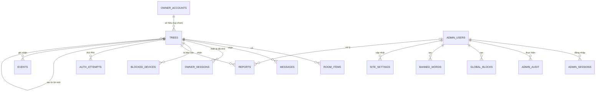
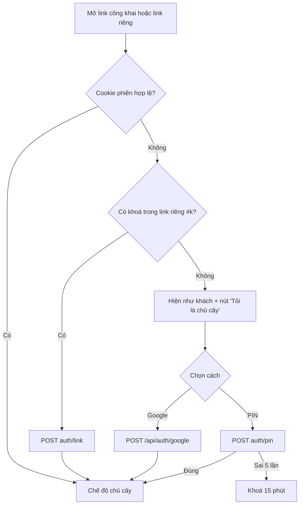
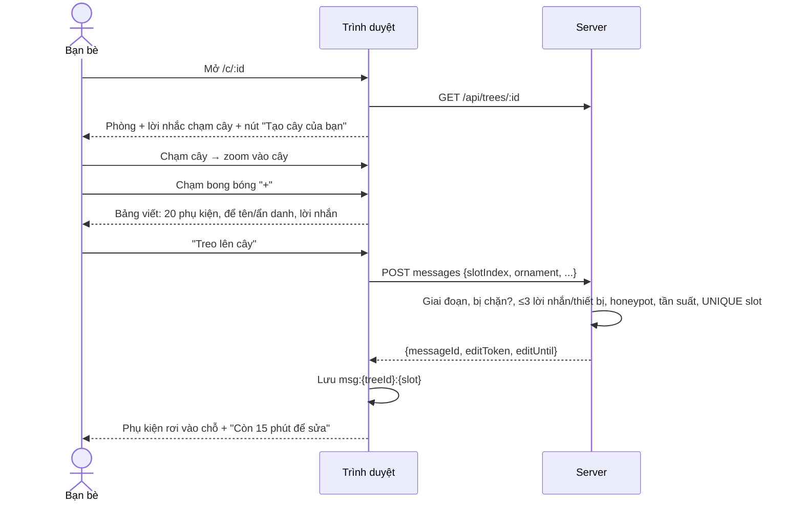
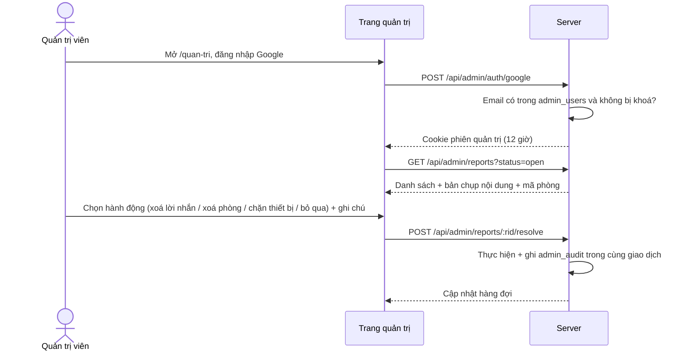

# Cây Thông Lời Nhắn — Đặc tả dự án v3

> Bản v3 thay cho v2. Thay đổi lớn: **phòng tự do** (chủ cây tự sắp đồ), **đồ hoạ màu nước tách lớp**, **20 phụ kiện treo**, **xác thực chủ cây bằng Google hoặc mã PIN**, **sửa lời nhắn trong 15 phút theo thiết bị**.
> Mục có **[CẦN XÁC NHẬN]** là chỗ mình đề xuất mặc định, bạn đồng ý thì giữ.
> Ngày soạn: 16/11/2026. Bản thiết kế đồ hoạ: canvas "Cây Thông Lời Nhắn – Bản thiết kế đồ hoạ".

---

## Mục lục

1. Tổng quan
2. Các quyết định đã chốt
3. Phạm vi chức năng
4. Danh mục đồ hoạ
5. Dòng thời gian & giai đoạn dịch vụ
6. Kiến trúc & công nghệ
7. **Thiết kế cơ sở dữ liệu**
8. Thiết kế API
9. Các luồng hoạt động
10. Bảo mật, quyền riêng tư, chống lạm dụng
11. Giao diện & trải nghiệm
12. Yêu cầu phi chức năng
13. Triển khai Azure & chi phí
14. Kiểm thử
15. Kế hoạch & mốc thời gian
16. Rủi ro
17. Chỉ số thành công
18. Các câu hỏi đã chốt
- Phụ lục A: Ánh xạ chức năng → bảng → API
- Phụ lục B: Thay đổi so với v2

---

## 1. Tổng quan

Mỗi người dùng có một **căn phòng Noel** vẽ theo phong cách màu nước. Trong phòng có **cây thông** (bắt buộc) và các món đồ chủ cây tự chọn, tự kéo thả: cửa sổ, lò sưởi, thảm, hộp quà, chồng quà, thú cưng. Chủ cây gửi link cho bạn bè. Bạn bè mở link, chạm vào cây thì **camera zoom vào cây**, chạm một **bong bóng "+"** để chọn 1 trong 20 phụ kiện treo, viết lời nhắn rồi treo lên cây. Đến **0h ngày 24/12**, chủ cây mới đọc được lời nhắn.

**Cảm xúc cốt lõi:** trang trí căn phòng của riêng mình, rồi háo hức "mở quà" vào đêm Noel.

**Vòng lan truyền:** chủ cây tạo phòng → gửi link → bạn bè treo lời nhắn → nút "Tạo cây của bạn" → bạn bè tạo phòng riêng → lặp lại.

**Nguyên tắc:**
- Không bắt buộc đăng ký.
- Mobile-first, máy tính có bố cục riêng.
- Dịch vụ theo mùa, kết thúc 31/12/2026, xoá dữ liệu sau đó.
- Lời nhắn chỉ chủ cây đọc được.

---

## 2. Các quyết định đã chốt

| # | Nội dung | Quyết định |
|---|---|---|
| 1 | Lời nhắn mỗi điểm | 1 lời nhắn / điểm |
| 2 | Khoá đến đêm Noel | Có, mở lúc 0h 24/12 |
| 3 | Ẩn danh | Người viết tự chọn để tên hoặc ẩn danh |
| 4 | Người viết thấy lời nhắn của nhau | Không |
| 5 | Đăng nhập | Không bắt buộc |
| 6 | Phong cách | Màu nước hoạt hình (cây, phòng, lò sưởi); thú cưng và phụ kiện treo dạng hoạt hình viền mềm, loang màu |
| 7 | Ngôn ngữ, phông | Chỉ tiếng Việt; Amatic SC, Mynerve, Grape Nuts |
| 8 | Thu tiền | Không |
| 9 | Thời hạn | Đến hết 31/12/2026; từ 26/12 có thông báo ngừng và nhắc tải ảnh |
| 10 | Hạ tầng | Azure, credit khoảng 50 USD |
| 11 | Ra mắt | Chạy thử kín 10–12/12, công khai 15/12 |
| 12 | Bố cục phòng | **Phòng tự do**: kéo thả, phóng to/nhỏ, lật, đổi kiểu, thêm/xoá đồ |
| 13 | Xác thực chủ cây | Nhớ thiết bị + **bắt buộc chọn 1 cách khôi phục**: đăng nhập Google hoặc mã PIN 6 số; link riêng làm dự phòng |
| 14 | Sửa lời nhắn | **Trong 15 phút** kể từ lúc tạo, **trên đúng thiết bị đã viết**; khoá sớm hơn nếu chủ cây đã mở |
| 15 | Điểm nhắn | Chủ cây chọn số theo mốc 6/9/12/16/20/25/30; máy tự xếp đều trên tán |
| 16 | Đổi kiểu trên điện thoại | Phương án C: mũi tên ‹ › cạnh món + dải chọn mỏng, camera tự dời tới món |
| 17 | Trên máy tính | Hai bảng bên: trái là khay đồ và phông nền, phải là chỉnh món đang chọn |
| 18 | Cách làm | Làm đầy đủ chức năng, ưu tiên P0 trước |
| 19 | Công nghệ | TypeScript; React + Vite; Fastify; PostgreSQL 16 + Drizzle; pnpm monorepo |
| 20 | Trang quản trị | Có, tại `/quan-tri` |

---

## 3. Phạm vi chức năng

Ký hiệu: **P0** bắt buộc khi ra mắt · **P1** nên có · **P2** nếu còn thời gian.

### 3.1 Trang trí phòng (chủ cây)

| Mã | Chức năng | Ưu tiên |
|---|---|---|
| R1 | Phòng mặc định khi tạo mới (phông, cửa sổ, lò sưởi, thảm, cây, quà, thú cưng đã sắp sẵn) | P0 |
| R2 | Kéo thả để di chuyển món đồ; cửa sổ chỉ nằm trên tường, đồ khác chỉ nằm trên sàn | P0 |
| R3 | Tự xếp lớp: món đứng gần người xem hơn nằm trước; tường → thảm → đồ trên sàn | P0 |
| R4 | Phóng to / thu nhỏ (50%–160%), lật ngang | P0 |
| R5 | Đổi kiểu: mũi tên ‹ › cạnh món (đổi nhanh) và dải chọn mỏng (xem hết kiểu) | P0 |
| R6 | Thêm đồ từ khay; xoá đồ (trừ cây thông); tối đa 25 món | P0 |
| R7 | Đổi phông nền (9 kiểu) | P0 |
| R8 | Cây thông: dáng tán, màu tán, dáng thân, màu gỗ, số điểm nhắn | P0 |
| R9 | Tự lưu (sau mỗi thay đổi, gộp lại 1–2 giây mới gửi) | P0 |
| R10 | Bố cục máy tính với hai bảng bên | P0 |
| R11 | Hoàn tác / làm lại | P1 |
| R12 | Nút "Phòng ngẫu nhiên" | P1 |
| R13 | Giảm số điểm nhắn khi đã có lời nhắn (tự dồn lời nhắn sang chỗ trống) | P1 |
| R14 | Nhân bản một món | P2 |

### 3.2 Bạn bè mở link

| Mã | Chức năng | Ưu tiên |
|---|---|---|
| G1 | Xem phòng, lời nhắc "Chạm vào cây thông để treo lời nhắn", nút "Tạo cây của bạn" | P0 |
| G2 | Chạm cây → zoom mượt vào giữa cây (ở bất kỳ vị trí/kích thước nào), hiện bong bóng "+" và phụ kiện đã treo | P0 |
| G3 | Chạm bong bóng → bảng viết: chọn 1/20 phụ kiện, để tên hoặc ẩn danh, lời nhắn ≤ 300 ký tự | P0 |
| G4 | Treo xong: phụ kiện rơi vào chỗ, thông báo "còn 15 phút để sửa" | P0 |
| G5 | Sửa / xoá lời nhắn của mình trong 15 phút trên cùng thiết bị | P0 |
| G6 | Chạm lò sưởi, quà, thú cưng → hiệu ứng (mỗi lần một hiệu ứng khác) | P0 |
| G7 | Hai người cùng chọn một bong bóng: người sau được báo và chọn chỗ khác | P0 |
| G8 | Báo cáo phòng vi phạm | P1 |
| G9 | Ảnh / ghi âm kèm lời nhắn | P2 |

### 3.3 Chủ cây đọc & quản lý

| Mã | Chức năng | Ưu tiên |
|---|---|---|
| O1 | Mở lại phòng: tự nhận thiết bị; thiết bị khác dùng Google, mã PIN hoặc link riêng | P0 |
| O2 | Trước 0h 24/12: phụ kiện hiện "quà còn gói" + đếm ngược; không đọc được | P0 |
| O3 | Từ 0h 24/12: phụ kiện chưa đọc lấp lánh; chạm → thẻ lời nhắn | P0 |
| O4 | Xoá lời nhắn, chặn thiết bị người gửi, báo cáo | P0 |
| O5 | Xoá phòng và toàn bộ dữ liệu | P0 |
| O6 | Danh sách lời nhắn dạng thẻ (ngoài cách chạm từng phụ kiện) | P1 |
| O7 | Tải ảnh phòng (PNG) và ảnh thẻ lời nhắn | P1 |
| O8 | Đổi mã PIN, liên kết thêm Google sau khi tạo | P1 |
| O9 | Trả lời cảm ơn | P2 |
| O10 | Hiện số lời nhắn đang có (và số mới kể từ lần vào trước); chủ cây bật/tắt được, **mặc định hiện**, lưu theo phòng | P0 |

### 3.4 Chia sẻ & lan truyền

| Mã | Chức năng | Ưu tiên |
|---|---|---|
| S1 | Link ngắn `/c/{id}` (id 8 ký tự) | P0 |
| S2 | Nút chia sẻ: hệ thống (Web Share), Messenger, Zalo, sao chép | P0 |
| S3 | Ảnh xem trước (OG) vẽ từ chính căn phòng | P0 |
| S4 | Ghi nhận phòng tạo từ lời mời (đo hệ số lan truyền) | P0 |
| S5 | Mã QR | P2 |

### 3.5 Vòng đời & quản trị

| Mã | Chức năng | Ưu tiên |
|---|---|---|
| L1 | Khoá đọc đến 0h 24/12 (server quyết định) | P0 |
| L2 | Đóng tạo phòng / gửi lời nhắn / sửa phòng từ 0h 26/12 | P0 |
| L3 | Biểu ngữ từ 26/12: "Hết tháng 12 sẽ ngừng dịch vụ, tải ảnh sớm" | P0 |
| L4 | Từ 0h 01/01/2027: trang kết thúc, API trả 410 | P0 |
| L5 | Xoá toàn bộ dữ liệu ngày 07/01/2027 | P0 |
| L6 | Giới hạn tần suất, honeypot, chặn dò PIN | P0 |
| L7 | **Trang quản trị web** (chi tiết ở mục 3.7 và 9.10) | P0/P1 |
| L8 | Lọc từ ngữ thô tục cơ bản (danh sách từ quản lý trên trang quản trị) | P1 |
| L9 | Sao lưu tự động hằng ngày (dịch vụ PostgreSQL của Azure, giữ 7 ngày) | P0 |

### 3.7 Trang quản trị (`/quan-tri`)

Chỉ dành cho bạn (và người bạn cấp quyền). Đăng nhập bằng Google, chỉ tài khoản có trong danh sách cho phép mới vào được. Mọi thao tác đều ghi nhật ký.

**Nguyên tắc riêng tư:** quản trị viên **không đọc được lời nhắn tuỳ ý**. Chỉ thấy nội dung của lời nhắn **đã bị báo cáo** (bản chụp lúc báo cáo). Trang tra cứu phòng chỉ hiện số liệu, không hiện nội dung.

| Mã | Màn hình / chức năng | Ưu tiên |
|---|---|---|
| A1 | **Đăng nhập** bằng Google + danh sách cho phép; phiên riêng cho quản trị, hết hạn sau 12 giờ | P0 |
| A2 | **Tổng quan:** giai đoạn hiện tại + đếm ngược tới mốc kế tiếp; tổng số phòng, lời nhắn, lượt xem; số mới trong 24 giờ; báo cáo đang chờ; hệ số lan truyền | P0 |
| A3 | **Hàng đợi báo cáo:** danh sách báo cáo đang mở, xem bản chụp nội dung và phòng liên quan; hành động: xoá lời nhắn, xoá phòng, chặn thiết bị toàn hệ thống, bỏ qua; ghi chú lý do | P0 |
| A4 | **Tra cứu phòng** theo mã hoặc link: tên chủ cây, ngày tạo, số món, số lời nhắn (đã đọc / chưa đọc), cách khôi phục đang dùng, số phiên đang mở, số báo cáo; xem ảnh căn phòng (như khách thấy); hành động: xoá phòng, thu hồi mọi phiên chủ cây, mở khoá PIN đang bị khoá | P0 |
| A5 | **Nhật ký thao tác:** ai làm gì, lúc nào, với đối tượng nào | P0 |
| A6 | **Biểu đồ:** phòng mới, lời nhắn mới, lượt xem theo giờ/ngày; phễu khách → treo lời nhắn → tạo phòng riêng; phân bố lựa chọn đồ hoạ (phông, lò sưởi, phụ kiện treo được chọn nhiều nhất) | P1 |
| A7 | **Chặn toàn hệ thống:** danh sách thiết bị / IP (dạng băm) bị chặn, thời hạn, lý do; thêm, gỡ | P1 |
| A8 | **Từ cấm:** thêm, xoá từ; chọn mức xử lý (che bằng dấu \*, hoặc từ chối gửi) | P1 |
| A9 | **Thông báo hệ thống:** bật/tắt biểu ngữ tuỳ chỉnh trên toàn trang (ví dụ báo bảo trì) | P1 |
| A10 | **Tạm dừng khẩn cấp:** tắt tạo phòng mới / tắt gửi lời nhắn mới (khi bị spam), không cần triển khai lại | P1 |
| A11 | **Quản lý quản trị viên:** thêm / gỡ người, vai trò `admin` (toàn quyền) hoặc `moderator` (chỉ xử lý báo cáo) | P1 |
| A12 | **Sao lưu & dữ liệu:** xem trạng thái sao lưu tự động của Azure; nút xoá toàn bộ dữ liệu chỉ hiện sau ngày kết thúc và cần xác nhận 2 bước | P2 |
| A13 | Xuất số liệu tổng hợp (CSV, không có nội dung cá nhân) | P2 |

### 3.6 Đã bỏ khỏi phạm vi

Bảng xếp hạng công khai · màn quản lý nhiều phòng trên một tài khoản (một tài khoản vẫn có thể sở hữu nhiều phòng, xem 8.2) · song ngữ · nhạc ngoài · mở rộng Tết/Valentine · thu tiền · bố cục cố định theo vị trí (thay bằng phòng tự do).

---

## 4. Danh mục đồ hoạ

Mọi đồ hoạ vẽ bằng code (SVG có bộ lọc màu nước) rồi xuất sẵn thành ảnh WebP theo lớp; phần chuyển động là lớp SVG nhẹ hoặc CSS. Toạ độ căn phòng cố định **720 × 1080** (dọc), sàn bắt đầu ở y = 770.

| Nhóm | Mã loại (`item_type`) | Lớp | Biến thể (`variant`) | Số lượng |
|---|---|---|---|---|
| Phông nền | (thuộc tính phòng) | — | night, wood, stone, home, sage, rose, navy, whitebrick, shiplap | 9 |
| Cây thông | `tree` | sàn | main (cấu hình riêng, xem dưới) | 1, bắt buộc |
| Cửa sổ | `window` | tường | wood, white, honey | 3 |
| Lò sưởi | `fireplace` | sàn | classic, stove, rustic, victorian, modern, dome, cabinet, tiled | 8 |
| Thảm | `rug` | thảm | plaid, knit | 2 |
| Chồng quà | `stack` | sàn | warm, pastel | 2 |
| Hộp quà lẻ | `gift` | sàn | red, green, gold, blue, cream, pink, mint, lilac | 8 |
| Thú cưng | `pet` | sàn | cat, dog, deer, bear, owl, penguin | 6 |

**Cấu hình cây thông:**

| Thuộc tính | Giá trị |
|---|---|
| Dáng tán | cloud3 (3 tầng mây), cloud4 (thon cao 4 tầng), puffy (bông tròn), snowy (3 tầng phủ tuyết) |
| Màu tán | teal, green, pine, pink, lavender, frost |
| Dáng thân | straight, flared, stout |
| Màu gỗ | oak, walnut, cedar, birch |
| Số điểm nhắn | 6, 9, 12, 16, 20, 25, 30 |

**20 phụ kiện treo (`ornament`):** sock, star, bulb, ball, candy, bell, gingerbread, heart, snowflake, mitten, minigift, pinecone, bow, snowman, moon, lantern, stripeball, cookie, reindeer, cocoa.

**Danh mục là dữ liệu tĩnh trong code** (`catalog.json`, có trường `version`), dùng chung cho trình duyệt và server để kiểm tra hợp lệ. Không lưu danh mục trong cơ sở dữ liệu vì nó không đổi khi chạy. Thêm kiểu mới chỉ cần thêm ảnh + một dòng danh mục.

**Kích thước tải:** mỗi món 6–90 KB; phông nền 60–250 KB; tải lần đầu một phòng điển hình khoảng 0,5–0,8 MB.

---

## 5. Dòng thời gian & giai đoạn dịch vụ

Múi giờ **Asia/Ho_Chi_Minh (UTC+7)**, server quyết định giai đoạn.

| Giai đoạn | Thời gian | Tạo/sửa phòng | Treo/sửa lời nhắn | Chủ cây đọc | Ghi chú |
|---|---|---|---|---|---|
| `BUILD` | Ra mắt → 23:59:59 ngày 23/12 | Có | Có | Không (quà còn gói) | Đếm ngược |
| `OPEN` | 0h 24/12 → 23:59:59 ngày 25/12 | Có | Có | Có | |
| `NOTICE` | 0h 26/12 → 23:59:59 ngày 31/12 | Không | Không | Có | Biểu ngữ ngừng dịch vụ, tải ảnh |
| `ENDED` | Từ 0h 01/01/2027 | Không | Không | Không | Trang kết thúc, API 410 |
| (xoá dữ liệu) | 0h 07/01/2027 | | | | Chạy tác vụ xoá, xoá resource group |

Quy tắc sửa lời nhắn: chỉ khi `now < edit_until` **và** `read_at IS NULL` **và** giai đoạn cho phép ghi.

Các mốc là biến môi trường (`UNLOCK_AT`, `WRITE_CLOSES_AT`, `SERVICE_ENDS_AT`, `PURGE_AT`); `FAKE_NOW` chỉ dùng khi phát triển.

---

## 6. Kiến trúc & công nghệ

### 6.1 Lựa chọn công nghệ (đã chốt 16/11)

| Lớp | Lựa chọn | Lý do |
|---|---|---|
| Ngôn ngữ | **TypeScript** cho frontend và backend; riêng `packages/shared` là JavaScript (`.mjs`) có kiểu qua JSDoc, không cần bước build | Dùng chung kiểu dữ liệu, danh mục, xếp điểm nhắn, quy tắc kiểm tra; chạy giống nhau trên Node 22 (Azure) và máy phát triển |
| Frontend | **React 19 + Vite** | Nhiều màn có trạng thái (trang trí, dải chọn, bảng bên, viết lời nhắn, đọc lời nhắn, quản trị) |
| Định tuyến | React Router | `/`, `/tao`, `/c/:id`, `/quan-tri/*` |
| Trạng thái phía trình duyệt | Zustand (phòng đang sửa) + TanStack Query (dữ liệu từ server) | Nhẹ, ít khuôn mẫu |
| Kéo thả | Tự viết bằng Pointer Events, cập nhật thẳng `transform` khi đang kéo, chỉ ghi vào state khi thả tay | Giữ 60 khung hình trên điện thoại |
| Backend | **Fastify 5** + plugin cookie, helmet, static; giới hạn tần suất tự viết trên bảng `rate_counters` (7.4) | Nhanh, có kiểm tra dữ liệu, log có cấu trúc |
| Kiểm tra dữ liệu | **Zod** (dùng chung frontend/backend) | Một bộ quy tắc cho form và API |
| Cơ sở dữ liệu | **PostgreSQL 16** (Azure Database for PostgreSQL – Flexible Server) | Chạy được nhiều instance, sao lưu tự động |
| Truy vấn | **Drizzle ORM** + driver `postgres` | Có kiểu TypeScript, gần SQL; migration là file SQL viết tay (7.9) |
| Xác thực | scrypt (Node), `google-auth-library`, cookie HttpOnly | Không lưu mật khẩu, không lưu email người dùng |
| Ảnh OG | `sharp` ghép các lớp WebP | Đã dùng khi xuất đồ hoạ |
| Biểu đồ quản trị | Recharts | |
| Kiểm thử | Vitest, React Testing Library, PGlite, Playwright (vài luồng chính) | |
| Quản lý repo | pnpm workspaces | Một repo, nhiều gói |

### 6.2 Cấu trúc repo

```
cay-thong-loi-nhan/
├─ apps/
│  ├─ web/                 React + Vite
│  │  └─ src/
│  │     ├─ routes/        trang chủ, tạo phòng, phòng (/c/:id), quản trị
│  │     ├─ room/          Scene, Camera, DragLayer, Editor, PickerStrip, SidePanels, Effects
│  │     ├─ guest/         Compose (viết / sửa lời nhắn)
│  │     ├─ owner/         Reader (đếm ngược, mở quà), Auth (PIN, Google, link riêng)
│  │     ├─ admin/         Overview, Reports, TreeLookup, Stats, Blocks, Words, Settings, Admins, Audit
│  │     ├─ art/           hàm vẽ SVG động: thú cưng, phụ kiện treo, lửa, đèn
│  │     └─ styles/        base, room (chuyển động), admin
│  └─ server/              Fastify
│     └─ src/
│        ├─ routes/        trees, room, messages, owner, auth, og, admin
│        ├─ db/            schema Drizzle, migration, truy vấn
│        ├─ phase.ts       giai đoạn theo giờ
│        └─ security.ts    băm, phiên, giới hạn tần suất, từ cấm, chặn
├─ packages/
│  ├─ shared/              catalog, slots, schema Zod, kiểu dữ liệu, hằng số giai đoạn
│  └─ art/                 mã nguồn SVG màu nước + script xuất WebP và catalog.json
├─ tools/design-canvas/    mã sinh các bảng thiết kế trên canvas
└─ docs/
```

### 6.3 Cách chạy khi triển khai

```
Trình duyệt ──HTTPS──> Azure App Service (Fastify)
                         ├─ /assets/*      ảnh WebP, phông (cache dài hạn)
                         ├─ /c/:id         HTML có sẵn thẻ chia sẻ + bản build React
                         ├─ /og/:id.png    ảnh xem trước (lưu đệm theo room_version)
                         └─ /api/*         API ──TLS──> Azure Database for PostgreSQL
```

Một tên miền cho cả trang và API: cookie đơn giản, không cần cấu hình chia sẻ giữa nhiều tên miền.

### 6.4 Ghi chú cài đặt backend (chốt 16/11, cho M1)

- **Cấu trúc:** `buildApp({ db, now })` dựng ứng dụng Fastify; test truyền PGlite + đồng hồ giả, chạy thật truyền PostgreSQL. Mọi kiểm tra giai đoạn vẫn qua `phase.ts`.
- **Phiên chủ cây** hết hạn ở `PURGE_AT` (nhớ thiết bị suốt mùa).
- **Băm IP:** muối theo ngày = HMAC(`PEPPER`, ngày giờ VN), mọi instance tính ra giống nhau; danh sách chặn IP dùng `BLOCK_IP_KEY` cố định.
- **Honeypot** (`website` có giá trị): trả kết quả thành công giả, không lưu gì.
- **Chủ cây không treo lời nhắn** lên cây của mình (8.8): có cookie chủ cây → 403.
- **Giảm số điểm nhắn** (P0): còn lời nhắn ở chỉ số ≥ số điểm mới → 409 kèm lý do; tự dồn là R13 (P1).
- **Vị trí khi lưu phòng:** món lớp `wall` có y < `floorY`, món khác y ≥ `floorY` (lấy từ `catalog.json`).
- **Có ở M1:** kiểm tra `global_blocks` và `pause_*` trước thao tác ghi (bảng trống đến khi có trang quản trị). **Để M7:** lọc từ cấm.
- **`events`:** M1 chỉ ghi sự kiện server tự biết (tạo phòng, lưu phòng, treo/sửa/gỡ, mở lời nhắn); sự kiện chỉ trình duyệt biết để M3.
- **Google:** test dùng bộ xác minh giả; thiếu `GOOGLE_CLIENT_ID` thì API Google trả 503, PIN vẫn chạy.
- **Chống giả mạo yêu cầu:** API ghi chỉ nhận `Content-Type: application/json`, kết hợp cookie `SameSite=Lax`.

---

## 7. Thiết kế cơ sở dữ liệu

### 7.1 Nguyên tắc

- **Không lưu khoá thô.** Mọi mã bí mật (link riêng, PIN, phiên thiết bị, mã sửa lời nhắn) chỉ lưu dạng băm.
- **Không lưu IP thô.** IP băm với muối đổi theo ngày, chỉ dùng chống lạm dụng.
- **Vị trí điểm nhắn không lưu.** Chỉ lưu `slot_index`; toạ độ tính lại từ dáng tán + số điểm bằng `slots.mjs` (cùng code ở hai phía).
- **Danh mục đồ hoạ không lưu.** Chỉ lưu mã loại và mã kiểu; server kiểm tra với `catalog.json`.
- **Xoá phòng là xoá thật** (`ON DELETE CASCADE`), không giữ bản ẩn.
- Thời gian lưu kiểu `timestamptz` (UTC); mốc giai đoạn so sánh ở tầng ứng dụng theo giờ Việt Nam (UTC+7).
- Mọi thao tác ghi nhiều bảng chạy trong **một giao dịch**; chỗ có tranh chấp (2 người cùng treo một điểm, lưu phòng) dựa vào ràng buộc UNIQUE và `room_version` thay vì khoá dài.
- Truy cập qua **Drizzle ORM** (TypeScript); file migration SQL viết tay nằm trong `apps/server/src/db/migrations/`.

### 7.2 Sơ đồ quan hệ



Tổng cộng **16 bảng**: 10 bảng cho người dùng (`owner_accounts`, `trees`, `room_items`, `owner_sessions`, `messages`, `blocked_devices`, `auth_attempts`, `rate_counters`, `reports`, `events`) và 6 bảng cho quản trị (`admin_users`, `admin_sessions`, `admin_audit`, `global_blocks`, `banned_words`, `site_settings`).

### 7.3 Lược đồ (PostgreSQL 16)

Đã chạy thử toàn bộ trên PostgreSQL (bản nhúng PGlite): 16 bảng tạo được; các ràng buộc chính (mỗi phòng 1 cây, bắt buộc có cách khôi phục, 1 lời nhắn/điểm, ẩn danh không có tên, giới hạn độ dài, email quản trị không trùng hoa/thường, xoá phòng xoá sạch) đều chặn đúng.

```sql
-- Cây Thông Lời Nhắn — lược đồ PostgreSQL 16
-- Thời gian: timestamptz (UTC). Mã bí mật chỉ lưu dạng băm. Không lưu IP thô.

-- ===== Người dùng =====

CREATE TABLE owner_accounts (
  id            bigint GENERATED ALWAYS AS IDENTITY PRIMARY KEY,
  google_sub    text NOT NULL UNIQUE,              -- mã người dùng Google ("sub"); không lưu email
  display_name  text CHECK (display_name IS NULL OR char_length(display_name) <= 60),
  created_at    timestamptz NOT NULL DEFAULT now(),
  last_login_at timestamptz
);

CREATE TABLE trees (
  id                  text PRIMARY KEY CHECK (id ~ '^[a-z2-9]{8}$'),  -- 8 ký tự base32 bỏ ký tự dễ nhầm
  owner_account_id    bigint REFERENCES owner_accounts(id) ON DELETE SET NULL,
  owner_name          text NOT NULL CHECK (char_length(owner_name) BETWEEN 1 AND 30),
  title               text CHECK (title IS NULL OR char_length(title) <= 40),

  -- xác thực chủ cây
  private_key_hash    text NOT NULL,                                  -- HMAC khoá trong link riêng
  pin_hash            text,                                           -- scrypt(PIN 6 số); NULL nếu chỉ dùng Google
  pin_failed_count    smallint NOT NULL DEFAULT 0,
  pin_locked_until    timestamptz,
  pin_last_failed_at  timestamptz,                                    -- thêm ở migration 0002: mốc lần sai PIN cuối (cửa sổ 15 phút)

  -- phòng và cấu hình cây
  background          text NOT NULL DEFAULT 'night',
  tree_shape          text NOT NULL DEFAULT 'cloud3' CHECK (tree_shape IN ('cloud3','cloud4','puffy','snowy')),
  tree_palette        text NOT NULL DEFAULT 'teal'   CHECK (tree_palette IN ('teal','green','pine','pink','lavender','frost')),
  trunk_shape         text NOT NULL DEFAULT 'straight' CHECK (trunk_shape IN ('straight','flared','stout')),
  trunk_wood          text NOT NULL DEFAULT 'oak'    CHECK (trunk_wood IN ('oak','walnut','cedar','birch')),
  slot_count          smallint NOT NULL DEFAULT 12   CHECK (slot_count IN (6,9,12,16,20,25,30)),

  room_version        integer NOT NULL DEFAULT 1,                     -- chống ghi đè khi sửa trên 2 thiết bị
  catalog_version     integer NOT NULL DEFAULT 1,
  ref_tree_id         text REFERENCES trees(id) ON DELETE SET NULL,   -- phòng tạo ra từ lời mời của phòng nào
  creator_ip_hash     text,
  created_at          timestamptz NOT NULL DEFAULT now(),
  updated_at          timestamptz NOT NULL DEFAULT now(),
  last_owner_visit_at timestamptz,
  show_message_count  boolean NOT NULL DEFAULT true,               -- O10; thêm ở migration 0001

  CONSTRAINT trees_has_recovery CHECK (pin_hash IS NOT NULL OR owner_account_id IS NOT NULL)
);
CREATE INDEX idx_trees_owner   ON trees(owner_account_id);
CREATE INDEX idx_trees_ref     ON trees(ref_tree_id);
CREATE INDEX idx_trees_created ON trees(created_at);

CREATE TABLE room_items (
  id          bigint GENERATED ALWAYS AS IDENTITY PRIMARY KEY,
  tree_id     text NOT NULL REFERENCES trees(id) ON DELETE CASCADE,
  client_id   text NOT NULL CHECK (char_length(client_id) BETWEEN 1 AND 24),  -- mã do trình duyệt sinh
  item_type   text NOT NULL CHECK (item_type IN ('tree','window','fireplace','rug','stack','gift','pet')),
  variant     text NOT NULL CHECK (char_length(variant) BETWEEN 1 AND 24), -- kiểm tra theo catalog ở tầng ứng dụng
  x           double precision NOT NULL CHECK (x BETWEEN 0 AND 720),        -- điểm neo trong khung 720x1080
  y           double precision NOT NULL CHECK (y BETWEEN 0 AND 1080),
  scale       real NOT NULL DEFAULT 1 CHECK (scale BETWEEN 0.5 AND 1.6),
  flip        boolean NOT NULL DEFAULT false,
  UNIQUE (tree_id, client_id)
);
CREATE INDEX idx_items_tree ON room_items(tree_id);
CREATE UNIQUE INDEX uq_one_tree_per_room ON room_items(tree_id) WHERE item_type = 'tree';

CREATE TABLE owner_sessions (
  id           bigint GENERATED ALWAYS AS IDENTITY PRIMARY KEY,
  tree_id      text NOT NULL REFERENCES trees(id) ON DELETE CASCADE,
  token_hash   text NOT NULL UNIQUE,                                  -- HMAC token trong cookie HttpOnly
  method       text NOT NULL CHECK (method IN ('create','link','pin','google')),
  created_at   timestamptz NOT NULL DEFAULT now(),
  last_seen_at timestamptz,
  expires_at   timestamptz NOT NULL,
  revoked_at   timestamptz
);
CREATE INDEX idx_sessions_tree ON owner_sessions(tree_id);

CREATE TABLE messages (
  id              bigint GENERATED ALWAYS AS IDENTITY PRIMARY KEY,
  tree_id         text NOT NULL REFERENCES trees(id) ON DELETE CASCADE,
  slot_index      smallint NOT NULL CHECK (slot_index BETWEEN 0 AND 29),
  ornament        text NOT NULL CHECK (ornament IN ('sock','star','bulb','ball','candy','bell','gingerbread','heart',
                    'snowflake','mitten','minigift','pinecone','bow','snowman','moon','lantern','stripeball','cookie','reindeer','cocoa')),
  is_anonymous    boolean NOT NULL DEFAULT false,
  author_name     text CHECK (author_name IS NULL OR char_length(author_name) BETWEEN 1 AND 30),
  content         text NOT NULL CHECK (char_length(content) BETWEEN 1 AND 300),
  edit_token_hash text NOT NULL,                                      -- HMAC token sửa lưu trên thiết bị người viết
  edit_until      timestamptz NOT NULL,                               -- created_at + 15 phút, không kéo dài khi sửa
  device_hash     text NOT NULL,
  ip_hash         text,
  created_at      timestamptz NOT NULL DEFAULT now(),
  updated_at      timestamptz NOT NULL DEFAULT now(),
  read_at         timestamptz,                                        -- NULL = chưa mở
  UNIQUE (tree_id, slot_index),
  CONSTRAINT messages_anon_name CHECK ((is_anonymous AND author_name IS NULL) OR (NOT is_anonymous AND author_name IS NOT NULL))
);
CREATE INDEX idx_messages_tree_device ON messages(tree_id, device_hash);

CREATE TABLE blocked_devices (
  tree_id     text NOT NULL REFERENCES trees(id) ON DELETE CASCADE,
  device_hash text NOT NULL,
  created_at  timestamptz NOT NULL DEFAULT now(),
  PRIMARY KEY (tree_id, device_hash)
);

CREATE TABLE auth_attempts (
  id         bigint GENERATED ALWAYS AS IDENTITY PRIMARY KEY,
  tree_id    text REFERENCES trees(id) ON DELETE CASCADE,
  ip_hash    text NOT NULL,
  method     text NOT NULL CHECK (method IN ('pin','link','google','admin')),
  success    boolean NOT NULL,
  created_at timestamptz NOT NULL DEFAULT now()
);
CREATE INDEX idx_auth_ip_time   ON auth_attempts(ip_hash, created_at);
CREATE INDEX idx_auth_tree_time ON auth_attempts(tree_id, created_at);

-- Giới hạn tần suất dùng chung giữa nhiều instance (thay cho bộ nhớ trong tiến trình)
CREATE TABLE rate_counters (
  bucket      text NOT NULL,              -- vd 'create:ip:<hash>', 'msg:ip:<hash>', 'save:tree:<id>'
  window_start timestamptz NOT NULL,      -- đầu khung giờ
  hits        integer NOT NULL DEFAULT 0,
  PRIMARY KEY (bucket, window_start)
);

-- ===== Quản trị =====

CREATE TABLE admin_users (
  id            bigint GENERATED ALWAYS AS IDENTITY PRIMARY KEY,
  google_sub    text UNIQUE,
  email         text NOT NULL,
  role          text NOT NULL DEFAULT 'moderator' CHECK (role IN ('admin','moderator')),
  disabled      boolean NOT NULL DEFAULT false,
  created_by    bigint REFERENCES admin_users(id),
  created_at    timestamptz NOT NULL DEFAULT now(),
  last_login_at timestamptz
);
CREATE UNIQUE INDEX uq_admin_email ON admin_users (lower(email));

CREATE TABLE admin_sessions (
  id         bigint GENERATED ALWAYS AS IDENTITY PRIMARY KEY,
  admin_id   bigint NOT NULL REFERENCES admin_users(id) ON DELETE CASCADE,
  token_hash text NOT NULL UNIQUE,
  created_at timestamptz NOT NULL DEFAULT now(),
  expires_at timestamptz NOT NULL,                                    -- 12 giờ
  revoked_at timestamptz
);

CREATE TABLE reports (
  id               bigint GENERATED ALWAYS AS IDENTITY PRIMARY KEY,
  tree_id          text NOT NULL REFERENCES trees(id) ON DELETE CASCADE,
  message_id       bigint,                                            -- NULL nếu báo cáo cả phòng
  message_snapshot text,                                              -- chép nội dung lúc báo cáo
  reason           text CHECK (reason IS NULL OR char_length(reason) <= 200),
  reporter         text NOT NULL CHECK (reporter IN ('owner','guest')),
  reporter_hash    text,
  status           text NOT NULL DEFAULT 'open' CHECK (status IN ('open','resolved','dismissed')),
  resolution       text CHECK (resolution IS NULL OR resolution IN ('message_deleted','tree_deleted','device_blocked','no_action')),
  handled_by       bigint REFERENCES admin_users(id) ON DELETE SET NULL,
  handled_at       timestamptz,
  created_at       timestamptz NOT NULL DEFAULT now()
);
CREATE INDEX idx_reports_open ON reports(created_at) WHERE status = 'open';

CREATE TABLE admin_audit (
  id          bigint GENERATED ALWAYS AS IDENTITY PRIMARY KEY,
  admin_id    bigint REFERENCES admin_users(id) ON DELETE SET NULL,
  action      text NOT NULL,
  target_type text CHECK (target_type IN ('tree','message','report','block','word','setting','admin','system')),
  target_id   text,
  note        text CHECK (note IS NULL OR char_length(note) <= 500),
  created_at  timestamptz NOT NULL DEFAULT now()
);
CREATE INDEX idx_audit_time ON admin_audit(created_at);

CREATE TABLE global_blocks (
  id         bigint GENERATED ALWAYS AS IDENTITY PRIMARY KEY,
  kind       text NOT NULL CHECK (kind IN ('device','ip')),
  value_hash text NOT NULL,
  reason     text CHECK (reason IS NULL OR char_length(reason) <= 200),
  created_by bigint REFERENCES admin_users(id) ON DELETE SET NULL,
  created_at timestamptz NOT NULL DEFAULT now(),
  expires_at timestamptz,
  UNIQUE (kind, value_hash)
);

CREATE TABLE banned_words (
  id         bigint GENERATED ALWAYS AS IDENTITY PRIMARY KEY,
  word       text NOT NULL UNIQUE CHECK (char_length(word) BETWEEN 1 AND 40),  -- chữ thường, bỏ dấu
  action     text NOT NULL DEFAULT 'mask' CHECK (action IN ('mask','reject')),
  created_by bigint REFERENCES admin_users(id) ON DELETE SET NULL,
  created_at timestamptz NOT NULL DEFAULT now()
);

CREATE TABLE site_settings (
  key        text PRIMARY KEY CHECK (key IN ('banner_text','banner_enabled','pause_create','pause_messages')),
  value      text NOT NULL,
  updated_by bigint REFERENCES admin_users(id) ON DELETE SET NULL,
  updated_at timestamptz NOT NULL DEFAULT now()
);

-- ===== Thống kê =====

CREATE TABLE events (
  id         bigint GENERATED ALWAYS AS IDENTITY PRIMARY KEY,
  type       text NOT NULL CHECK (type IN ('tree_created','room_saved','tree_viewed_guest','tree_zoomed',
               'compose_opened','message_created','message_edited','message_deleted_by_author',
               'message_opened','cta_clicked','image_downloaded')),
  tree_id    text,
  created_at timestamptz NOT NULL DEFAULT now()
);
CREATE INDEX idx_events_type_time ON events(type, created_at);

-- Tự cập nhật updated_at
CREATE FUNCTION touch_updated_at() RETURNS trigger LANGUAGE plpgsql AS $$
BEGIN NEW.updated_at := now(); RETURN NEW; END $$;
CREATE TRIGGER trg_trees_touch    BEFORE UPDATE ON trees    FOR EACH ROW EXECUTE FUNCTION touch_updated_at();
CREATE TRIGGER trg_messages_touch BEFORE UPDATE ON messages FOR EACH ROW EXECUTE FUNCTION touch_updated_at();
```

### 7.4 Quy tắc dữ liệu và cách bảo đảm

| Quy tắc | Bảo đảm bằng |
|---|---|
| 1 điểm nhắn = 1 lời nhắn | `UNIQUE (tree_id, slot_index)`; người đến sau nhận 409 |
| `slot_index` < số điểm nhắn hiện tại | Kiểm tra trong giao dịch ghi (CHECK không đọc được bảng khác) |
| Mỗi phòng đúng 1 cây | Index duy nhất có điều kiện `uq_one_tree`; API không cho xoá cây |
| Tối đa 25 món | Kiểm tra trong giao dịch lưu phòng |
| Mã kiểu hợp lệ | Kiểm tra với `catalog.json` trước khi ghi |
| Có ít nhất một cách khôi phục | `CHECK (pin_hash IS NOT NULL OR owner_account_id IS NOT NULL)` |
| Ẩn danh không lưu tên | `CHECK` trên `messages` |
| Sửa lời nhắn trong 15 phút | `edit_until` tính lúc tạo, không đổi khi sửa; so với giờ server |
| Không sửa sau khi chủ cây đã mở | Điều kiện `read_at IS NULL` trong câu `UPDATE ... WHERE` |
| Hai thiết bị cùng sửa phòng | `room_version`: gửi kèm phiên bản đang có; lệch thì trả 409 và gửi bản mới |
| Mỗi thiết bị tối đa 3 lời nhắn / phòng | Đếm theo `(tree_id, device_hash)` trong giao dịch |
| Giới hạn tần suất dùng chung khi chạy nhiều instance | Bảng `rate_counters`: `INSERT ... ON CONFLICT DO UPDATE SET hits = hits + 1 RETURNING hits`; dọn khung cũ hằng giờ |
| `updated_at` luôn đúng | Trigger `touch_updated_at` trên `trees`, `messages` |
| Thiết bị / IP bị chặn toàn hệ thống | Kiểm tra `global_blocks` (còn hạn) trước mọi thao tác ghi; kết quả lưu đệm 60 giây |
| Từ cấm | So khớp sau khi chuyển chữ thường và bỏ dấu; `mask` thì thay bằng `***`, `reject` thì trả 400 |
| Tạm dừng khẩn cấp | Đọc `site_settings.pause_create`, `pause_messages` (lưu đệm 30 giây) |
| Quản trị viên chỉ đọc lời nhắn bị báo cáo | API quản trị không có đường đọc `messages.content`; chỉ trả `reports.message_snapshot` |
| Mọi thao tác quản trị có dấu vết | Ghi `admin_audit` trong cùng giao dịch với thao tác |
| Xoá phòng xoá sạch | `ON DELETE CASCADE` trên mọi bảng con |

### 7.5 Lưu phòng: cách ghi

Trình duyệt gửi **toàn bộ trạng thái phòng** (phông, cấu hình cây, danh sách món) kèm `room_version`. Server trong một giao dịch:

1. Kiểm tra giai đoạn, quyền chủ cây, `room_version` khớp.
2. Kiểm tra hợp lệ (danh mục, giới hạn toạ độ, ≤ 25 món, đúng 1 cây).
3. Nếu đổi `tree_shape` hoặc `slot_count`: kiểm tra số lời nhắn hiện có ≤ số điểm mới. Lời nhắn có `slot_index` ≥ số điểm mới được dồn sang chỉ số trống nhỏ nhất (P1; ở P0 chỉ cho phép khi không cần dồn).
4. Xoá các món không còn trong danh sách, chèn/cập nhật phần còn lại theo `client_id`.
5. Tăng `room_version`, cập nhật `updated_at`, xoá đệm ảnh OG.

Trình duyệt gộp các thay đổi trong 1,5 giây rồi mới gửi, nên kéo thả liên tục không tạo nhiều lượt ghi.

### 7.6 Dữ liệu trên trình duyệt

| Nơi lưu | Khoá | Giá trị | Dùng để |
|---|---|---|---|
| Cookie HttpOnly, Secure, SameSite=Lax | `ctln_owner_{treeId}` | token phiên chủ cây | Tự nhận chủ cây trên thiết bị này |
| localStorage | `deviceId` | UUID ngẫu nhiên | Nhận diện thiết bị khi viết lời nhắn |
| localStorage | `msg:{treeId}:{slot}` | `{ messageId, editToken, editUntil }` | Sửa lời nhắn trong 15 phút |
| localStorage | `lastName` | tên đã nhập | Điền sẵn lần sau |
| localStorage | `draft:{treeId}` | trạng thái phòng chưa lưu | Không mất thay đổi khi rớt mạng |

Ghi chú: trình duyệt trong Zalo/Messenger có bộ nhớ riêng, nên chủ cây mở bằng trình duyệt khác cần đăng nhập lại bằng Google hoặc PIN. Đây là lý do bắt buộc chọn cách khôi phục.

### 7.7 Quy mô & dung lượng

| Đại lượng | Ước tính cả mùa |
|---|---|
| Phòng | 5.000 – 20.000 |
| Món đồ | ~10 / phòng → 50.000 – 200.000 dòng |
| Lời nhắn | ~8 / phòng → 40.000 – 160.000 dòng |
| Dung lượng DB | dưới 200 MB |
| Ghi đỉnh | vài chục lượt/giây (đêm 23–24/12) — PostgreSQL gói Burstable xử lý thoải mái; nhóm kết nối tối đa 10 / instance |

### 7.8 Lưu giữ & xoá

| Dữ liệu | Giữ đến |
|---|---|
| Phòng, lời nhắn, phiên, báo cáo | 07/01/2027 (hoặc khi chủ cây xoá) |
| `auth_attempts` | 7 ngày (dọn hằng ngày) |
| `admin_sessions` | Hết hạn sau 12 giờ, dọn hằng ngày |
| `admin_audit`, `admin_users` | 07/01/2027 (xoá cùng toàn bộ dữ liệu) |
| `events` | 07/01/2027, chỉ dùng thống kê tổng |
| Bản sao lưu tự động của Azure | Mất cùng lúc khi xoá máy chủ PostgreSQL ngày 07/01/2027 |

### 7.9 Kết nối, migration, sao lưu

- **Kết nối:** driver `postgres` (postgres.js) qua Drizzle, nhóm kết nối 10 / instance, bắt buộc TLS tới Azure.
- **Migration:** file SQL viết tay trong `apps/server/src/db/migrations/` là gốc; `schema.ts` của Drizzle chỉ để có kiểu khi truy vấn, có test đối chiếu với CSDL. Script tự viết chạy các file theo thứ tự khi khởi động server (giữ khoá `pg_advisory_lock`), ghi file đã chạy vào bảng `meta.migrations` (schema riêng, không tính vào 16 bảng).
- **Sao lưu:** Azure tự sao lưu hằng ngày, giữ 7 ngày, khôi phục về một thời điểm bất kỳ. Không cần tự viết script sao lưu như SQLite.
- **Môi trường phát triển:** PostgreSQL chạy bằng Docker trên máy; kiểm thử tự động dùng PGlite (PostgreSQL chạy trong tiến trình, không cần cài).
- **Xoá cuối mùa:** sau 07/01/2027 xoá luôn máy chủ PostgreSQL, toàn bộ dữ liệu và bản sao lưu biến mất cùng lúc.

---

## 8. Thiết kế API

JSON, UTF-8. Header `X-Device-Id` cho người viết. Quyền chủ cây qua cookie phiên. Mã lỗi: 400 sai dữ liệu · 401 chưa xác thực · 403 bị chặn / không có quyền · 404 không thấy · 409 xung đột (điểm đã có người treo, `room_version` lệch) · 410 dịch vụ kết thúc · 423 chưa đến giờ mở · 429 quá nhiều yêu cầu.

### 8.1 Chung
| Phương thức | Đường dẫn | Mô tả |
|---|---|---|
| GET | `/api/config` | `{ now, phase, unlockAt, writeClosesAt, serviceEndsAt, catalogVersion, limits }` |

### 8.2 Tạo phòng & xác thực chủ cây
| Phương thức | Đường dẫn | Mô tả |
|---|---|---|
| POST | `/api/trees` | Tạo phòng. Body: `ownerName, title?, recovery: { type: 'pin', pin } \| { type: 'google', idToken }, room, ref?`. Trả `{ id, publicUrl, privateUrl, roomVersion }` và đặt cookie phiên. `privateUrl` chỉ trả một lần |
| POST | `/api/trees/:id/auth/link` | Đăng nhập bằng khoá trong link riêng (`#k=...`) → đặt cookie |
| POST | `/api/trees/:id/auth/pin` | Body `{ pin }` → đặt cookie; sai 5 lần thì khoá 15 phút |
| POST | `/api/auth/google` | Body `{ idToken, treeId? }`. Có `treeId` → đặt cookie nếu tài khoản sở hữu phòng đó. Không có → trả danh sách phòng `{ id, title }` của tài khoản để chọn rồi gọi lại kèm `treeId` |
| POST | `/api/trees/:id/auth/logout` | Thu hồi phiên trên thiết bị này |
| PUT | `/api/trees/:id/recovery` | Đổi PIN / liên kết Google (P1) |

### 8.3 Phòng
| Phương thức | Đường dẫn | Quyền | Mô tả |
|---|---|---|---|
| GET | `/api/trees/:id` | Công khai | Phòng: phông, cấu hình cây, món đồ, trạng thái từng điểm nhắn `{ index, occupied, ornament? }` — không có nội dung, tên |
| PUT | `/api/trees/:id/room` | Chủ cây | Lưu toàn bộ phòng kèm `roomVersion` (xem 7.5) |
| DELETE | `/api/trees/:id` | Chủ cây | Xoá phòng và mọi dữ liệu |
| GET | `/api/trees/:id/owner` | Chủ cây | Như GET công khai + `{ messageId, unread, locked }` cho từng điểm + `{ messageCount, newSinceLastVisit, showMessageCount }` |
| PUT | `/api/trees/:id/settings` | Chủ cây | `{ showMessageCount }` — bật/tắt hiện số lời nhắn (O10) |

### 8.4 Lời nhắn (người viết)
| Phương thức | Đường dẫn | Mô tả |
|---|---|---|
| POST | `/api/trees/:id/messages` | Body `{ slotIndex, ornament, anonymous, authorName?, content, website }` → `{ messageId, editToken, editUntil }` |
| GET | `/api/messages/:mid/mine` | Header `X-Edit-Token` → nội dung của chính người viết (để mở bảng sửa) |
| PUT | `/api/messages/:mid` | Sửa `ornament, anonymous, authorName, content`; điều kiện ở 7.4 |
| DELETE | `/api/messages/:mid` | Người viết gỡ lời nhắn; cùng điều kiện |

### 8.5 Chủ cây đọc & quản lý
| Phương thức | Đường dẫn | Mô tả |
|---|---|---|
| POST | `/api/trees/:id/messages/:mid/open` | Trả nội dung, đặt `read_at`; 423 nếu chưa tới `UNLOCK_AT` |
| GET | `/api/trees/:id/messages` | Danh sách lời nhắn đã mở được (P1) |
| DELETE | `/api/trees/:id/messages/:mid` | Chủ cây xoá |
| POST | `/api/trees/:id/block` | `{ messageId }` → chặn thiết bị người gửi, xoá lời nhắn |
| POST | `/api/trees/:id/reports` | Báo cáo (chủ cây hoặc khách) |

### 8.6 Trang & ảnh
| Phương thức | Đường dẫn | Mô tả |
|---|---|---|
| GET | `/c/:id` | HTML có sẵn thẻ OG |
| GET | `/og/:id.png` | Ảnh xem trước 1200×630, lưu đệm theo `room_version` |
| GET | `/da-ket-thuc` | Trang kết thúc |

### 8.7 Quản trị (`/api/admin/*`, cookie phiên quản trị riêng)

| Phương thức | Đường dẫn | Vai trò | Mô tả |
|---|---|---|---|
| POST | `/api/admin/auth/google` | — | Đăng nhập; chỉ email có trong `admin_users` và không bị khoá |
| POST | `/api/admin/auth/logout` | cả hai | Đăng xuất |
| GET | `/api/admin/overview` | cả hai | Giai đoạn, tổng số, số mới 24 giờ, báo cáo chờ, hệ số lan truyền |
| GET | `/api/admin/stats?range=24h\|7d\|season` | admin | Chuỗi số liệu cho biểu đồ, phễu, phân bố lựa chọn đồ hoạ |
| GET | `/api/admin/reports?status=open` | cả hai | Hàng đợi báo cáo kèm bản chụp nội dung |
| POST | `/api/admin/reports/:rid/resolve` | cả hai | `{ action: 'delete_message' \| 'delete_tree' \| 'block_device' \| 'dismiss', note }` |
| GET | `/api/admin/trees/:id` | cả hai | Thông tin tra cứu phòng (không có nội dung lời nhắn) |
| DELETE | `/api/admin/trees/:id` | admin | Xoá phòng |
| POST | `/api/admin/trees/:id/revoke-sessions` | admin | Thu hồi mọi phiên chủ cây |
| POST | `/api/admin/trees/:id/unlock-pin` | admin | Mở khoá PIN đang bị khoá |
| GET/POST/DELETE | `/api/admin/blocks` | admin | Danh sách / thêm / gỡ chặn toàn hệ thống |
| GET/POST/DELETE | `/api/admin/words` | admin | Từ cấm |
| GET/PUT | `/api/admin/settings` | admin | Biểu ngữ, tạm dừng tạo phòng / gửi lời nhắn |
| GET/POST/PATCH | `/api/admin/admins` | admin | Mời, đổi vai trò, khoá quản trị viên |
| GET | `/api/admin/audit` | admin | Nhật ký thao tác |
| GET | `/api/admin/export.csv` | admin | Số liệu tổng hợp (P2) |

Quản trị viên đầu tiên được tạo từ biến môi trường `ADMIN_BOOTSTRAP_EMAIL` khi khởi động lần đầu.

### 8.8 Ma trận quyền

| Hành động | Khách | Người viết (đúng thiết bị, trong 15 phút) | Chủ cây |
|---|---|---|---|
| Xem phòng, điểm trống / đã có | Có | Có | Có |
| Đọc nội dung | Không | Chỉ của mình | Có, từ 0h 24/12 |
| Treo lời nhắn | Có | Có | Không |
| Sửa / gỡ lời nhắn | Không | Có (nếu chưa bị mở) | Xoá được mọi lời nhắn |
| Sửa phòng | Không | Không | Có (đến hết 25/12) |
| Chặn, báo cáo | Báo cáo phòng | Báo cáo phòng | Có |

---

## 9. Các luồng hoạt động

### 9.1 Tạo phòng

```mermaid
sequenceDiagram
    actor U as Chủ cây
    participant B as Trình duyệt
    participant S as Server
    U->>B: "Tạo cây của bạn"
    B-->>U: Phòng mặc định ở chế độ trang trí
    U->>B: Kéo thả, đổi kiểu, thêm đồ, chỉnh cây
    U->>B: "Hoàn tất" → nhập tên, tiêu đề
    B-->>U: Chọn cách khôi phục: Đăng nhập Google hoặc đặt PIN 6 số
    B->>S: POST /api/trees {room, ownerName, recovery, ref?}
    S->>S: Kiểm tra giai đoạn, tần suất, danh mục; băm PIN hoặc xác minh Google
    S-->>B: {id, publicUrl, privateUrl} + cookie phiên
    B-->>U: Màn hình chia sẻ + nhắc lưu link riêng / ghi nhớ PIN
```

Trước khi bấm "Hoàn tất", phòng chỉ nằm trên trình duyệt (bản nháp), nên người dùng có thể nghịch thoải mái mà không tạo dữ liệu rác.

### 9.2 Chủ cây mở lại phòng



### 9.3 Trang trí phòng (tự lưu)

1. Mọi thao tác (kéo, đổi kiểu, phóng to, thêm, xoá) cập nhật giao diện ngay.
2. Sau 1,5 giây không thao tác, gửi `PUT /room` kèm `roomVersion`.
3. Lệch phiên bản (409): hiện "Phòng vừa được sửa ở thiết bị khác" và tải bản mới.
4. Mất mạng: giữ bản nháp trong localStorage, thử lại khi có mạng; hiện chấm trạng thái "Đã lưu / Đang lưu / Chưa lưu".

### 9.4 Bạn bè treo lời nhắn



### 9.5 Sửa / gỡ lời nhắn trong 15 phút

- Chạm phụ kiện của mình: nếu máy còn `editToken` và `now < editUntil` → mở bảng sửa (có nút "Lưu thay đổi", "Xoá lời nhắn", số phút còn lại).
- Hết hạn hoặc chủ cây đã mở: thông báo không sửa được nữa.
- Thiết bị khác hoặc trình duyệt khác: không có token → không sửa được (chấp nhận được vì cửa sổ chỉ 15 phút).

### 9.6 Chủ cây đọc lời nhắn

- Trước 0h 24/12: phụ kiện nhạt màu có nơ ("quà còn gói"), thanh đếm ngược; API mở trả 423.
- Từ 0h 24/12: phụ kiện chưa đọc lấp lánh; chạm → thẻ lời nhắn (tên hoặc "Ẩn danh", nội dung, thời gian), nút Xoá / Chặn / Báo cáo, nút chuyển thẻ trước/sau.

### 9.7 Kiểm duyệt, chia sẻ, vòng đời

Giữ như v2: xoá / chặn / báo cáo; chia sẻ qua Web Share, Messenger, Zalo, sao chép; OG image; NOTICE từ 26/12 với nút tải ảnh; ENDED từ 01/01/2027; xoá dữ liệu 07/01/2027.

### 9.8 Quản trị xử lý báo cáo



### 9.9 Tạm dừng khẩn cấp

Khi bị spam tạo phòng hoặc lời nhắn hàng loạt: quản trị viên bật `pause_create` / `pause_messages` trên trang Cài đặt. Trong vòng 30 giây, server trả 503 kèm thông báo thân thiện ("Đang bảo trì một chút, quay lại sau ít phút nhé"), các chức năng xem vẫn hoạt động. Tắt lại cũng trên trang đó.

### 9.10 Bố cục trang quản trị

- **Thanh bên:** Tổng quan · Báo cáo (kèm số đang chờ) · Tra cứu phòng · Biểu đồ · Chặn · Từ cấm · Cài đặt · Quản trị viên · Nhật ký.
- **Tổng quan:** thẻ số liệu lớn, biểu đồ nhỏ 24 giờ, danh sách 5 báo cáo mới nhất.
- **Báo cáo:** bảng có lọc theo trạng thái; bấm một dòng mở bảng chi tiết bên phải với bản chụp và các nút hành động.
- **Tra cứu phòng:** ô nhập mã hoặc dán link; kết quả gồm ảnh phòng thu nhỏ và các nút hành động có hộp xác nhận.
- Dùng trên máy tính là chính, điện thoại vẫn xem được (bảng chuyển thành thẻ).
- Phong cách: cùng bảng màu và phông với trang chính, nhưng gọn và nhiều thông tin hơn.

### 9.11 Lỗi thường gặp

| Tình huống | Hành vi |
|---|---|
| Hai người cùng chọn một bong bóng | Người sau nhận 409: "Chỗ này vừa có người treo, chọn chỗ khác nhé", làm mới danh sách |
| Cây đã đầy | Ẩn bong bóng, hiện "Cây đã đầy lời nhắn" + nút tạo cây riêng |
| Bị chủ cây chặn | 403, thông báo trung tính, không nêu lý do |
| Quên PIN, không có Google, mất link riêng | Không khôi phục được; cảnh báo rõ từ lúc tạo |
| Chủ cây giảm số điểm nhắn quá số lời nhắn hiện có | Không cho giảm, giải thích lý do |

---

## 10. Bảo mật, quyền riêng tư, chống lạm dụng

| Đối tượng | Tạo | Lưu | Truyền |
|---|---|---|---|
| Khoá link riêng | 128 bit ngẫu nhiên, base32 | HMAC-SHA256 + `PEPPER` | Phần `#k=` của link (không vào log server), gửi trong body |
| PIN 6 số | Người dùng đặt | `scrypt` + muối riêng | Body POST qua HTTPS |
| Phiên chủ cây | 256 bit | HMAC | Cookie HttpOnly, Secure, SameSite=Lax |
| Token sửa lời nhắn | 128 bit | HMAC | Header `X-Edit-Token` |
| Google | `id_token` từ Google | Chỉ lưu `sub` | Xác minh chữ ký, `aud`, `exp` ở server |

**Chống dò PIN:** 5 lần sai / phòng / 15 phút thì khoá phòng đó với cách PIN; thêm giới hạn 20 lần sai / IP / giờ trên mọi phòng. PIN 6 số có 1 triệu khả năng; với giới hạn này, dò hết mất hàng chục năm.

**Giới hạn tần suất:** tạo phòng 5/giờ/IP; lời nhắn 20/giờ/IP; lưu phòng 120/giờ/phòng; mỗi thiết bị 3 lời nhắn/phòng.

**Ứng dụng web:** hiển thị nội dung bằng `textContent`; CSP chỉ cùng nguồn (trừ Google Identity); truy vấn có tham số; giới hạn kích thước body 64 KB; kiểm tra danh mục cho mọi mã kiểu.

**Trang quản trị:** đăng nhập Google + danh sách cho phép; cookie phiên riêng (`ctln_admin`, HttpOnly, Secure, SameSite=Strict, đường dẫn `/quan-tri` và `/api/admin`); mọi thao tác thay đổi dữ liệu yêu cầu thêm header chống giả mạo yêu cầu (CSRF token); giới hạn 10 lần đăng nhập thất bại / IP / giờ; thao tác xoá phòng và xoá dữ liệu có hộp xác nhận; trang quản trị gắn `noindex`.

**Quyền riêng tư:** không lưu email người dùng (chỉ lưu email của quản trị viên), không lưu IP thô; quản trị viên chỉ thấy nội dung lời nhắn đã bị báo cáo; ẩn danh thì không lưu tên; chính sách riêng tư ngắn, thông báo ngày xoá dữ liệu; chủ cây xoá phòng bất cứ lúc nào.

---

## 11. Giao diện & trải nghiệm

- **Điện thoại (phương án C):** chọn món → mũi tên ‹ › và nhãn kiểu ngay cạnh món; "Đổi kiểu" mở dải mỏng ở đáy, camera dời tới món; cây thông có tab Dáng · Màu · Thân · Gỗ · Điểm nhắn. Thanh công cụ dưới: nhỏ hơn, to hơn, lật, đổi kiểu, xoá. Nút trên: Thêm đồ, Phông nền.
- **Máy tính:** trái là khay đồ + phông nền; giữa là phòng; phải là món đang chọn. Từ 900px trở lên.
- **Chủ cây có hai chế độ (chốt 16/11):** mặc định **"Xem"** — phòng như khách thấy, cộng thêm đếm ngược, số lời nhắn (O10), nút chia sẻ; từ 0h 24/12 chạm phụ kiện để mở quà. Nút **"Sửa phòng"** vào khung chỉnh sửa (phương án C / hai bảng bên); nút ẩn từ 0h 26/12.
- **Bạn bè:** lời nhắc chạm cây; zoom vào cây 0,9 giây; bảng viết trượt lên; hiệu ứng chạm đồ vật.
- **Chuyển động lặp:** cây đung đưa, đèn lấp lánh, lửa, tuyết ngoài cửa sổ, thú cưng thở/chớp mắt/vẫy đuôi, phụ kiện treo đung đưa. Tôn trọng "giảm chuyển động".
- **Hiệu ứng chạm:** quà 6 kiểu (nảy, lắc, xoay, bẹp, bung, rung + pháo giấy/tim/sao/tuyết/lấp lánh); thú cưng 6 kiểu (nhảy thả tim, nói, nhảy múa, xoay, ngủ gật, nhảy cao); lò sưởi bùng lửa.
- **Thanh cuộn:** dải ngang ẩn thanh cuộn, mờ hai mép; bảng dọc dùng thanh mảnh bo tròn cùng tông.
- **Phông chữ:** tiêu đề Amatic SC, nội dung và lời nhắn Mynerve (≥ 18px), nhãn Grape Nuts.

---

## 12. Yêu cầu phi chức năng

| Hạng mục | Mục tiêu |
|---|---|
| Thiết bị | Từ 360px; Chrome/Safari di động gần đây; trình duyệt trong Zalo, Messenger |
| Hiệu năng | Hiển thị phòng < 2,5 giây trên 4G; 60 khung hình khi kéo thả; JS+CSS < 250 KB nén |
| Chạm | Mục tiêu chạm ≥ 44px |
| Truy cập | Tương phản đủ, nhãn cho nút biểu tượng, điều hướng bàn phím trong bảng viết |
| Độ tin cậy | Ghi trong giao dịch; sao lưu hằng đêm |
| Quan sát | Nhật ký lỗi, bảng `events`, `/healthz` |

---

## 13. Triển khai Azure & chi phí

| Thành phần | Đề xuất | Ước tính / tháng |
|---|---|---|
| Ứng dụng | App Service Linux **B1**, Node 22, 1 instance (có thể tăng lên 2 đêm 24/12) | ~13 USD |
| Cơ sở dữ liệu | Azure Database for PostgreSQL – Flexible Server, **Burstable B1ms**, 32 GB | ~16 USD (máy chủ ~12 + lưu trữ ~4) |
| Sao lưu | Tự động 7 ngày, đi kèm | 0 |
| Ảnh tĩnh | **Azure Blob Storage** cùng vùng (Southeast Asia), cache dài hạn — giảm tải cho App Service B1. Cloudflare không dùng được vì cần tên miền riêng | < 1 (trong 100 GB băng thông miễn phí/tháng) |

**Tổng khoảng 29 USD/tháng.** Tạo tài nguyên khoảng 01/12, xoá ngày 07/01/2027 (khoảng 1,2 tháng) → **khoảng 35 USD**, còn dư so với credit 50 USD.

Để tiết kiệm:
- Giai đoạn phát triển (18/11–30/11) chạy PostgreSQL bằng Docker trên máy, chưa tạo tài nguyên Azure.
- Không tạo môi trường thử riêng trên Azure; dùng `FAKE_NOW` trên chính bản chạy thật trước ra mắt.
- Bật cảnh báo chi phí ở mức 40 USD.

Giá trên chỉ là ước tính, cần kiểm tra lại bảng giá khi tạo tài nguyên.

---

## 14. Kiểm thử

| Loại | Nội dung chính |
|---|---|
| Đơn vị | Giai đoạn theo giờ (biên 24/12, 26/12, 01/01); `slots.mjs` (đủ điểm, nằm trong tán); kiểm tra danh mục; băm và so sánh khoá |
| Cơ sở dữ liệu | Chạy trên PGlite: ràng buộc UNIQUE/CHECK, cascade, `uq_one_tree_per_room`, dồn chỉ số khi giảm điểm nhắn, `rate_counters` khi nhiều yêu cầu đồng thời |
| API | Tạo phòng với PIN / Google; đăng nhập bằng link, PIN (khoá sau 5 lần); lưu phòng với `roomVersion` lệch; treo / sửa / gỡ trong và sau 15 phút; mở trước và sau 24/12; 410 sau khi kết thúc |
| Giao diện | Kéo thả chuột và cảm ứng; mũi tên và dải chọn; camera dời; bố cục máy tính; bảng viết 20 phụ kiện |
| Thiết bị thật | iPhone Safari, Android Chrome, trình duyệt trong Zalo và Messenger |
| Bảo mật | XSS trong tên / lời nhắn; dò PIN; dùng token sửa của lời nhắn khác; xem nội dung khi còn khoá |
| Quản trị | Email ngoài danh sách bị từ chối; moderator không gọi được API của admin; mọi thao tác có dòng nhật ký; không có đường nào trả `messages.content`; tạm dừng khẩn cấp có hiệu lực trong 30 giây |
| Tải | Mô phỏng đêm 23–24/12: vài trăm yêu cầu đồng thời |

---

## 15. Kế hoạch & mốc thời gian

| Mốc | Thời gian | Nội dung |
|---|---|---|
| M0 | 16–18/11 | Chốt đặc tả v3 + thiết kế CSDL (tài liệu này) |
| M1 | 18–25/11 | Dựng monorepo; backend Fastify + PostgreSQL (Docker): migration, giai đoạn, xác thực (link, PIN, Google), API phòng và lời nhắn, kiểm thử API với PGlite |
| M2 | 25/11–02/12 | Frontend React phòng tự do: tải lớp ảnh, kéo thả, xếp lớp, mũi tên, dải chọn, bố cục máy tính, tự lưu |
| M3 | 02–07/12 | Bạn bè: zoom, bảng viết, sửa 15 phút; chủ cây đọc, khoá, đếm ngược; chia sẻ, OG |
| M3b | 05–08/12 | **Trang quản trị P0:** đăng nhập, tổng quan, hàng đợi báo cáo, tra cứu phòng, nhật ký |
| M4 | 07–10/12 | Hoàn thiện hiệu ứng, lỗi, biểu ngữ giai đoạn; tạo App Service + PostgreSQL trên Azure, triển khai |
| M5 | 10–12/12 | **Chạy thử kín** với nhóm bạn bè, sửa lỗi |
| M6 | **15/12** | **Ra mắt công khai** |
| M7 | 16–23/12 | Sửa lỗi, theo dõi qua trang quản trị; làm trang quản trị P1 (biểu đồ, chặn, từ cấm, cài đặt, quản trị viên); thử khoá 24/12 bằng `FAKE_NOW` |
| M8 | 24–25/12 | Theo dõi đêm mở quà |
| M9 | 26–31/12 | NOTICE, tải ảnh |
| M10 | 01–07/01/2027 | Kết thúc, xoá dữ liệu, xoá resource group |

---

## 16. Rủi ro

| Rủi ro | Mức | Giảm thiểu |
|---|---|---|
| Kéo thả giật trên điện thoại yếu | Trung bình | Lớp ảnh WebP, chỉ biến đổi transform, không bộ lọc khi chạy |
| Chủ cây mất quyền truy cập | Trung bình | Bắt buộc chọn Google hoặc PIN; nhắc lưu link riêng |
| Dò PIN | Thấp | Giới hạn theo phòng và IP, scrypt |
| Nội dung xấu qua ẩn danh | Cao | Xoá, chặn, báo cáo, lọc từ, giới hạn 3 lời nhắn/thiết bị |
| Tải đột biến đêm 24/12 | Trung bình | Cache ảnh tĩnh, OG lưu đệm, có thể nâng gói tạm thời |
| Tải ảnh lần đầu chậm trên 4G | Trung bình | Tải phông + cây trước, đồ khác sau; ảnh WebP nén |
| Đăng nhập Google bị chặn trong trình duyệt Zalo | Trung bình | Luôn có PIN; nút "Mở bằng trình duyệt" |
| Hết kết nối PostgreSQL khi tăng tải | Thấp | Nhóm kết nối 10/instance, gói B1ms cho phép khoảng 50 kết nối |
| Vượt credit Azure | Thấp | Dev bằng Docker trên máy, tạo tài nguyên từ 01/12, cảnh báo chi phí 40 USD |

---

## 17. Chỉ số thành công

| Chỉ số | Mục tiêu tham khảo |
|---|---|
| Hệ số lan truyền (phòng mới từ lời mời / phòng hiện có) | > 1 |
| Lời nhắn trung bình mỗi phòng | ≥ 5 |
| Khách mở link → treo lời nhắn | ≥ 25% |
| Khách → tạo phòng riêng | ≥ 15% |
| Chủ cây quay lại 24–25/12 | ≥ 60% |
| Thời gian tạo phòng | < 3 phút |
| Lỗi treo lời nhắn | < 1% |

---

## 18. Các câu hỏi đã chốt (16/11)

| # | Câu hỏi | Quyết định |
|---|---|---|
| 1 | Chủ cây được sửa phòng đến khi nào? | Đến hết 25/12 |
| 2 | Mỗi thiết bị tối đa bao nhiêu lời nhắn trên một phòng? | 3 |
| 3 | Số điểm nhắn mặc định khi tạo phòng | 12 |
| 4 | Phòng mặc định gồm những gì? | Phông "Đêm ấm", cửa sổ gỗ, lò cổ điển vòm gạch, thảm kẻ đỏ, cây 3 tầng mây xanh ngọc, chồng quà đỏ xanh, 1 hộp quà xanh dương, mèo cam |
| 5 | Có cho chủ cây chọn "Phòng ngẫu nhiên" khi tạo? | Có (P1) |
| 6 | Tên sản phẩm và tên miền | **Cây Thông Lời Nhắn**; tên miền dùng `*.azurewebsites.net` lúc đầu |
| 7 | Có cần trang quản trị web? | **Có** — trang `/quan-tri` (mục 3.7, 8.7, 9.8–9.10, bảng quản trị ở 7.3) |
| 8 | Giới hạn tần suất dùng Redis? | **Không** — dùng bảng `rate_counters` trong PostgreSQL |
| 9 | Ảnh tĩnh phục vụ từ đâu? | **Azure Blob Storage** (làm ở M4) |
| 10 | Hiện số lời nhắn cho chủ cây? | **Có**, trong app (không thông báo đẩy), bật/tắt được, mặc định hiện |
| 11 | Chủ cây vào phòng thấy gì? | Chế độ **"Xem"** mặc định + nút **"Sửa phòng"** |

**Còn mở:** email Google dùng làm quản trị viên đầu tiên (`ADMIN_BOOTSTRAP_EMAIL`) — bạn cung cấp khi triển khai.

---

## Phụ lục A. Chức năng → bảng → API

| Chức năng | Bảng | API |
|---|---|---|
| Tạo phòng, khôi phục | `trees`, `owner_accounts`, `owner_sessions`, `room_items` | `POST /api/trees`, `/auth/*` |
| Trang trí, tự lưu | `trees`, `room_items` | `PUT /api/trees/:id/room` |
| Xem phòng | `trees`, `room_items`, `messages` (chỉ chỉ số + phụ kiện) | `GET /api/trees/:id` |
| Treo, sửa, gỡ lời nhắn | `messages`, `blocked_devices` | `POST/PUT/DELETE messages` |
| Đọc lời nhắn | `messages.read_at` | `GET /owner`, `POST .../open` |
| Kiểm duyệt | `messages`, `blocked_devices`, `reports` | `DELETE`, `/block`, `/reports` |
| Chống dò PIN | `auth_attempts` | `/auth/pin` |
| Đo lan truyền | `trees.ref_tree_id`, `events` | `GET /api/admin/stats` |
| Trang quản trị | `admin_users`, `admin_sessions`, `admin_audit`, `global_blocks`, `banned_words`, `site_settings`, `reports` | `/api/admin/*` |

## Phụ lục B. Thay đổi so với v2

| v2 | v3 |
|---|---|
| Trình thiết kế cây kéo thả phụ kiện quanh cây | Phòng tự do với danh mục đồ màu nước, xếp lớp tự động |
| Bảng `slots` lưu toạ độ điểm nhắn | Bỏ bảng; chỉ lưu `slot_index`, toạ độ tính bằng `slots.mjs` |
| `design_json` một cột | Bảng `room_items` + cột cấu hình cây trên `trees`, có `room_version` |
| Node + Express + SQLite, JavaScript thuần | TypeScript; React + Vite; Fastify; PostgreSQL + Drizzle; pnpm monorepo |
| Chủ cây chỉ có link riêng | Thêm cookie phiên, Google, PIN; bảng `owner_accounts`, `owner_sessions`, `auth_attempts` |
| Mã sửa 12 ký tự, sửa đến khi chủ cây mở | Token theo thiết bị, sửa trong 15 phút (`edit_until`), khoá sớm nếu đã mở |
| 8 phụ kiện treo | 20 phụ kiện treo |
| Ra mắt khoảng 10/12 | Chạy thử 10–12/12, công khai 15/12 |
| Quản trị bằng công cụ dòng lệnh | Trang quản trị web `/quan-tri` với 6 bảng dữ liệu riêng |
