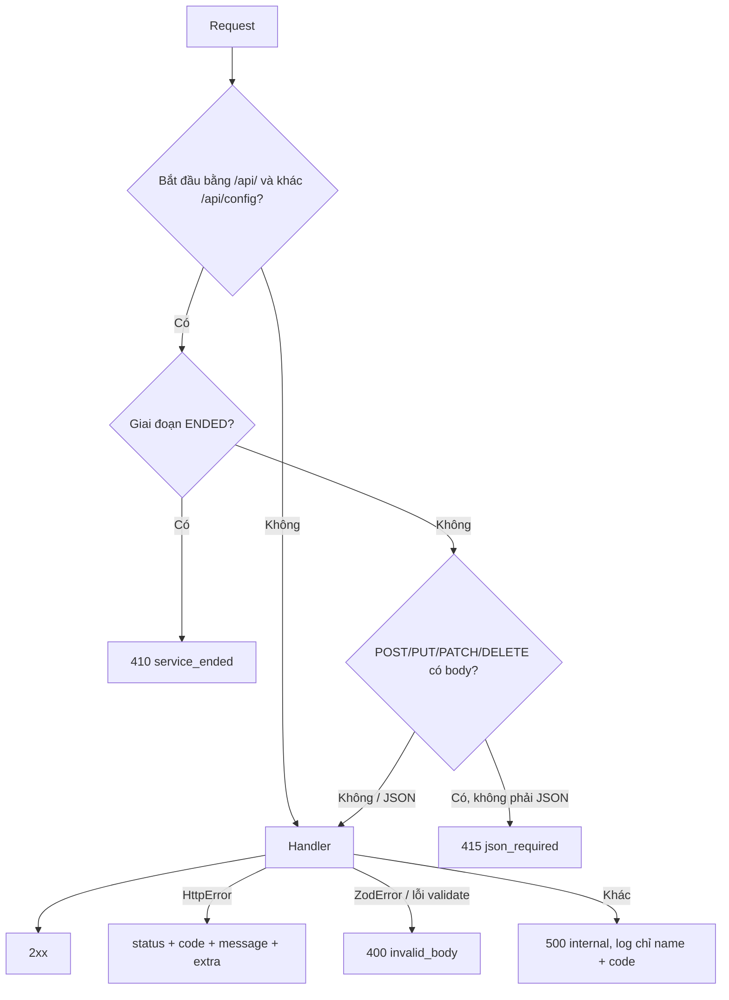
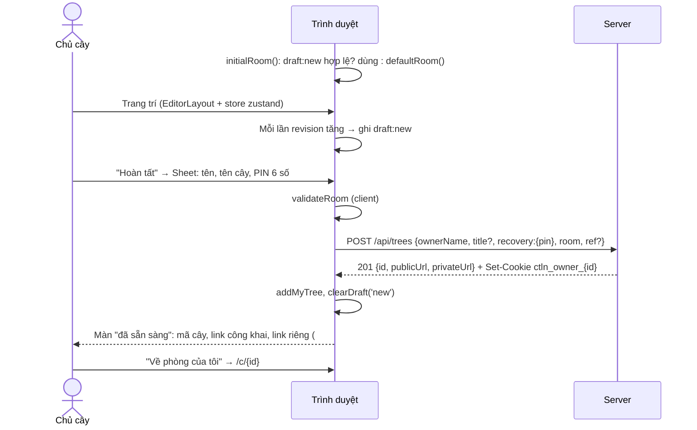
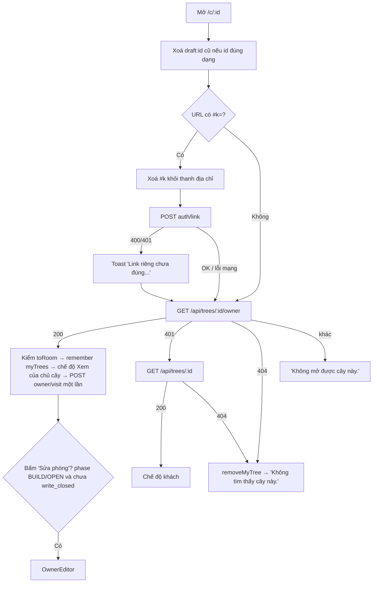
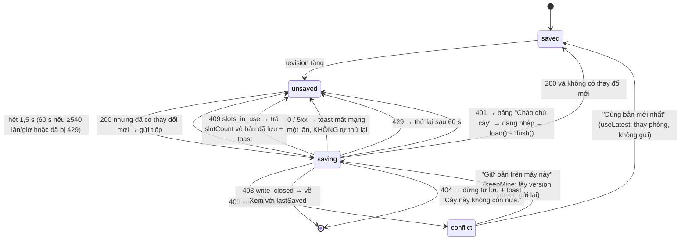

# Luồng hoạt động hiện tại (sau M2) và các chỗ có thể lỗi

> Viết ngày 22/11/2026 từ code trên `main` (commit `51e00e0`, đã gộp M1 + M2). Tài liệu mô tả **cái code đang làm**, không phải cái đặc tả muốn; chỗ nào lệch đặc tả thì ghi rõ. Đặc tả vẫn là nguồn sự thật (`docs/dac-ta-v3.md`).
>
> Trạng thái kiểm tra lúc viết: `pnpm test` qua hết (40 shared + 122 server + 167 web). `pnpm typecheck` **lỗi ở web** — xem mục 9, lỗi số 1.
>
> **Cập nhật 22/11 (nhánh `fix-luong-sau-m2`):** đã sửa các lỗi 1, 2, 3, 4, 5 (một phần), 8, 9, 14, 15 — đánh dấu "✅ đã sửa" ở mục 9; các luồng bên dưới đã viết lại theo code mới. Nay 40 shared + 125 server + 187 web, typecheck sạch.
>
> **Lượt 2 (22/11):** sửa nốt 6, 7, 10, 11, 12 và xung đột giả khi lưu; 13 chấp nhận. Nay 40 shared + 131 server + 198 web.

## Mục lục

1. [Tổng quan](#1-tổng-quan)
2. [Đường đi của một request ở server](#2-đường-đi-của-một-request-ở-server)
3. [Giai đoạn theo thời gian](#3-giai-đoạn-theo-thời-gian)
4. [Luồng chủ cây trên web](#4-luồng-chủ-cây-trên-web)
5. [Luồng khách](#5-luồng-khách)
6. [Luồng chỉ có API (chưa có giao diện)](#6-luồng-chỉ-có-api-chưa-có-giao-diện)
7. [Dữ liệu trên trình duyệt](#7-dữ-liệu-trên-trình-duyệt)
8. [Những gì chưa làm](#8-những-gì-chưa-làm)
9. [Các chỗ có thể lỗi](#9-các-chỗ-có-thể-lỗi)

---

## 1. Tổng quan

```
Trình duyệt (React 19, Vite :5173)
   │  fetch /api/*  (header x-device-id, cookie ctln_owner_{id})
   ▼
Vite proxy /api, /og  ──►  Fastify 5 (:3000)  ──►  PostgreSQL 16 (Drizzle)
```

| Phần | Vị trí | Vai trò |
|---|---|---|
| Khởi động | `apps/server/src/index.ts` | `loadEnv` → nối Postgres → `runMigrations` (khoá advisory) → `buildApp` → listen `0.0.0.0:PORT` |
| App | `apps/server/src/app.ts` | cookie, helmet, hook `onRequest`, xử lý lỗi, đăng ký 6 nhóm route |
| Giai đoạn | `apps/server/src/phase.ts` | BUILD / OPEN / NOTICE / ENDED theo `now()` (`FAKE_NOW` khi dev) |
| Kiểm tra chung | `apps/server/src/guards.ts` | `clientIp`, `assertWritable`, `assertNotPaused`, `assertNotGloballyBlocked`, `requireDeviceId`, phiên chủ cây |
| Bảo mật | `apps/server/src/security.ts` | HMAC theo mục đích, scrypt PIN, băm IP theo ngày, `rateLimit` (độ dài khung cấu hình được, mặc định 1 giờ, trong bảng `rate_counters`) |
| Schema dùng chung | `packages/shared/src/schemas.mjs` | Zod cho phòng, tạo cây, lời nhắn + `validateRoom` |
| Web | `apps/web/src` | 3 route: `/`, `/tao`, `/c/:id` (+ `*` 404) |

## 2. Đường đi của một request ở server



- Log request chỉ có method + đường dẫn (không query, không IP) — `reqSerializer`.
- `trustProxy` là số bước (`TRUST_PROXY_HOPS`, mặc định 1); `clientIp` bỏ `:port`.
- Giới hạn body 64 KB.

### Bảng route

| Route | Quyền | Kiểm tra theo thứ tự |
|---|---|---|
| `GET /api/config` | công khai | — (trả `phase`, mốc, `limits`, `googleClientId`) |
| `POST /api/trees` | công khai | ghi được → không tạm dừng `pause_create` → không bị chặn IP toàn cục → Zod → `validateRoom` → 20/giờ/IP → PIN (scrypt) hoặc Google → `ref` → chèn cây + món (thử lại 3 lần nếu trùng mã) → cookie phiên |
| `GET /api/trees/:id` | công khai | phòng + trạng thái từng điểm nhắn (không nội dung) |
| `POST /api/trees/:id/auth/link` | công khai | cây tồn tại → 20/giờ/IP → so HMAC khoá → ghi `auth_attempts` → cookie |
| `POST /api/trees/:id/auth/pin` | công khai | cây tồn tại → có PIN → **giữ lượt nguyên tử trong `rate_counters`** (INSERT…ON CONFLICT…RETURNING): `pin:tree:{id}:ip:{ipHash}` ≤5 / 15 phút → `pin:tree:{id}` ≤50 / ngày UTC → `pinfail:ip` ≤20 / giờ (vượt thì trả lại lượt đã giữ, 429 `pin_locked` / `rate_limited`) → scrypt → sai 401; đúng thì xoá bộ đếm phòng + IP, trả lượt ngày và IP, cookie |
| `POST /api/auth/google` | công khai | xác minh token; không `treeId` → danh sách cây; có `treeId` → kiểm sở hữu → cookie |
| `POST /api/trees/:id/auth/logout` | công khai | thu hồi phiên hiện tại, xoá cookie |
| `PUT /api/trees/:id/room` | chủ cây | phiên → ghi được → 600/giờ/cây → Zod + `validateRoom` → giao dịch: khoá dòng cây, so `roomVersion`, không giảm điểm nhắn dưới lời nhắn đang có, xoá món bị bỏ + cây cũ khác mã, upsert món, tăng phiên bản |
| `DELETE /api/trees/:id` | chủ cây | xoá cây (CASCADE) |
| `GET /api/trees/:id/owner` | chủ cây | phòng + `messageId/unread/locked` từng điểm + `messageCount`, `newSinceLastVisit`, `showMessageCount`; **chỉ đọc** |
| `POST /api/trees/:id/owner/visit` | chủ cây | ghi `last_owner_visit_at = now` → 204 |
| `PUT /api/trees/:id/settings` | chủ cây | `{ showMessageCount }` |
| `POST /api/trees/:id/messages` | khách | ghi được → không `pause_messages` → `x-device-id` → không bị chặn toàn cục → cây tồn tại → không phải chủ cây → Zod → honeypot (trả 201 giả) → không bị chủ cây chặn → 100/giờ/IP → giao dịch: khoá cây, `slotIndex < slotCount`, ≤3/thiết bị, chèn (trùng điểm → 409 `slot_taken`) |
| `GET /api/messages/:mid/mine` | người viết | không có lời nhắn → 404; `x-edit-token` khớp (so timing-safe) → nội dung; sai → 403 |
| `PUT` / `DELETE /api/messages/:mid` | người viết | ghi được → không bị chặn toàn cục → một câu UPDATE/DELETE có điều kiện (token, `edit_until > now`, `read_at IS NULL`); 0 dòng → `denyReason` |
| `POST /api/trees/:id/messages/:mid/open` | chủ cây | `canRead` (không thì 423) → một câu UPDATE đặt `read_at` (giữ lần đầu) và trả nội dung |
| `DELETE /api/trees/:id/messages/:mid` | chủ cây | xoá lời nhắn thuộc cây |
| `POST /api/trees/:id/block` | chủ cây | giao dịch: thêm `blocked_devices`, xoá lời nhắn |
| `POST /api/trees/:id/reports` | chủ cây hoặc khách | chủ cây: có thể kèm `messageId` (chép nội dung vào `message_snapshot`); khách: cần `x-device-id`, không được kèm `messageId`, 10/giờ/IP |

## 3. Giai đoạn theo thời gian

| Giai đoạn | Từ (giờ VN) | `canWrite` | `canRead` | Ảnh hưởng hiện tại |
|---|---|---|---|---|
| BUILD | — | có | không | tạo/sửa phòng, treo/sửa lời nhắn; `/open` trả 423 |
| OPEN | 0h 24/12 | có | có | như BUILD + chủ cây mở được lời nhắn |
| NOTICE | 0h 26/12 | không | có | tạo cây / lưu phòng / lời nhắn trả 403 `write_closed`; web ẩn "Sửa phòng" |
| ENDED | 0h 01/01/2027 | không | không | mọi `/api/*` (trừ `/api/config`) trả 410 |

Mốc đọc từ `UNLOCK_AT`, `WRITE_CLOSES_AT`, `SERVICE_ENDS_AT`, `PURGE_AT`; `FAKE_NOW` bị cấm khi production. Web không tự tính giai đoạn: lấy `phase` trong phản hồi phòng.

## 4. Luồng chủ cây trên web

### 4.1 Trang chủ `/`

1. Nền là phòng mặc định (`defaultRoom()`), khung giới thiệu, nút "Bắt đầu tạo cây" → `/tao`.
2. Có `?ref=<mã cây>` hợp lệ → lưu `sessionStorage.ref` (gửi kèm khi tạo cây).
3. "Bạn đã có cây?" → `ReopenDialog` (mục 4.4).

### 4.2 Tạo cây `/tao`



- Chỉ có cách khôi phục PIN; nút Google ghi "sắp có".
- Lỗi (mạng, 429, 500…) → hiện `message` của server, giữ `draft:new`, bấm lại được.

### 4.3 Mở phòng `/c/:id` (`RoomPage` → `TreeRoom`)



- Phòng từ server phải qua `RoomSchema` + `validateRoom`, sai thì hiện lỗi.
- Chế độ Xem của chủ cây: tên phòng + "Sửa phòng"; khối dưới đang để trống cho M3 (đếm ngược, số lời nhắn, chia sẻ).

### 4.4 "Bạn đã có cây?" (`ReopenDialog`)

1. Mở bảng: điền sẵn mã cây mới nhất trong `myTrees`. Chỉ khi máy nhớ **đúng 1 cây** mới gọi ngay `GET /owner`; phiên còn hiệu lực → chuyển thẳng `/c/{id}`; 404 → quên cây đó.
2. Có nhiều cây → hiện chip, không tự thử; bấm chip mới thử `GET /owner` như trên.
3. Nhập mã cây hoặc dán link (`parseTreeRef`): có `#k=` → `auth/link`; không → cần PIN → `auth/pin`. Thành công → `addMyTree` → `/c/{id}`.
4. Lỗi: `authErrorMessage` (PIN sai, bị khoá N phút, 404, link sai).

### 4.5 Sửa phòng và tự lưu (`OwnerEditor` + `createAutosave`)



- Chỉ một lượt gửi tại một thời điểm; lượt đang gửi xong sẽ tự gửi bản mới nhất.
- "Xong": `flush()` → nếu đang xung đột (`hasConflict()`) thì ở lại chế độ Sửa với bảng hỏi; nếu chưa lưu được vì lý do khác thì `stop()` + toast "Thay đổi chưa được lưu." → luôn về Xem với `lastSaved()` và `version()`.
- Gỡ component: hoãn một nhịp (chống StrictMode) rồi `flush()` + `stop()`.
- `pagehide` (đóng tab, rời trang) còn thay đổi chưa lưu → `flushOnUnload()` gửi `PUT /room` một lần với `keepalive`, không chờ; thành công thì nhận `roomVersion` mới (trang quay lại từ bộ nhớ Back không bị xung đột giả).
- Phòng đã tạo **không** có nháp cục bộ (chốt 19/11).

### 4.6 Trình sửa (`EditorLayout`, `Editor`, `drag`, `model`)

- Kéo: `createDragController` bắt con trỏ, dịch bằng `style.translate` lúc kéo, thả mới `move()` vào store (toạ độ đã kẹp theo lớp tường/sàn — `clampPosition`).
- Thanh món đang chọn: nhỏ/to (±0,1, kẹp 0,5–1,6), lật, đổi kiểu, xoá (cây không xoá được).
- ‹ › đổi kiểu; với cây là đổi bảng màu.
- Dải cây: dáng, màu, thân, gỗ, số điểm nhắn. Dải phông nền. Khay thêm đồ (tối đa 25 món).
- `drawOrder`: tường < thảm < sàn, cùng lớp xếp theo `y`.

## 5. Luồng khách

Trên web hiện tại khách chỉ:

1. Xem phòng (`GET /api/trees/:id`), không thấy bong bóng điểm nhắn hay lời nhắn (M3).
2. "Tạo cây của bạn" → `/?ref={id}`.
3. "Tôi là chủ cây" → `OwnerLogin` (PIN) → `load()` lại → thành chủ cây.

## 6. Luồng chỉ có API (chưa có giao diện)

Đã có route + test ở server nhưng web chưa gọi (để M3/M3b):

- **Treo lời nhắn** (đặc tả 9.4): `POST /messages` → trả `editToken`; web sẽ lưu `msg:{treeId}:{slot}`.
- **Sửa / gỡ trong 15 phút** (9.5): `GET /mine`, `PUT`, `DELETE /api/messages/:mid` với `x-edit-token`.
- **Chủ cây đọc** (9.6): `GET /owner` cho `messageId`, rồi `POST /open` (423 trước 0h 24/12).
- **Xoá / chặn / báo cáo**, **bật tắt số lời nhắn**, **xoá cây**, **đăng xuất**, **Google** (server có, web khoá nút "sắp có", `/api/config` chưa được gọi).

## 7. Dữ liệu trên trình duyệt

| Nơi | Khoá | Dùng cho |
|---|---|---|
| localStorage | `deviceId` | UUID v4, gửi ở header `x-device-id` mọi request (không có storage thì giữ trong bộ nhớ, mất khi tải lại) |
| localStorage | `myTrees` | cây đã tạo / đã đăng nhập trên máy này (cho "Bạn đã có cây?") |
| localStorage | `draft:new` | phòng đang trang trí ở `/tao` |
| sessionStorage | `ref` | cây đã mời mình (`?ref=`) |
| Cookie HttpOnly | `ctln_owner_{id}` | phiên chủ cây, hết hạn lúc `PURGE_AT`, SameSite=Lax, Secure khi production |

## 8. Những gì chưa làm

| Việc | Mốc | Ghi chú |
|---|---|---|
| Giao diện treo/sửa lời nhắn, chủ cây đọc/đếm ngược/chia sẻ | M3 | API đã có |
| `GET /c/:id` có thẻ OG, `/og/:id.png`, `/da-ket-thuc` | M3 | chưa có route; Vite chỉ proxy `/api`, `/og` (chú thích trong `vite.config.ts` có nhắc `/c` nhưng cấu hình không có) |
| Đăng nhập Google trên web | M3 | server sẵn sàng; web chưa nạp Google Identity |
| Server phục vụ `dist` của web + SPA fallback | M4 | hiện Fastify không phục vụ file tĩnh |
| Trang quản trị + `/api/admin/*` | M3b | bảng CSDL đã có |
| Từ cấm (`banned_words`) áp vào lời nhắn | M3b | bảng có, chưa dùng |
| Dọn `auth_attempts` 7 ngày, phiên quản trị, xoá dữ liệu 07/01 | M4/M10 | chưa có tác vụ định kỳ; `rate_counters` cũng tăng mãi; khi dọn chỉ xoá khung đã kết thúc (bucket `pin:tree:` giữ đến quá 1 ngày, bucket khác quá 1 giờ) — dọn thô sẽ xoá khung ngày và đặt lại trần 50 lần sai / phòng / ngày |
| `PUT /recovery`, `GET /trees/:id/messages` | P1 | |

---

## 9. Các chỗ có thể lỗi

Xếp theo mức độ. "Cao" = hỏng chức năng hoặc chặn việc tiếp theo; "Vừa" = sai hành vi trong tình huống thật; "Thấp" = ít gặp / chỉ cần biết.

### Cao

**1. ✅ đã sửa 22/11 (`pnpm install`). `pnpm typecheck` lỗi ở web — thiếu `@tanstack/react-query` trong `node_modules`.**
`apps/web/src/main.tsx:3` import `@tanstack/react-query`; `package.json` và `pnpm-lock.yaml` đều có, nhưng `apps/web/node_modules/@tanstack` không tồn tại → cài đặt trên máy đang lệch lockfile. Test vẫn qua vì không test nào import `main.tsx`, nên `pnpm test` không bắt được; `pnpm build` (chạy `tsc -b`) cũng sẽ lỗi.
*Cách sửa:* chạy `pnpm install`. Thêm nữa: theo việc nhỏ đã chốt "TanStack Query — để đến M3 dùng hoặc gỡ", nếu M3 không dùng thì gỡ hẳn cả `QueryClientProvider`.

**2. ✅ đã sửa 22/11 (`POST /owner/visit`). `newSinceLastVisit` gần như luôn bằng 0 khi vào qua "Bạn đã có cây?" (ảnh hưởng tính năng O10 của M3).**
`GET /api/trees/:id/owner` vừa tính số mới, vừa ghi `last_owner_visit_at = now` (`apps/server/src/routes/room.ts:127`). `ReopenDialog.tryOwner` gọi `getOwnerTree` chỉ để thử phiên, rồi chuyển sang `/c/:id`, nơi `RoomPage.load` gọi `getOwnerTree` lần nữa → lần thứ hai thấy 0. Cũng bị khi phiên hết giữa lúc sửa rồi đăng nhập lại (`onLoggedIn` → `load()` lần hai), và trong dev `ReopenDialog` còn gọi hai lần do StrictMode.
*Cách sửa gợi ý:* tách ghi lượt vào ra khỏi GET (ví dụ `POST /owner/visit` gọi một lần khi trang phòng hiển thị), hoặc `tryOwner` dùng một route nhẹ không ghi. Nên chốt trước khi làm M3 vì M3 mới hiện con số này.

### Vừa

**3. ✅ đã sửa 22/11. Bấm "Xong" đúng lúc lượt lưu bị 409 `version_conflict` → bỏ qua bảng xung đột, về Xem với bản cũ.**
`done()` (`apps/web/src/routes/RoomPage.tsx:263`) kiểm `conflict` (state React) **trước** `await a.flush()`. Nếu chính lượt flush đó bị 409, `onConflict` đặt state nhưng `done()` vẫn chạy tiếp: `isSaved()` sai → `stop()` → toast "Thay đổi chưa được lưu." → `onLeave(lastSaved)`. Kết quả: không hỏi "giữ bản nào" (trái đặc tả 9.3 mục 3), phòng ở chế độ Xem là bản trước khi thiết bị kia sửa, `roomVersion` vẫn cũ. Lần "Sửa phòng" sau sẽ lại 409 nên không mất dữ liệu server, nhưng thay đổi trên máy này mất. Chưa có test cho tình huống này.
*Cách sửa gợi ý:* sau `await a.flush()`, nếu autosave đang ở trạng thái xung đột (thêm `a.hasConflict()`) thì ở lại chế độ Sửa để bảng xung đột hiện.

**4. ✅ đã sửa 22/11 (chỉ tự thử khi có 1 cây). "Bạn đã có cây?" tự chuyển trang ngay lập tức, kể cả khi máy có nhiều cây.**
Effect khi mở bảng gọi `tryOwner(trees[0])`; phiên còn hiệu lực → `navigate` ngay, người dùng không kịp chọn chip cây khác. Có test cho trường hợp một cây ("mở thẳng"), không có test cho nhiều cây. Đây có thể là chủ ý — cần chủ dự án xác nhận: với ≥2 cây có nên chờ người dùng chọn không?

**5. ✅ đã sửa một phần 22/11 (20 cây / 100 lời nhắn mỗi giờ mỗi IP, đếm sau khi kiểm dữ liệu; IPv6 bật ở M4). Giới hạn theo IP dễ chặn nhầm người thật ở Việt Nam.**
Tạo phòng 5/giờ/IP và lời nhắn 20/giờ/IP (đúng đặc tả 10). Nhà mạng di động dùng NAT chung (CGNAT), wifi trường/công ty cũng chung một IP — một lớp học cùng treo lời nhắn cho một bạn có thể vượt 20 trong một giờ. Ngoài ra `POST /api/trees` đếm lượt **trước** khi kiểm body, nên lần gửi lỗi 400 cũng ăn hạn mức. Không phải lỗi code, nhưng nên cân nhắc trước ra mắt 15/12 (nâng ngưỡng, hoặc đếm theo `IP + deviceId`).

**6. ✅ đã sửa 22/11 (khoá theo phòng + IP, trần 50/ngày/phòng). Ai có link công khai cũng khoá được cách đăng nhập PIN của chủ cây.**
5 lần sai / cây / 15 phút → khoá cây đó (`auth.ts`). Mã cây nằm trong link công khai, nên người lạ có thể giữ PIN bị khoá liên tục (thêm IP khác để vượt 20/giờ/IP). Chủ cây vẫn vào được bằng cookie thiết bị hoặc link riêng, nên đây là đánh đổi chấp nhận được — chỉ cần biết khi hỗ trợ người dùng ("PIN đúng mà vẫn bị khoá").

**7. ✅ đã sửa 22/11 (CSP cho `accounts.google.com`). Helmet đang bật CSP mặc định — sẽ chặn Google Identity khi server phục vụ web.**
`app.register(helmet)` không cấu hình; CSP mặc định `script-src 'self'`. Hiện chỉ áp cho phản hồi API nên chưa sao, nhưng ở M3/M4, khi Fastify phục vụ trang và bật Google, phải thêm `accounts.google.com` theo đặc tả 10 ("CSP chỉ cùng nguồn trừ Google Identity").

### Thấp

**8. ✅ đã sửa 22/11 (`pagehide` + `keepalive`). Đóng tab / tải lại trong vòng 1,5 giây sau thao tác cuối → mất thao tác đó, không cảnh báo.** Không có `pagehide`/`beforeunload`; `flush` khi gỡ component chỉ chạy khi điều hướng trong app. Hợp với quyết định "không nháp cho phòng đã tạo", nhưng có thể thêm `fetch(..., { keepalive: true })` khi `pagehide` nếu muốn.

**9. ✅ đã sửa 22/11. Gửi lưu thừa:** `setTreeConfig` luôn trả object mới, nên bấm lại đúng dáng/màu đang chọn vẫn tăng `revision` và gửi `PUT /room` (tính vào 600/giờ).

**10. ✅ đã sửa 22/11 (migration 0003 bỏ trigger). `trees.updated_at` không còn nghĩa "sửa phòng lúc nào":** trigger `touch_updated_at` chạy với mọi UPDATE trên `trees`, gồm đếm PIN sai và `last_owner_visit_at`. Nếu trang quản trị M3b định hiện "sửa lần cuối" thì phải dùng cột khác hoặc bỏ trigger cho các UPDATE đó. Thêm nữa, trigger dùng `now()` của CSDL nên không theo `FAKE_NOW`.

**11. ✅ đã sửa 22/11 (cookie dự phòng `ctln_did`; `editToken` còn để M3). Không có `deviceId` ổn định trong trình duyệt chặn storage** (một số chế độ của Zalo/Messenger): mỗi lần tải lại là thiết bị mới → vượt được giới hạn 3 lời nhắn/thiết bị và mất `editToken`. Đặc tả chấp nhận; ghi để biết khi làm M3.

**12. ✅ đã sửa 22/11. Mã lỗi không nhất quán nhỏ:** `GET /api/messages/:mid/mine` trả 403 `bad_token` cả khi lời nhắn không tồn tại, còn `PUT`/`DELETE` trả 404. `denyReason` so hash bằng `!==` (không timing-safe) — token 128 bit nên không khai thác được thực tế.

**13. Chấp nhận (chủ dự án chốt 22/11). Tạo cây trả về bị mất mạng giữa chừng:** server đã tạo cây nhưng trình duyệt không nhận được phản hồi (nên cũng không có cookie, mã cây, link riêng); bấm "Tạo cây" lại → tạo thêm cây mới, cây đầu thành cây mồ côi không ai mở được. Ít gặp, chỉ tốn một dòng CSDL.

**14. ✅ đã sửa 22/11. `fitRoom` có thể ra `scale` âm** khi vùng hiển thị thấp hơn `reserveTop + reserveBottom` (ví dụ điện thoại ngang rất thấp) → phòng bị lật/ẩn. Ngoài khung 360×640 đang thử nên chưa gặp; thêm `Math.max(0, …)` là đủ.

**15. ✅ đã sửa 22/11. Tài liệu lệch nhẹ:** đặc tả 7.9 ghi migration giữ `pg_advisory_lock`, code dùng `pg_advisory_xact_lock` (tự nhả khi hết giao dịch — tốt hơn, chỉ cần sửa chữ trong đặc tả). Chú thích `vite.config.ts` nói proxy `/c` nhưng cấu hình không có.

### Đã kiểm, không thấy vấn đề

- Đua khi treo lời nhắn / lưu phòng / giảm số điểm nhắn: cả ba cùng `SELECT … FOR UPDATE` dòng cây trong giao dịch.
- Mở lời nhắn và tác giả sửa cùng lúc: cả hai là một câu lệnh có điều kiện `read_at`, không đọc-rồi-ghi.
- Dò PIN song song: giữ lượt nguyên tử trước scrypt; tràn thì khoá.
- Riêng tư: `GET /api/trees/:id` không có nội dung/tên; `/open` kiểm `canRead` ở server; log không có IP hay nội dung; khách không gửi được `messageId` khi báo cáo.
- CSRF cho cookie chủ cây: SameSite=Lax + chỉ nhận JSON (gửi JSON khác nguồn cần preflight); `azurewebsites.net` nằm trong Public Suffix List nên app khác trên cùng miền không tính là "cùng site".
- `trustProxy` dạng hàm `hop < N` tương đương `trustProxy: N`.
